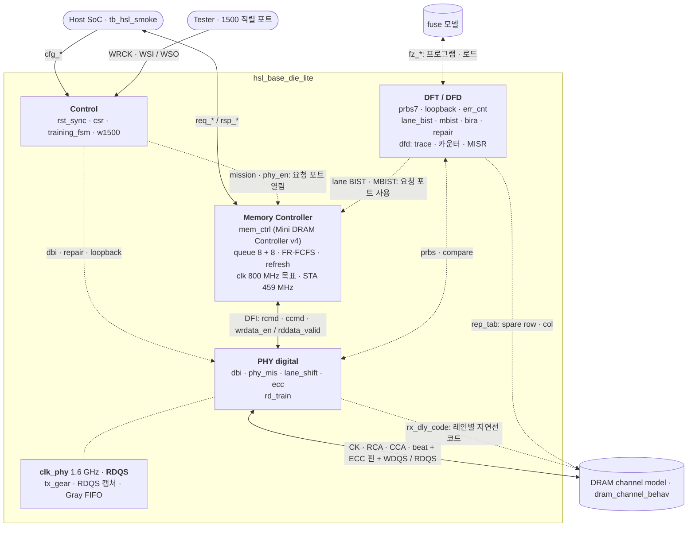

<div align="center">

# High-Speed Link Lite

**HBM Base Die 디지털 링크를 한 채널 슬라이스로 축소한 SystemVerilog RTL 설계**<br>
Spec → Architecture → RTL → Verification → PD Guide

[](rtl/)
[](sim/)
[](syn/)

**[📄 포트폴리오 PDF (29쪽)](portfolio-deck/HighSpeedLinkLite_Portfolio.pdf)** · [PPTX](portfolio-deck/HighSpeedLinkLite_Portfolio.pptx) · [스터디 맵](docs/00_study_map.md)

<a href="portfolio-deck/HighSpeedLinkLite_Portfolio.pdf"></a>

SK hynix HBM Digital Design (RTL Design) 지원 · 권용현

</div>

## 한눈에 보기

| 설계 범위 | 회귀 | 커버리지 | 면적 | STA |
| :---: | :---: | :---: | :---: | :---: |
| **MC · PHY · DFT** | **23 / 23 PASS** | **Line 96.9%**<br>**Branch 91.5%** | **53,763 µm²**<br>**4,846 FF** | **HSL 로직 통과**<br>**MC 459 MHz** |
| RTL 35개 모듈<br>4,676줄 (주석 제외) | SMOKE · T1–T17<br>E7 · E9 · E11 | Toggle 80.2% | Nangate45<br>배선 없음 | 800 MHz · 1.6 GHz<br>RDQS · CDC |

> [!NOTE]
> 표와 아래 결과는 commit `e61e90d` 기준이다(Verilator 5.052, ModelSim-Altera 10.1d 모두 23/23 PASS). `5a24f07`은 TB에 회귀 종료 시 채널 모델 검사를 추가하고 주석만 수정해 결과가 동일하다. `0193c04`에서 메모리 컨트롤러를 [Mini DRAM Controller](https://github.com/yhkwon-git/mini-dram-controller) v4로 교체해 PHY와 DFI 형태로 연결하고 저속 bypass framer를 제거했으며, `8af801b`에서 칩 STA(세 클럭과 CDC)를 추가하고 STA가 지적한 HSL 경로를 수정했으며, `f018966`에서 DRAM 배열의 March MBIST를, `6c29d60`에서 그 실패 로그로 spare를 할당하는 BIRA와 fuse repair를, `ffc073d`에서 ECC 핀 2개를 사용하는 데이터 SECDED를, `796d969`에서 trace buffer · 명령 카운터 · MISR(DFD)과 디버그 사례를, `14fec6e`에서 CSR 전체에 접근하는 IEEE 1500 방식 시험 포트를 추가했고, `3d596a4`에서 리뷰 지적 3건(DFD가 카운터 clear를 이벤트로 판정한 문제, RDQS 도메인 리셋 해제의 동기화, 요청 포트 close 상태에서 시작한 시험 엔진)을, `e61e90d`에서 재검토 지적 4건(다른 엔진 뒤에서 대기하는 start의 CSR 표시, Gray 포인터 최상위 비트의 CDC 제약, MBIST 첫 실패 기록의 초기화, 거절된 읽기 레벨링의 결과 보존)을, `5a24f07`에서 3차 검토 지적 2건(T12에서만 확인하던 채널 모델 오류 검사를 회귀 종료 시점으로 이동, PHY off → on 시 soft reset 규칙)을 수정했다. 절마다 표기한 commit은 해당 수치의 측정 commit이다. PDF는 2–20쪽과 23–28쪽이 이 칩(`e61e90d`) 기준이며 페이지마다 측정 commit을 표기했고, 21–22쪽은 DBI-AC와 리뷰 수정의 당시 기록이다.

## 개요

HBM base die는 스택 맨 아래의 로직 다이로, 호스트 SoC와 DRAM core die 사이에서 인터페이스, TSV 연결, 테스트를 맡는다. 표준 HBM(HBM3E까지)에서는 메모리 컨트롤러와 PHY 트레이닝 로직이 호스트 SoC에 있고, base die는 호스트가 보낸 명령을 받아 core die로 넘긴다. HBM4 세대부터 base die를 로직 공정으로 만들면서, 컨트롤러를 base die로 옮기는 custom HBM 구조가 나왔다.

본 저장소는 custom HBM 구조를 전제로, 메모리 컨트롤러 · 디지털 PHY · DFT를 포함한 base die의 1채널을 스터디 규모(DQ 8 · BL 4 · Bank 4)로 축소해 요구 스펙부터 PD 인계 문서까지 단일 Flow로 설계했다. 호스트의 읽기 · 쓰기 요청은 메모리 컨트롤러가 DRAM 명령으로 변환해 DFI 형태로 PHY에 전달하고, PHY가 핀으로 출력한다. 실제 custom HBM에서 이 위치는 core die로 연결되는 TSV 인터페이스지만, 본 설계는 공개된 HBM 인터페이스 개념(행 · 열 CA, WDQS · RDQS, DBI, 레인 리페어)을 축소해 핀으로 모델링했다. 핀 너머의 DRAM 동작은 테스트벤치의 채널 모델이 담당한다.

- **경계 우선 정의.** 디지털은 핀의 논리값과 enable, 핸드셰이크, CDC, 리셋, DFT 관측점을 담당한다. 드라이버, 샘플러, VREF, ZQ 회로, 클럭 스파인은 아날로그 · 풀커스텀 영역이다.
- **컨트롤러는 검증된 것을 그대로 쓴다.** 메모리 컨트롤러는 별도 저장소에서 600만 요청 랜덤 회귀와 독립 타이밍 체커로 검증한 RTL을 파일 그대로 가져온다. 이 저장소는 그 경계(DFI 형태의 명령 · 데이터 신호)와 칩 레벨 검증(핀에서 재는 프로토콜 · 타이밍 검사, 참조 메모리 스코어보드)에 집중한다.
- **수치의 단일 출처 관리.** 스펙 값은 `docs/01_requirements.md` → `hsl_pkg` → RTL → 테스트벤치 → SDC 순서로 전파한다. DRAM 타이밍은 컨트롤러의 `dram_pkg` 단일 정의를 사용하고, TIMING CSR은 그 값을 읽기 전용으로 제공한다. 클럭 주기는 E12 대조표로 4곳의 일치를 확인하고, 스모크 테스트 시작 시 패키지 상수를 재검사한다.
- **근거 없는 수치는 기재하지 않음.** 면적과 타이밍은 공개 교육용 라이브러리(Nangate45 typical)로 측정한 값이다. 배선과 클럭 트리는 미반영(Ideal Clock)이며, mW와 Sign-off slack은 기재하지 않는다.

공개된 HBM 개념을 교육용으로 축소한 모델이다. 특정 제품의 내부 구조나 IP를 재현하지 않으며, 파라미터와 타이밍 수치는 JEDEC 값이 아니다. RTL 이름과 주석은 영어, 설계 문서는 한글이다.

## 설계 범위

| 영역 | 구현 | 위치 |
| --- | --- | --- |
| Memory Controller | [Mini DRAM Controller](https://github.com/yhkwon-git/mini-dram-controller) v4 RTL(원 저장소와 동일 파일: 로직은 `44a0bb3`, 헤더 주석은 `422036a`). 읽기 8 + 쓰기 8 큐, FR-FCFS, 행 · 열 명령 버스에 매 클럭 각 1개, bank group 2 × 2, per-bank refresh와 RFM, posted write, 쓰기 큐 forwarding, in-order 응답 | [`rtl/mc/`](rtl/mc/) |
| PHY digital | DFI 형태 입력(행 · 열 명령, WL 뒤 쓰기 데이터, `rddata_valid`). 행 · 열 CA 핀, 동기 2:1 TX 기어 → 1.6 GHz beat + WDQS, RDQS 캡처 → Gray FIFO, DBI(DC · AC), shift 방식 레인 리페어(spare 핀 1개, 핀마다 2:1 mux), 읽기 레벨링(레인별 지연선 코드 스윕 → eye 중앙), SECDED (39,32) ECC(ECC 핀 2개, 오류 주입, CE · UE 카운터와 첫 오류의 주소 · syndrome, 디코더 self-test), 0–4 tap deskew(블록만) | [`rtl/phy/`](rtl/phy/) |
| Control | IEEE 1500 방식 시험 포트(WIR · WBY · ID · CSR 접근 WDR), CSR 26개, 트레이닝 FSM(9개 상태, done 펄스 대기), 리셋 동기화기(비동기 assert, 2-FF 동기 deassert), 호스트 · 테스트 엔진 요청 포트 mux | [`rtl/ctrl/`](rtl/ctrl/), [`rtl/top/`](rtl/top/) |
| DFT / DFD | PRBS7, 병렬 루프백, 16 bit 포화 에러 카운터, 레인 BIST(컨트롤러 요청 포트로 PRBS7 16워드를 쓰고 큐 empty 후 읽어 DQ 레인별 고장 검출), MBIST(동일 포트로 DRAM 배열에 MATS+ · March X · March C-, 실패 워드 로그 16개), BIRA(must-repair + spare 순서 탐색으로 spare row 2 · col 2 할당), repair 표와 fuse(SECDED (39,32), 리셋 뒤 자동 로드), DFD(CA 핀과 이벤트의 trigger trace 16항목, ACT · RD · WR · REFpb 카운터, 읽기 데이터 MISR), STATUS · ERRCNT · REMAP · LANE_BIST · MBIST · BIRA · FUSE 관측점 | [`rtl/dft/`](rtl/dft/) |
| PD 인계 | SDC(클럭, 생성 클럭, I/O delay, CDC `set_max_delay`), 클럭 · 리셋 · CDC · 핀 · floorplan 가이드 | [`syn/`](syn/), [`docs/05_pd_guide.md`](docs/05_pd_guide.md) |
| 검증 | 칩 레벨 테스트, 블록 테스트, DRAM 채널 모델(핀에서 프로토콜 · 동일 뱅크 타이밍 검사), 모든 호스트 응답을 참조 메모리와 비교하는 스코어보드를 단일 회귀로 수행 | [`tb/`](tb/), [`sim/`](sim/) |

## 아키텍처



- **요청**: `req_*`(14 bit 워드 주소) → `mem_ctrl`. 주소를 XOR 맵으로 bank · row · col로 나눠 읽기 큐와 쓰기 큐에 넣는다. 쓰기는 받은 다음 클럭에 응답하고(posted), 쓰기 큐에 있는 주소를 읽으면 핀을 거치지 않고 그 데이터로 답한다. 응답은 요청 순서대로 나간다
- **명령**: 스케줄러가 매 클럭 행 명령(ACT · PRE · REFpb) 1개와 열 명령(RD · WR) 1개를 선택한다. PHY는 1클럭 후 `pin_rca = {cmd, bank, row}`, `pin_cca = {cmd, bank, col, ap}`로 출력하며, 코드는 컨트롤러의 `dram_cmd_e`를 그대로 사용한다. 열 명령은 row 필드 없이 해당 뱅크의 열린 row를 사용한다
- **쓰기 데이터**: WR 뒤 WL(1) 클럭에 `wrdata_en` → DBI(DC 또는 AC) → 레인 shift(4 심볼) → 동기 2:1 TX 기어 → `clk_phy` beat 두 개(beat당 2 UI × 10핀)와 WDQS
- **읽기 데이터**: RDQS(= CK + tDQSCK)로 beat 2개를 수신해 Gray FIFO로 컨트롤러 클럭 도메인에 전달하고, shift 복원과 DBI 복원 후 `rddata_valid`. 지연이 고정되지 않아도 컨트롤러가 `rddata_valid`로 진행 중 RD 수를 카운트한다. 루프백 활성 시 RD를 핀으로 발행하지 않고 마지막 쓰기 버스트(`lb_hold`)로 응답한다
- **포트**: 요청 포트는 MISSION이며 PHY 활성(`CTRL.phy_en`) 시에만 open된다. CK는 PHY 활성 시에만 `pin_ck`로 출력된다. PHY off 후에는 soft reset을 거쳐 재활성한다(off 동안 컨트롤러 refresh가 핀에 출력되지 않음, [한계](#한계-및-향후-과제)). 레인 BIST · MBIST 동작 중에는 해당 엔진이 포트를 점유하고 응답을 모두 수신한다(한 번에 1개). deskew는 데이터 경로 미연결, 블록 테스트만 수행한다

<details>
<summary>모듈 계층 (35개 모듈 + 패키지 2개)</summary>

```text
hsl_base_die_lite
├─ hsl_rst_sync           비동기 assert, 2-FF 동기 deassert
├─ hsl_w1500             IEEE 1500 방식 포트: WIR · WBY · ID · CSR 접근 (clk로 오버샘플)
├─ hsl_csr                CSR 26개, ID "HSL1"
├─ hsl_training_fsm       RESET → … → MISSION
├─ hsl_rd_train           읽기 레벨링: 레인별 지연선 코드 스윕, eye 중앙 (레인 BIST로 판정)
├─ mem_ctrl               Mini DRAM Controller v4 (원 저장소와 동일 파일, 로직은 44a0bb3, 주석은 422036a)
│  ├─ mc_queue ×2         읽기 8 · 쓰기 8, 큐 안의 나이 행렬, 주소 비교
│  ├─ mc_xage             두 큐 사이의 나이 (WDRAIN = 0일 때만 씀)
│  ├─ mc_wdrain           읽기 모드 / 쓰기 배치 (WR_HI 6, WR_LO 2)
│  ├─ mc_bank ×4          열린 row, tRCD · tRP · tRAS · tRC · tRTP · tWR, auto-precharge, RAA
│  ├─ mc_chan             bank group별 tCCD · tRRD · tWTR(S/L), tFAW · tRTW · tRFC
│  ├─ mc_refresh          per-bank refresh (tREFI/4마다 REFpb 하나)
│  ├─ mc_sched            행 · 열 명령을 매 클럭, FR-FCFS, refresh와 RFM
│  └─ mc_resp             tag, 읽기 반환 FIFO, 쓰기 데이터 파이프, in-order 응답
├─ hsl_phy_top            DBI, PRBS 먹스, 루프백 보관, CK 게이트
│  ├─ hsl_phy_clk         2배 클럭 (합성 시 빈 쉘, PLL 자리)
│  ├─ hsl_dbi             DBI-DC · DBI-AC
│  └─ hsl_phy_mis         CA 핀, TX 기어, RDQS 캡처, 읽기 FIFO
│     ├─ hsl_lane_shift   shift 방식 레인 리페어 (TX · RX, 핀마다 2:1 mux). ECC 주입 비트용 한 벌 더
│     ├─ hsl_tx_gear      동기 2:1, 컨트롤러 클럭마다 워드 하나 → beat 두 개
│     ├─ hsl_cdc_fifo     Gray 포인터, RDQS → clk (쓰기 · 읽기측 리셋 분리)
│     ├─ hsl_rst_sync     RDQS 도메인 리셋: 비동기 assert, RDQS 2-FF로 deassert
│     └─ hsl_ecc          SECDED (39,32): 인코더 · 디코더, 주입, CE · UE 로그, self-test
├─ hsl_dft_top
│  ├─ hsl_prbs            x⁷ + x⁶ + 1
│  ├─ hsl_loopback        병렬 루프백
│  ├─ hsl_err_cnt         16 bit 포화 카운터
│  ├─ hsl_lane_bist       레인 BIST (요청 포트로 PRBS7 쓰기 → 큐 비움 → 읽기)
│  ├─ hsl_mbist           March MBIST (MATS+ · March X · March C-, 실패 워드 로그)
│  ├─ hsl_bira            spare 할당: must-repair → spare 순서 탐색
│  └─ hsl_repair          repair 표, fuse 프로그램 · 로드
│     ├─ hsl_secded_enc   SECDED (39,32) 인코더
│     └─ hsl_secded_dec   디코더 (1 bit 정정, 2 bit 검출)
└─ hsl_dfd                trace buffer(CA 핀 · 이벤트, trigger · pre/post), 명령 카운터, MISR
hsl_deskew                레인별 0–4 tap (블록 테스트만)
```

</details>

## 설계 결정

| 결정 | 이유 | 대가와 후속 조치 |
| --- | --- | --- |
| 단일 클럭(A)으로 시작해 E7에서 컨트롤러 1 : PHY 2(B)로 전환. RTL UI 직렬화(C)는 채택하지 않음 | 명령이 드롭되지 않는 핸드셰이크와 뱅크 타이밍을 먼저 닫고 CDC를 올린다. UI 직렬화는 아날로그 PHY 경계 밖이다 | 클럭이 하나 늘고 포인터 동기화 리스크가 생긴다 → E8 Gray FIFO, E12 클럭 대조표 |
| 메모리 컨트롤러는 Mini DRAM Controller v4 RTL을 동일 파일로 사용하고, PHY와는 DFI 형태 신호로만 연결 | 컨트롤러는 원 저장소에서 랜덤 회귀 600만 요청과 독립 타이밍 체커로 검증했다. 본 칩은 경계(행 · 열 명령 버스, WL 후 쓰기 데이터, `rddata_valid`)만 정합하면 되고, 두 저장소가 동일 RTL을 사용한다 | 컨트롤러 수정은 원 저장소에서 선행 후 반영한다(ModelSim 캐스트 수정, `q_empty` 출력). 원 저장소 모델은 RD 발행 후 3클럭에 data_valid를 받지만 본 PHY는 8클럭이라, RD in-flight를 4개로 제한하는 `RD_PIPE`가 읽기 대역폭을 제한한다([mission 데이터패스](#mission-데이터패스-ca-핀-16-ghz-beat-rdqs)) |
| PHY 읽기 경로는 지연을 고정하지 않고 `rddata_valid`로 통지 | RDQS 캡처와 Gray FIFO 동기화의 지연은 RDQS 위상에 따라 약 1클럭 변동한다. 컨트롤러가 `rddata_valid`로 진행 중 RD 수를 카운트하므로 순서만 보장하면 된다 | 실제 DFI의 `tphy_rdlat` 같은 고정 지연 계약은 없다. 컨트롤러의 읽기 반환 FIFO는 PHY 왕복 지연만큼의 깊이가 필요하다 |
| Beat-major 데이터 배치 | DBI와 ECC가 한 UI의 바이트를 한 덩어리로 다룬다 | 레인 단위 접근은 비트를 흩어 읽는다 |
| CSR은 `rst_sync_n`만, 데이터패스는 `rst_sync_n & ~soft_rst` | CSR까지 soft reset에 넣으면 `soft_rst` 비트가 다음 사이클에 스스로 지워진다 | 리셋 도메인이 둘이 된다 |
| RDQS 도메인 플롭은 RDQS 동기 해제 전용 리셋 동기화기(`u_rst_rdqs`)를 사용하고, 읽기 FIFO의 쓰기 · 읽기측 리셋을 분리 | 리셋 assert는 비동기여도 되지만 해제는 해당 플롭의 클럭에 동기되어야 recovery · removal을 준수한다. 컨트롤러 클럭 기준 해제는 RDQS와 위상 관계가 없다 | RDQS 토글 전(PHY off)에는 RDQS 도메인이 리셋 상태를 유지한다(T12 확인). Ideal Clock STA에서 해당 리셋 핀 removal은 −0.048 ns다(`e61e90d`)(CTS 후 hold 수정 대상). 채널 모델의 RDQS 연속 토글 가정에 의존한다: 실제 RDQS는 읽기 버스트 구간에만 토글하므로, 실제 PHY에서는 `clk`측 해제와 DQS gating 기반 캡처 구조가 필요하다 |
| CSR 읽기 데이터 레지스터 출력 | 칩 STA에서 `cfg_addr` → `cfg_rdata` 조합 feedthrough가 입출력 지연(각 0.5 ns)으로 −0.174 ns였다(`8af801b`에서 수정). 블록 경계에 입력 → 출력 조합 경로를 두지 않는다 | 읽기 1클럭 지연. 테스트벤치는 주소 인가 다음 엣지 이후에 읽는다 |
| CDC: Gray 포인터는 소스 클럭의 플롭에서 넘기고, 크로싱은 false path 대신 `set_max_delay` | 조합 XOR 출력이 넘어가면 여러 비트가 바뀌는 순간의 glitch를 싱크 플롭이 잡을 수 있다. false path는 그 경로의 지연을 타이밍이 보지 않게 만든다 | 포인터 레지스터가 늘고, 제약 값을 클럭 주기와 함께 관리해야 한다 |
| mission TX 기어는 동기식, RX는 RDQS로 수신해 Gray FIFO로만 전달 | `clk_phy`는 PLL 기준 컨트롤러 클럭과 위상이 정렬되므로, 컨트롤러 엣지 반 주기 후의 PHY 엣지(E1)에서 워드를 수신하면 핸드셰이크 없이 매 클럭 1워드를 고정 지연으로 출력한다. RDQS는 위상이 정해지지 않은 클럭이라 FIFO 외 경로로는 크로싱하지 않는다 | 이전의 토글 핸드셰이크 기어박스는 3클럭당 1워드라 교체했다. E1은 컨트롤러 토글을 PHY 클럭으로 비교해 검출한다(FF 1개) |
| 레인 리페어는 shift 방식: 고장 핀부터 상위 레인을 1칸씩 spare(RED) 방향으로 이동 | 핀별로 자기 레인과 하위 레인 중 하나를 선택하는 2:1 mux라 배선이 인접 핀까지만 필요하다. 치환 방식은 모든 레인에서 spare까지 경로가 필요하다 | 고장 핀 상위의 레인 번호와 핀 번호가 불일치 → 양단(PHY, DRAM)의 설정 일치가 필요하다. 모델은 mode register 대신 입력으로 설정한다 |
| 읽기 레벨링: 지연선은 아날로그 모델로 두고 디지털은 코드만 출력 | 디지털 담당 범위는 코드 스윕, 레인별 판정, 최장 통과 구간 탐색, 중앙 선택이다. 지연선과 샘플러는 채널 모델이 코드에 따라 모델링한다(창 밖에서는 인접 UI를 읽음) | 판정에 레인 BIST를 재사용해 코드마다 BIST 1회(32 코드). 레인당 상태 27 FF. 쓰기 방향 레벨링은 미구현 |
| 레인 BIST는 컨트롤러 요청 포트로 16워드를 쓰고, 큐 empty까지 대기 후 읽기 | 뱅크 타이밍, refresh, 버스 전환은 컨트롤러가 준수한다. 쓰기가 큐에 남은 상태로 읽으면 컨트롤러가 쓰기 큐에서 즉시 응답해 링크를 경유하지 않으므로, 컨트롤러의 `q_empty` 출력으로 그 시점까지 대기한다. 주소는 CA 핀 경유이므로 16 컬럼을 사용해도 DQ 고장이 주소와 섞이지 않는다 | BIST 중에는 호스트 포트를 차단하고 응답을 BIST가 수신하므로, 호스트 idle · 응답 수신 완료 상태에서 시작해야 한다. 요청 포트 close 상태(MISSION이 아니거나 PHY off)에서는 start를 즉시 거절한다(done · refused, MBIST와 읽기 레벨링도 동일). DBI 레인 고장은 DBI off 상태에서 양방향 반전이 상쇄되어 데이터로 검출되지 않는다 |
| MBIST는 컨트롤러를 경유해 연산을 1개씩 발행(쓰기 후에는 `q_empty` + 4클럭) | 배열 앞단에 컨트롤러가 있어야 refresh와 뱅크 타이밍이 보장된다. 그러나 컨트롤러는 다른 주소 간 요청 순서를 재정렬하므로, 다중 발행 시 배열 수신 순서가 March 순서와 달라지고 coupling fault는 aggressor 쓰기가 victim 읽기보다 먼저 반영되어야 검출된다 | 연산당 약 13.2클럭(March C- 64워드 640연산 8,443클럭, `ffc073d`). 실제 HBM의 MBIST는 core die측에서 배열을 직접 구동한다. 본 모델의 MBIST는 base die에서 컨트롤러 경계를 검사하는 위치다 |
| ECC 검사 비트는 ECC 핀 2개로 별도 전송, 디코더 앞에 레지스터 단 배치 | HBM의 ECC 핀처럼 검사 비트를 데이터 beat 옆에 실어 DRAM에 함께 저장한다. 인코더를 컨트롤러 쓰기 데이터 경로에 두면 해당 경로가 −1.029 ns, 디코더를 읽기 FIFO 직후에 두면 −0.403 ns였다(`ffc073d`에서 수정) | 읽기 지연 1클럭 증가(열린 row 읽기 9 → 10, `ffc073d`). RD in-flight 4개 제한 컨트롤러에서 연속 읽기 32개가 76 → 97클럭 → `RD_PIPE`의 PHY 왕복 지연 정합이 향후 과제 |
| repair는 배열측 spare가 수행, base die는 BIST · BIRA · fuse 로드를 담당 | 실제 HBM에서 spare row · col과 그 치환은 core die 배열 내부에 있다. base die가 주소를 변환해 다른 row로 보내는 방식은 컬럼 spare를 구현할 수 없고, 컨트롤러 앞단에 조합 논리가 추가된다 | repair 표(`rep_tab`)를 배열 모델에 사이드밴드로 전달한다(읽기 지연 코드 `rx_dly_code`와 동일 형태). JEDEC PPR 명령 인터페이스는 아니다 |
| DBI는 DC 방식(beat의 1이 4개를 넘으면 반전)으로 시작하고, AC 방식(직전 UI 대비 DQ 전이가 4개를 넘으면 반전)을 CSR로 선택하도록 추가 | DC는 high 개수를 줄이므로 high 시 종단 전류가 흐르는 I/O에 적합하다. HBM처럼 종단이 없는 짧은 채널에서는 전이 수가 스위칭 전력과 SSO를 결정하므로 AC가 적합하다 | AC는 이전 beat의 반전 여부에 의존하는 직렬 체인이다 → 원시 beat 간 전이를 미리 카운트해 beat당 2:1 mux 1단으로 축소([DBI-AC](#dbi-ac-off--dc--ac-비교)) |

## 스펙 요약

| 항목 | 값 |
| --- | --- |
| DQ / DBI / RED / ECC | 8 / 1 / 1 / 2 (데이터 핀 10개 + 검사 비트를 싣는 ECC 핀 2개) |
| 버스트 | BL 4, beat-major (beat 0이 첫 UI) |
| 뱅크 / row / col | 4 (bank group 2 × 2) / 8 bit / 4 bit. 호스트 주소는 14 bit 워드 주소, XOR 맵(bank = a[5:4] ^ a[7:6]) |
| 데이터 폭 | 32 bit (`DQ_W × BL`). 컨트롤러 클럭 한 번에 버스트 하나 |
| 목표 데이터율 | 3.2 Gb/s/DQ → raw 3.2 GB/s (리프레시, 명령 간격, 트레이닝을 빼기 전) |
| 클럭 | 컨트롤러 1.25 ns (800 MHz), PHY 0.625 ns (1.6 GHz) |
| 타이밍 (컨트롤러 클럭, `dram_pkg`) | tRCD 3 · tRP 3 · tRAS 6 · tRC 9 · tRTP 2 · tWR 2 · tCCD_S/L 1/2 · tRRD_S/L 2/3 · tWTR_S/L 2/4 · tFAW 8 · tRTW 4 · tRFC 12 · tRFCpb 8 · tREFI 64 · WL 1 |
| 트레이닝 순서 | RESET → CKE → MRS → ZQCAL → WRLVL → RDLVL → DESKEW → WRTRAIN → MISSION. 상태 순서만 구현하며 MRS · ZQ · leveling 명령은 핀에 발행하지 않는다(DRAM측 DBI · 리페어 설정은 TB가 채널 모델 입력으로 설정). 읽기 레벨링은 MISSION에서 `RDTRAIN`으로 수행한다 |
| 전력 · 신뢰성 규칙 | CKE는 RESET에서만 0, 쓰기 beat가 없으면 TX beat는 0, DBI-DC는 beat의 1이 4개를 넘으면 반전, DBI-AC는 직전 UI 대비 DQ 전이가 4개를 넘으면 반전, 에러 카운터는 16'hFFFF에서 포화 |

```text
CK              = 3.2 Gb/s ÷ 2   = 1.6 GHz (625 ps)
Controller      = CK ÷ 2         = 800 MHz (1250 ps)
beats_per_burst = BL ÷ DDR_BITS  = 2   → PHY beat 20 bit (2 UI × 10핀)
```

<details>
<summary>CSR 맵</summary>

| 주소 | 이름 | 접근 | 내용 |
| --- | --- | --- | --- |
| `0x00` | ID | RO | `0x48534C31` ("HSL1") |
| `0x04` | VERSION | RO | `0x00000400` |
| `0x08` | CTRL | RW | `soft_rst`, `train_bypass`, `loopback`, `prbs_en`, `dbi_en`, (bit 5 예약, 0으로 읽힘), `dbi_ac`, `phy_en` |
| `0x0C` | STATUS | RO | `train_state`, `train_done`, `mission_mode`, `soft_rst` 에코 |
| `0x10` | TRAIN | RW | `[0]` start, `[4:1]` done 펄스, `[15:8]` wait(저장만 하고 FSM은 쓰지 않음) |
| `0x14` | ERRCNT | RW | 읽기는 카운트, 쓰기는 clear |
| `0x18` | REMAP | RW | `[0]` enable, `[7:4]` 건너뛸 핀 (0–7 DQ, 8 DBI, 9 이상은 shift 없음) |
| `0x1C` | TIMING0 | RO | `{tCCD_L, tRAS, tRP, tRCD}`, 컨트롤러 상수 |
| `0x20` | TIMING1 | RO | `{tRFC, tRTP, tWR, tWTR_L}`, 컨트롤러 상수 |
| `0x24` | LANE_BIST | RW | 쓰기: `[0]` start, `[5:4]` bank, `[15:8]` row(해당 bank · row의 컬럼 0–15 사용). 읽기: `[0]` busy, `[1]` done, `[2]` pass, `[3]` 한 레인만 실패, `[7:4]` 실패 레인, `[15:8]` 레인별 에러, `[20:16]` 불일치 버스트 수, `[21]` 시작 거절, `[22]` 대기(MBIST 동작 중, busy로 표시) |
| `0x28` | RDTRAIN | RW | 쓰기: `[0]` start, `[6:4]` 읽어 볼 레인. 읽기: `[0]` busy, `[1]` done, `[2]` 모든 레인에서 eye 찾음, `[3]` 시작 거절, `[6:4]` 레인, `[12:8]` 그 레인의 코드, `[20:16]` eye 시작, `[29:24]` eye 폭 |
| `0x2C` | MBIST | RW | 쓰기: `[0]` start, `[2:1]` 알고리즘(0 MATS+, 1 March X, 2 March C-), `[5:4]` bank, `[15:8]` 첫 row, `[19:16]` row 수 − 1, `[22:20]` log2 컬럼 수(0–4). 읽기: `[0]` busy, `[1]` done, `[2]` pass, `[3]` 로그 overflow, `[8:4]` 로그의 실패 워드 수, `[9]` 시작 거절, `[10]` 대기(레인 BIST 동작 중, busy로 표시), `[31:16]` 실패 읽기 수 |
| `0x30` | MBIST_LOG | RW | 쓰기: `[3:0]` 읽을 로그 항목. 읽기: `[13:0]` 첫 실패 읽기의 호스트 주소(없으면 0, start가 지움), `[23:16]` 그 항목 `{row offset, col}`(`MBIST[8:4]` 미만만 이번 실행의 것, start는 항목을 지우지 않음), `[27:24]` 항목 번호 |
| `0x34` | MBIST_BITS | RO | 첫 실패 읽기에서 다른 비트(없으면 0) |
| `0x38` | BIRA | RW | 쓰기: `[0]` start(마지막 MBIST 로그 분석), `[1]` 결과를 repair 표에 적용, `[2]` 표 비우기. 읽기: `[0]` busy, `[1]` done, `[2]` 수리 가능, `[5:4]` 쓴 spare row, `[7:6]` 쓴 spare col |
| `0x3C` | REPAIR | RW | 쓰기: `[1:0]` 읽을 표 항목. 읽기: `[15:0]` 항목 `{valid, 0, bank, row, col}`, `[17:16]` 항목 번호 |
| `0x40` | FUSE | RW | 쓰기: `[0]` 표를 fuse에 프로그램, `[1]` fuse 로드. 읽기: `[0]` busy, `[1]` 로드됨, `[7:4]` 정정한 워드, `[11:8]` 정정 불가 워드, `[15:12]` 폐기 항목 |
| `0x44` | ECC | RW | 쓰기: `[0]` enable, `[1]` 다음 쓰기 버스트에 주입, `[2]` 디코더 self-test, `[3]` 카운터 · 로그 지우기, `[14:8]` 뒤집을 검사 비트. 읽기: `[0]` enable, `[1]` 주입 대기, `[2]` self-test busy, `[3]` done, `[4]` pass, `[5]` 오류 기록됨, `[6]` 정정 불가였음, `[14:8]` 그 syndrome `{전체 패리티, s[5:0]}`, `[22:16]` self-test 실패 수 |
| `0x48` | ECC_INJ | RW | 뒤집을 데이터 비트 |
| `0x4C` | ECC_CNT | RO | `[15:0]` 정정, `[31:16]` 정정 불가 (포화) |
| `0x50` | ECC_ADDR | RO | 첫 오류 읽기의 호스트 주소 |
| `0x54` | TRACE | RW | 쓰기: `[0]` arm, `[3:1]` trigger(0 ECC 정정 불가, 1 ECC 정정, 2 PRBS 오류, 3 MBIST 실패, 4 필터 bank 명령, 5 수동), `[7:4]` trigger 뒤 항목 수, `[9:8]` 필터 bank, `[10]` 그 bank 명령만 기록, `[11]` 수동 trigger. 읽기: `[0]` 기록 중, `[1]` trigger됨, `[2]` 정지, `[3]` ring 1회 순환, `[7:4]` 다음 항목, `[11:8]` trigger 항목 |
| `0x58` | TRACE_DATA | RW | 쓰기: `[3:0]` 읽을 항목. 읽기: 항목 `{ts[7:0], 행 CA 13, 열 {cmd, bank}, 읽기 데이터, ECC 정정, ECC 정정 불가, PRBS 오류, MBIST 실패, trigger}` |
| `0x5C` | EVCNT0 | RW | 읽기: `[15:0]` ACT, `[31:16]` RD(핀). 쓰기: 카운터 모두 지움 |
| `0x60` | EVCNT1 | RO | `[15:0]` WR, `[31:16]` REFpb |
| `0x64` | MISR | RW | 쓰기 `[0]` 동작(0이면 seed 모두 1에 묶음). 읽기: 컨트롤러로 가는 읽기 데이터의 signature |

읽기 데이터는 레지스터 출력이다: 주소 인가 다음 클럭 엣지 이후에 유효하다. LANE_BIST · MBIST · RDTRAIN은 요청 포트 close 상태(MISSION이 아니거나 `phy_en` = 0)에서 start하면 요청을 발행하지 않고 즉시 done과 시작 거절 비트를 set한다(pass 0). 레인 BIST와 MBIST는 다른 엔진 동작 중 수신한 start를 대기시키고, 그동안 해당 엔진은 busy와 대기 비트(`LANE_BIST[22]`, `MBIST[10]`)로 표시된다(done · pass는 0, 결과 필드는 이전 실행 값). 동일 CSR을 IEEE 1500 방식 포트의 CSR 레지스터로도 읽고 쓴다([1500 포트](#ieee-1500-방식-시험-포트)). 비트 단위 정의는 [`docs/03_microarchitecture.md`](docs/03_microarchitecture.md) 참조.

</details>

## 검증

`tb_hsl_smoke`가 칩 전체(`hsl_base_die_lite`)와 DRAM 채널 모델을 연결하고, 동일 프로세스 내에서 `tb_hsl_blocks`가 블록을 독립 인스턴스로 검사한다. 1회 실행으로 칩, 블록, 채널 3계층을 모두 검증한다.

- **스코어보드**: 호스트 요청 포트의 응답을 모두 참조 메모리와 비교한다. 요청이 받아들여지는 순간 그 주소의 기대값을 기록하고, 응답은 요청 순서로 온다. 회귀 전체에서 요청 4,791개, 읽기 1,720개(ModelSim 1,716개)를 비교해 불일치 0이다
- **채널 모델의 핀 검사**: 프로토콜(열린 뱅크에 ACT, 닫힌 뱅크에 RD/WR, 열린 뱅크에 REFpb, 다른 버스의 명령), 동일 뱅크 타이밍(tRCD · tRP · tRAS · tRC · tRTP · 쓰기 회복 · tRFCpb · tRFC), 쓰기 데이터 도착 전 동일 주소를 읽는 RD, WDQS 패턴 오류를 카운트하고, 회귀 종료 시 `[CH]` 줄에서 모두 0이어야 한다(T13–T17 포함, `5a24f07`. 이전에는 T12 시점까지만 확인). 규칙을 의도적으로 tRCD + 1로 바꾼 변이(mutation) 모델은 1,162건을 검출했다(`0193c04`). bank group 간 규칙(tCCD · tRRD · tFAW · tWTR · tRTW)은 컨트롤러 저장소의 체커가 담당한다
- 체크별 PASS 또는 FAIL을 출력한다. 1개라도 실패하면 마지막 줄이 `[ALL] FAIL (n)`이며 non-zero exit 코드로 종료한다. 타임아웃도 FAIL이다
- 비교는 `!==`, `===`로 한다. X나 Z가 나오면 통과가 아니라 실패다
- 리셋은 클럭 negedge에서 해제한다. posedge와 동시 해제 시 첫 싱크로나이저 플롭과 race가 발생한다

| ID | 대상 | 확인 내용 |
| --- | --- | --- |
| SMOKE | 칩 기본 동작 | ID · VERSION · TIMING(읽기 전용) 값, 미정의 주소 0, 리셋 직후 핀과 ready 0, bypass 후 MISSION이어도 PHY가 꺼져 있으면 요청 포트가 닫힘, 응답을 막으면 요청 15개(tag 16개 중 진행 중 한도)에서 ready 0, soft reset 후 복귀 |
| T1 | 트레이닝 FSM | 순서대로 진행하고, 각 대기 상태는 done 펄스가 오기 전까지 머무름 |
| T2 | 핀의 DRAM 명령 | bank 1의 두 row에 쓰고 다시 읽을 때 행 · 열 CA 핀의 코드와 간격: ACT → WR 3, WR → PRE 4, PRE → ACT 3, ACT → RD 3, RD → PRE 3(tRAS가 묶음) 클럭으로 모두 그 자리에 걸린 규칙의 최소값. idle 256 클럭 동안 bank마다 REFpb 4번 |
| T3 | 랜덤 트래픽 | 4 bank × 4 row × 16 col을 채운 뒤 요청 2,000개(읽기 · 쓰기 무작위, 임의 idle, 응답은 네 클럭 중 세 클럭만 받음). 읽기 984개 모두 일치, row hit 35%, 쓰기 큐에서 답한 읽기 15개 |
| T4 | posted write · forwarding | 쓰기는 다음 클럭에 응답. 직후 동일 주소 읽기는 쓰기 큐에서 응답, 핀 RD 없음. 쓰기 발행 후의 읽기는 채널 모델에서 `A5A5_5A5A` |
| T5 | DBI | 핀 beat에서 `0x1F` → `E0` + DBI 1, `0x0F` → 그대로 |
| T6 | CDC FIFO | 두 클럭 사이에서 3 word 순서 유지 |
| T7 | 레인 리페어 | shift 핀 값: lane 3이면 `FF` → 핀 `1F7`(DQ3 쉼, DBI 핀이 DQ7, RED가 DBI), lane 8(DBI 핀)이면 DBI가 RED로(`200`), lane 15는 그대로. 블록: 모든 설정 × 랜덤에서 참조 모델 일치, 건너뛴 핀의 stuck 값이 RX로 들어오지 않음 |
| T8 | PRBS · 루프백 | PRBS 비교는 루프백이면 ERRCNT 0, 아니면 증가. 루프백 RD는 핀에 RD를 발행하지 않고 마지막 쓰기 버스트(`2222_2222`) 반환 |
| T9 | DBI-AC | 블록: 직렬 참조 모델과 랜덤 4,000 버스트 비교, 두 AC 구조 등가, 랜덤 스트림 전이 수가 이항분포 기대값과 일치. 칩: AC 핀 값 정확 비교, bank group 2개를 교대로 버스트가 연속되는 PRBS7 · 55/AA 쓰기 스트림의 off / DC / AC 전이 수와 규칙 위반 0, 채널 모델이 DBI를 적용한 읽기 데이터를 RX가 복원 |
| T10 | 레인 BIST · 리페어 | 칩과 채널 모델 사이 링크 핀에 stuck-at 주입 → BIST가 그 레인만 표시 → REMAP과 모델 설정 → 재검사 PASS. DQ 8레인 × stuck 0/1 = 16/16 검출, 16/16 복구. 리페어된 링크로 DBI-AC 트래픽 읽기 16개 일치. 두 레인 고장은 수리 불가로 표시 |
| T11 | 읽기 레벨링 | 레인마다 eye(통과하는 지연선 코드 구간)를 주고 학습: 고정 eye 한 번, 랜덤 eye 한 번 모두 8레인의 eye 시작 · 폭이 정확하고 코드가 중앙. 학습 전에는 eye가 기본 코드 16을 벗어난 레인만 BIST 실패, 학습 후 BIST PASS와 호스트 트래픽 읽기 16개 일치. 닫힌 eye는 실패로 표시 |
| T12 | mission 데이터패스 | 이전 in-order MC 기준으로 측정한 WR 16 + RD 16(162 → 81 클럭), 열린 row 읽기 1건의 지연(요청 → 응답 10, 핀의 RD → `rddata_valid` 7 클럭), bank group 2개에 걸친 읽기 32개, DBI-AC 양방향 + lane 5 stuck-at-1 리페어 트래픽, 채널 모델 오류 0. RDQS 도메인 리셋은 PHY off 동안 유지되다가 mission에서 해제 |
| T13 | MBIST | 고장 없음: 세 알고리즘 PASS. 배열 고장 24개 × 알고리즘 3개: 검출 집합이 참조 시뮬레이터(`tb/march_ref.py`)와 같고(13 · 17 · 24), 검출된 고장은 첫 실패가 victim 워드와 비트. 4 × 16 영역의 고장 워드 3개가 첫 실패 순서로 로그에 기록(실패 읽기 7개). DQ 핀 stuck-at-1은 모든 r0에서 실패해 로그 16개 full + overflow 표시. 한 엔진 동작 중 다른 엔진의 start는 대기 후 실행, 동시 busy 클럭 0. 요청 포트 close 상태(MISSION, PHY off)에서 start하면 레인 BIST · MBIST · 읽기 레벨링이 요청 없이 즉시 거절(done, refused, pass 0), BIRA는 해당 MBIST를 수리 불가로 판정. 다른 엔진 뒤에서 대기하는 start는 busy · 대기 비트로 표시(이전 실행의 done · pass 비노출), 실패 실행 후 PASS한 MBIST는 첫 실패 주소 · 비트가 0, 거절된 읽기 레벨링은 코드와 eye 값 유지 |
| T14 | Repair | 고장 워드 8개: must-repair가 row +1 · +6과 col 5를 할당, soft repair 후 재시험 PASS(spare 접근 460). fuse 프로그램 → 표 clear → 칩 리셋: fuse 로드로 4항목 복원 후 재시험 PASS. fuse 워드 1 bit 반전은 정정, 2 bit는 해당 항목 폐기로 col 5 재실패. 대각선 5워드와 로그 overflow는 수리 불가. greedy로 수리 불가한 5워드 맵을 spare 순서 탐색으로 수리. 랜덤 맵 12개에서 BIRA가 TB 참조와 모두 일치, 수리 가능 9개 모두 재시험 PASS |
| T15 | ECC | 디코더 self-test 78 codeword PASS, 정정 플래그를 0으로 강제한 디코더는 39개 실패로 검출. ECC on: 정상 16워드는 오류 0, 주입한 데이터 1 bit 오류는 정정되고 첫 오류로 호스트 주소 · syndrome(`4E`) 기록, 검사 비트 1 bit도 정정(첫 오류 기록 유지), 2 bit는 정정 불가로 카운트하고 데이터 유지, 배열 stuck bit는 정정. ECC off에서는 동일 워드가 원래 값으로, 카운트 없음. clear |
| T16 | DFD | 명령 카운터가 채널 모델과 같고(ACT 2 · RD 16 · WR 16, REFpb ±1), 읽기 16개의 MISR이 TB 참조와 같음. 수동 trigger trace가 trigger 항목을 표시하고 3항목 후 정지. bank 명령 · MBIST 실패 · PRBS 오류 · ECC 정정 불가 trigger가 각 이벤트 항목에서 정지, MBIST 재시작과 ERRCNT · ECC clear는 trigger 미발생. 디버그 사례: 채널 모델에 주입한 버그(REFpb 후 16클럭 내 RD의 bit 5 반전)가 ECC 정정 오류로만 관측되고, bank 3 전용 trace(정정 오류 trigger, bank 필터) 3회 모두 REFpb → ACT(+8) → RD(+11) → 정정 오류(RD + 8) 확인. 버그 비활성 시 동일 트래픽에서 오류 0 |
| T17 | 1500 포트 | WRSTN 리셋, ID 레지스터가 `HSL1`, WIR capture가 현재 명령, WBY가 패턴을 한 비트 늦춤, CSR 레지스터로 ID CSR 읽기, MBIST March C-를 직렬 포트만으로 시작하고 끝까지 폴링(PASS, 호스트가 읽는 상태와 같음) |
| E7 | TX 기어 | 32 bit 두 워드가 연속 PHY 클럭 네 beat로(`C3D4`, `A1B2`, `7788`, `5566`) |
| E9 | Deskew | tap 0 통과, tap 2 지연 |
| E11 | PRBS seed | 리셋 seed `5A`의 첫 비트 1, seed 0 load 무시 |

```text
[T7] unit PASS
[E9] PASS
[E11] prbs PASS
[E7] PASS
[T6] PASS
[SMOKE] PASS
[T9] random stream 40000 UI, DQ+DBI per UI: toggles off 4.00 dc 4.16 ac 3.38, ones off 4.00 dc 3.27 ac 4.36
[T9] unit PASS
[T1] PASS
[T2] bank 1 at the pins: ACT +3 WR +4 PRE +3 ACT +3 WR | PRE +11 ACT +3 RD +3 PRE +3 ACT +3 RD
[T2] 256 idle cycles: REFpb per bank 4 4 4 4 (tREFI 64)
[T2] PASS
[T3] 2000 requests (984 reads) in 6033 cycles; DFI data bus busy 32.9% (1016 WR, 969 RD bursts)
[T3] at the pins: 1291 ACT, 1290 PRE, 969 RD, 1016 WR, 376 REFpb; row hits 35.0%; 15 reads answered from the write queue
[T3] PASS
[T4] PASS
[T5] PASS
[T7] PASS
[T8] PASS
[T9] PRBS7 x254, DQ+DBI per data UI: toggles off 4.03 dc 4.12 ac 3.43, ones off 4.03 dc 3.31 ac 4.36
[T9] 55/AA x254, DQ+DBI per data UI: toggles off 7.74 dc 7.71 ac 1.20, ones off 4.00 dc 4.00 ac 4.50
[T9] PASS
[T10] stuck-at on 8 DQ lanes x {0,1}: found 16/16, repaired 16/16; two lanes flagged not repairable
[T10] PASS
[T11] lane:[eye]->code 0:[3,9]->6 1:[9,17]->13 2:[18,25]->21 3:[6,17]->11 4:[20,25]->22 5:[1,10]->5 6:[12,16]->14 7:[15,25]->20
[T11] lane:[eye]->code 0:[0,6]->3 1:[9,15]->12 2:[21,26]->23 3:[3,7]->5 4:[0,10]->5 5:[18,22]->20 6:[14,24]->19 7:[7,11]->9
[T11] PASS
[T12] 16 WR + 16 RD to one row, back to back: 81 cycles from the first write request to the last read response (16 RD at the pins)
[T12] one read of an open row: 10 cycles from request to response; RD on the pins to rddata_valid 7 cycles
[T12] 32 reads over two bank groups: 97 cycles from the first request to the last response (4 RDs in flight at most)
[T12] channel model, run so far: 1616 ACT, 1611 PRE, 3245 RD, 5096 WR, 1457 REFpb; errors: protocol 0, timing 0, read before its write data 0, WDQS 0
[T12] PASS
[T13] no fault, 8 words: MATS+ 40 ops in 507 clocks, March X 48 in 616, March C- 80 in 1021
[T13] fail log: 3 words of 64 (7 failing reads), entries {row,col} 03 29 3F; March C- on 64 words: 640 ops in 8443 clocks
[T13] DQ pin 5 stuck at 1: 192 failing reads, log full (16) with overflow, first bits 20202020
[T13] a start during the other engine's run waits for it: both orders ran and passed, 0 clocks with both busy
[T13] request port closed: lane BIST, MBIST and read leveling refuse the start at once (done, refused, pass 0); BIRA calls the refused MBIST not repairable
[T13] detected: MATS+ 13/24, March X 17/24, March C- 24/24 (reference 13, 17, 24)
[T13] PASS
[T14] A: 8 failing words -> spare rows +1 +6, spare column 5 (BIRA 66); retest PASS, 460 array accesses went to spares
[T14] B: fuses programmed, table cleared, chip reset: the fuse load restored all 4 entries, retest PASS
[T14] C: fuse word 0 with 1 bit flipped: corrected (1); word 2 with 2 bits: dropped (1, map 0100); column 5 fails again: 3 words, 9 reads
[T14] D: 5 words on a diagonal, and an overflowed log: both not repairable
[T14] E: 5 words a greedy pass cannot repair: rows +10 +14, columns 9 10, retest PASS
[T14] F: 12 random maps of 3-8 words: BIRA matches the reference on all 12, 9 repairable, each passes the retest
[T14] PASS
[T15] decoder self-test: 78 codewords PASS; with its correction flag forced to 0: FAIL, 39 codewords wrong
[T15] 1-bit data error (bit 9): read back corrected 12345678; logged at 1062, syndrome 4e
[T15] 2-bit error (bits 0, 1): uncorrectable counted, data passed through as face0003
[T15] stuck array bit 17: corrected with ECC on (ffffffff), raw with ECC off (fffdffff); counts CE 3 UE 1
[T15] PASS
[T16] counters: ACT 2 RD 16 WR 16 REFpb 7, as the channel model counted; MISR of 16 reads f5dfe450 = reference
[T16] manual trigger: frozen with the trigger at entry 12 of 16 and 3 after it
[T16] debug: symptom: 32 corrected reads in 200 (host data all correct), first at 1830 = bank 3
[T16] debug capture 0: REFpb b3, then the first RD b3 11 clocks later; corrected error 8 clocks after that RD
[T16] debug capture 1: REFpb b3, then the first RD b3 11 clocks later; corrected error 8 clocks after that RD
[T16] debug capture 2: REFpb b3, then the first RD b3 11 clocks later; corrected error 8 clocks after that RD
[T16] debug: 3 of 3 captures put a REFpb to bank 3 within 16 clocks before the failing reads; without the planted bug 200 reads have 0 errors
[T16] trigger sources: bank command, MBIST fail, PRBS error and ECC uncorrectable each froze the trace on its flagged entry; an MBIST restart and the ERRCNT and ECC clears fired none
[T16] PASS
[T17] 1500 port: ID 48534c31, WBY one bit, CSR register read ID and ran MBIST March C- to PASS (2 polls of 82 bits)
[T17] PASS
[CH] channel model, whole run: 13297 ACT, 13289 PRE, 29914 RD, 31480 WR, 44418 REFpb; errors: protocol 0, timing 0, read before its write data 0, WDQS 0
[SB] 4791 host requests, 1720 reads compared against the reference memory
[ALL] PASS
```

<sub>commit `5a24f07`의 Verilator 출력이다(`e61e90d`와 비교해 T12 줄의 문구와 회귀 종료 `[CH]` 줄만 다르다). T16 디버그 사례의 trace dump는 [DFD](#dfd-trace-카운터-misr-디버그-사례) 절 참조. T13의 고장별 24줄은 [MBIST](#mbist-march-알고리즘과-검출표) 절에 표로 정리했다. ModelSim은 난수 생성기 차이로 랜덤 입력 기반 수치만 다르고(T3의 읽기 수와 row hit, T9 랜덤 스트림의 소수 둘째 자리, T11 랜덤 eye, T12와 `[CH]`의 채널 모델 합계, `[SB]` 읽기 1,716개), 나머지 줄은 동일하다. T2의 `PRE +11 ACT`는 그 사이에 bank 1의 REFpb(tRFCpb 8)가 삽입되었기 때문이다.</sub>


<sub>T4, commit `0193c04`의 Verilator VCD(가운데 idle 7.1 ns는 생략). ① 쓰기 요청(호스트 주소 `1D1` = bank 2, row 07, col 1) 수락 다음 클럭에 응답한다(posted). ② 직후 동일 주소 읽기는 쓰기 큐에서 `A5A5_5A5A`로 응답하고 `pin_cca`에는 RD가 없다. 동일 클럭에 ACT b2 r07이 `pin_rca`로 출력된다. ③ tRCD 3클럭 후 WR b2 c1, 다음 클럭에 `wrdata_en`, 이어서 TX beat 2개(UI 순서 `5A 5A A5 A5`)와 WDQS. 그 사이 per-bank refresh(REFpb b0, b1)가 행 버스로 발행된다. ④ 쓰기 발행 후 동일 주소를 재읽기하면 RD b2 c1이 핀으로 출력되고, ⑤ RDQS beat 2개가 Gray FIFO를 거쳐 핀 RD 6클럭 후 `rddata_valid`, 요청 9클럭 후 응답이다.</sub>

<details>
<summary>모듈별 Code Coverage (commit <code>e61e90d</code>, Verilator)</summary>

| 모듈 | Line | Branch | Toggle |
| --- | ---: | ---: | ---: |
| mem_ctrl (top) | 100.0% | 100.0% | 86.3% |
| mc_queue | 100.0% | 100.0% | 81.1% |
| mc_xage | 100.0% | 100.0% | 100.0% |
| mc_wdrain | 100.0% | 100.0% | 96.2% |
| mc_bank | 100.0% | 88.5% | 86.2% |
| mc_chan | 100.0% | 96.2% | 46.8% |
| mc_refresh | 100.0% | 83.3% | 95.7% |
| mc_sched | 91.9% | 62.5% | 81.5% |
| mc_resp | 80.0% | 100.0% | 100.0% |
| phy_top | 100.0% | 100.0% | 82.5% |
| phy_mis | 100.0% | 100.0% | 77.5% |
| ecc | 100.0% | 100.0% | 79.0% |
| tx_gear | 100.0% | 100.0% | 84.0% |
| cdc_fifo | 100.0% | 100.0% | 66.2% |
| lane_shift | – | 100.0% | 100.0% |
| dbi | 100.0% | 75.0% | 100.0% |
| rd_train | 93.3% | 92.3% | 86.3% |
| deskew | 100.0% | 83.3% | 23.4% |
| csr | 100.0% | 100.0% | 71.7% |
| w1500 | 100.0% | 95.8% | 68.6% |
| training_fsm | 92.9% | 100.0% | 75.0% |
| rst_sync | 100.0% | 100.0% | 100.0% |
| lane_bist | 100.0% | 100.0% | 95.9% |
| mbist | 96.9% | 89.6% | 81.4% |
| bira | 91.2% | 90.6% | 87.2% |
| repair | 93.8% | 93.8% | 49.4% |
| secded_enc | 100.0% | 100.0% | 100.0% |
| secded_dec | 100.0% | 100.0% | 100.0% |
| dfd | 100.0% | 96.7% | 74.2% |
| prbs | 93.8% | 83.3% | 95.2% |
| err_cnt | 100.0% | 100.0% | 47.6% |
| loopback | – | 100.0% | 67.0% |
| **전체 (`rtl/` 35개 모듈)** | **96.9%** | **91.5%** | **80.2%** |

Verilator `--coverage-line --coverage-toggle`로 회귀 전체를 수행하고 `rtl/` 파일만 집계했다. 동일 모듈의 인스턴스는 병합했다(어느 인스턴스든 도달하면 커버). 표에 없는 top, dft_top, phy_clk도 전체에 들어 있다. 이전 in-order MC 시절(`4feb39f`)에는 87.5 / 96.6 / 56.6%였고, toggle은 T3의 랜덤 주소 · 데이터로 올랐다. `prbs`의 branch는 출력 레지스터 파라미터(`REG_OUT`)의 두 분기가 인스턴스마다 하나씩만 사용되어 낮다. `8af801b`(MBIST 전)에는 95.8 / 89.1 / 83.7%였고, toggle이 내려간 것은 MBIST의 넓은 레지스터(첫 실패 비트 32개, 주소, 로그)가 solid background 시험에서 일부 값만 거치기 때문이다(`f018966`에서 `mbist` toggle 59.1%, T14의 넓은 영역 실행으로 81.2%). `f018966`에는 96.0 / 89.4 / 81.8%였다. `6c29d60`에는 95.6 / 89.6 / 80.3%였다. SECDED 인코더 · 디코더는 데이터 ECC 트래픽과 self-test를 지나며 모두 100%가 됐다. `ffc073d`에는 95.9 / 90.8 / 78.7%, `14fec6e`에는 95.5 / 91.4 / 78.8%였다. `3d596a4`에서 T16이 trigger source 전체와 ERRCNT clear 경로를 수행해, `dfd` · `err_cnt`의 line이 75 · 66.7%에서 100%가 되었다(96.9 / 91.4 / 79.5%). `e61e90d`에서는 T13이 읽기 레벨링을 1회 추가 수행해 `rd_train` toggle이 70.5 → 86.3%가 되었다.

</details>

이 측정의 미도달 영역은 다음과 같다.

- 컨트롤러의 branch Coverage Hole 대부분은 본 칩 미사용 파라미터 경로다(all-bank refresh, close · timer page policy, 단일 명령 버스, FCFS, WL > 1). 컨트롤러 저장소에서 빌드 16종으로 해당 경로를 검증한다
- 실제 미커버 영역: starvation 우선(160 클럭 대기), RFM(뱅크당 ACT 누적), 밀린 refresh 카운터 포화, 읽기 레벨링의 일부 else 분기
- deskew(23.4%)와 err_cnt(47.6%)는 toggle이 낮다. deskew는 블록 테스트만 있고, 에러 카운터는 상위 비트까지 도달하는 시험이 없다

## DBI-AC: off · DC · AC 비교

DBI-AC는 beat마다 직전 UI에 실제로 출력된 바이트와 비교해, DQ 8개 중 4개 초과가 바뀌면 해당 beat를 반전한다. 따라서 UI당 DQ 전이는 4개 이하다(DBI 핀은 카운트하지 않으며 함께 바뀔 수 있다). 첫 beat의 기준은 그 직전 UI다. DQ는 데이터만 전송하므로, 직전 클럭에 쓰기 버스트가 출력되었으면 그 마지막 바이트, 아니면 idle 버스(0)와 비교한다. CSR `CTRL[6]`으로 DC와 AC를 선택한다.

| 데이터 (측정 위치) | 지표 (UI당, DQ + DBI) | off | DC | AC |
| --- | --- | ---: | ---: | ---: |
| PRBS7, 쓰기 254개 (칩 핀) | 전이 | 4.03 | 4.12 | **3.43 (−15%)** |
| | high | 4.03 | **3.31 (−18%)** | 4.36 |
| `55 AA 55 AA` 반복, 쓰기 254개 (칩 핀) | 전이 | 7.74 | 7.71 | **1.20 (−84%)** |
| 균등 랜덤 연속 스트림 40,000 UI (블록) | 전이 | 4.00 | 4.16 | **3.38** |
| | high | 4.00 | 3.27 | 4.36 |

<sub>칩 핀 값은 T9가 쓰기 beat의 UI마다 핀에서 앞 UI(앞 beat의 마지막 UI, 비어 있으면 0) 대비로 측정한 값이다(commit `8af801b`). 쓰기는 bank group 2개를 교대로 tCCD_S = 1 간격으로 연속되므로 버스트 경계를 넘는 전이도 포함된다. 55/AA의 off가 8이 아닌 7.74인 것은 refresh 등에 의한 idle 후 첫 UI(idle 0 → `55`, 4개)가 포함되기 때문이다. 랜덤 스트림은 버스트가 연속되는 경우이며, 이항분포 기대값(off 4.00, DC 4.16, AC 3.37)과 ±0.05 이내 일치 여부를 T9가 검사한다.</sub>

- **두 규칙은 서로 다른 것을 줄인다.** DC는 high 핀 수를, AC는 전이 수를 줄인다. 랜덤에 가까운 데이터에서 DC는 오히려 전이를 조금 늘리고, AC는 high를 조금 늘린다.
- **AC는 전이가 집중된 데이터에서 효과가 크다.** 모든 DQ가 매 UI 바뀌는 `55/AA`에서 DC는 효과가 없고(beat마다 1이 4개), AC는 DQ를 고정하고 DBI 핀만 토글한다.
- **읽기 방향**: 채널 모델이 모드 레지스터 대신 `mr_dbi_en` · `mr_dbi_ac` 입력으로 읽기 데이터를 동일 규칙으로 인코딩한다. 모델의 인코더는 RTL과 독립 구현한 직렬 규칙이며, RX가 DBI = 1인 beat를 복원해 읽기 32개가 모두 스코어보드와 일치했다.

AC 규칙은 직렬 체인이다. beat b의 기준은 beat b−1의 반전 출력 여부에 의존한다. 그대로 구현하면 beat마다 XOR, popcount, 비교, 반전이 직렬로 연결된다. 원시 beat 간 전이 수 `r_b = popcount(din_b ^ din_b−1)`를 4개 beat 모두 병렬로 계산하면, beat b−1이 반전된 경우 전이는 `8 − r_b`이므로 `inv_b = inv_b−1 ? (r_b < 4) : (r_b > 4)`가 되어 체인에는 beat당 2:1 mux 1단만 남는다. 두 구조는 파라미터 `AC_SERIAL`로 모두 빌드 가능하며, 블록 테스트가 동일 입력에 대한 결과 일치를 비교한다.

| `hsl_dbi` (Nangate45 typical, 배선 없음) | 면적 | Cell | 입력 → 출력 최대 지연 |
| --- | ---: | ---: | ---: |
| DC만 (commit `4d38ae9`) | 130 µm² | 101 | 0.449 ns |
| DC + AC, mux 체인 (기본) | 289 µm² | 224 | **0.882 ns** |
| DC + AC, 직렬 (`AC_SERIAL = 1`) | 301 µm² | 229 | 1.822 ns |

<sub>`syn/ppa_block.sh`(sv2v → Yosys 0.52 → OpenSTA 3.1, 입력 BUF_X1 구동, 출력 2 fF). 직렬 구조는 이 블록 단독으로 컨트롤러 주기 1.25 ns를 초과한다. 칩 STA(`8af801b`)에서 컨트롤러의 쓰기 데이터 플롭 → payload mux → DBI-AC → 레인 shift → TX 워드 레지스터는 +0.130 ns로 통과했고, PRBS 워드 레지스터 출력 적용 전에는 PRBS 경로가 −0.136 ns였다([STA](#sta-세-클럭과-cdc)).</sub>

## Mission 데이터패스: CA 핀, 1.6 GHz beat, RDQS

```text
cycle t   : 컨트롤러가 행 명령과 열 명령을 고름 → t+1에 pin_rca, pin_cca (한 클럭씩)
WR        : t+1에 wrdata_en (WL 1) → DBI → lane shift(4 심볼) → tx_word ─ E1 ─▶ beat0 (UI0, UI1) ─ E0 ─▶ beat1 (UI2, UI3) + WDQS
RD        : DRAM ─ RL ─▶ beat0, beat1 on RDQS ─▶ 캡처 플롭(RDQS) ─▶ Gray FIFO ─▶ clk ─▶ unshift ─▶ DBI 복원 ─▶ rddata_valid
```

컨트롤러 클럭(800 MHz)당 버스트 1개(4 UI × DQ 8)를 출력하므로 핀 기준 DQ당 3.2 Gb/s에 해당한다. UI 직렬화와 지연선, 샘플러는 아날로그 영역이고, 디지털은 `clk_phy` beat와 strobe 패턴까지 담당한다(구조 B).

| 항목 (commit `ffc073d`) | 결과 |
| --- | --- |
| 이전 in-order MC 기준 트래픽: 한 row에 WR 16 → RD 16 연속 (첫 쓰기 요청 → 마지막 읽기 응답) | 162 → **81 클럭**(ECC의 읽기 단계 전 `8af801b`에서는 77). 읽기 16개는 모두 핀을 경유했다. 이전 MC는 동일 뱅크의 컬럼 명령 간에도 tWR · tRTP를 대기했고, 현재는 동일 bank group의 tCCD_L 2클럭과 WR → RD 전환(tWTR_L 4)만 남는다 |
| 핀의 명령 간격 (T2) | ACT → WR 3, WR → PRE 4, PRE → ACT 3, ACT → RD 3 클럭. 모두 규칙의 최소값이다 |
| 열린 row 읽기 하나 (T12) | 요청 → 응답 10 클럭, 그중 핀의 RD → `rddata_valid`가 7 클럭(ECC의 읽기 단계 전에는 9 · 6) |
| Bottleneck: 진행 중 RD 수 | 컨트롤러는 RD in-flight를 최대 4개(`RD_PIPE`)로 제한하고, RD 1개는 발행 클럭부터 data_valid 수신까지 슬롯을 점유한다. 컨트롤러 저장소의 모델에서는 3클럭이지만 본 PHY에서는 8클럭이라, 읽기 전용 트래픽은 데이터 버스의 50%까지만 사용한다. bank group 2개에 걸친 읽기 32개에 97클럭이 소요된다(T12, ECC의 읽기 단계 전에는 76). 읽기 반환 FIFO를 PHY 왕복 지연만큼 확장하는 것이 향후 과제다 |
| 함께 검증한 항목 | DBI-AC(양방향), lane 5 stuck-at-1 리페어, 읽기 레벨링, 루프백. 채널 모델이 WDQS 패턴, 짝 없는 쓰기 데이터, 프로토콜, 동일 뱅크 타이밍을 검사해 오류 0 |

| 블록 (Nangate45 typical) | 면적 | Cell | FF |
| --- | ---: | ---: | ---: |
| `hsl_tx_gear` (40 bit → 20 bit × 2) | 325 µm² | 130 | 44 |
| `hsl_phy_mis` (CA, shift, 기어, RDQS 캡처, 깊이 4 × 40 bit FIFO, 복원) | 2,827 µm² | 1,088 | 352 |

<sub>`syn/ppa_block.sh`, `hsl_phy_mis`는 commit `0193c04`(DFI 입력), `hsl_tx_gear`는 `6a5a4ce`.</sub>

## 읽기 레벨링: 지연선 코드 스윕

디지털은 레인마다 지연선 코드(0–31, `rx_dly_code`)를 출력하고, 지연선과 샘플러는 아날로그 영역이다. 본 설계에서는 채널 모델이 그 역할을 담당한다: 코드가 해당 레인의 eye `[lo, hi]` 구간 내면 자기 UI를, 이전이면 이전 UI를, 이후면 다음 UI를 읽는다(버스트 외 0).

`hsl_rd_train`은 모든 레인에 동일 코드 c = 0 … 31을 순차 인가하고, 코드마다 레인 BIST를 1회 수행해 레인별 PASS 여부를 받는다. 레인별 연속 PASS 최장 구간(시작, 길이)을 저장했다가, 종료 시 코드를 `lo + (len − 1) / 2`로 설정한다. 구간이 2 코드 미만인 레인이 있으면 `ok` = 0이다. 판정을 레인 BIST에 위임하므로 본 블록은 스윕과 구간 추적만 수행한다.

```text
[T11] lane:[eye]->code 0:[3,9]->6 1:[9,17]->13 2:[18,25]->21 3:[6,17]->11 4:[20,25]->22 5:[1,10]->5 6:[12,16]->14 7:[15,25]->20
```

<sub>T11 고정 eye 회차. 레인 0, 2, 4, 5는 eye가 기본 코드 16을 벗어나서, 학습 전 BIST가 정확히 그 네 레인(`0x35`)을 실패로 표시한다. 학습 뒤에는 BIST와 호스트 트래픽이 모두 통과한다. 랜덤 eye 회차도 8레인 모두 eye 시작 · 폭과 중앙 코드가 정확했다.</sub>

| 블록 (Nangate45 typical) | 면적 | Cell | FF | 최대 경로 |
| --- | ---: | ---: | ---: | ---: |
| `hsl_rd_train` | 2,551 µm² | 1,361 | 228 | 0.707 ns |

<sub>commit `381dd5b`. FF는 레인당 27개(현재 구간 시작 · 길이, 최고 구간 시작 · 길이, 학습 코드) × 8과 코드 · 상태다. 현재는 모든 레인이 동일 코드로 함께 스윕하므로, 학습 코드를 최장 구간에서 직접 계산하면 레인당 5 FF를 추가 절감할 수 있다.</sub>

## 레인 리페어: 검출 → 재매핑 → 재검사

논리 레인 9개 `{DBI, DQ[7:0]}`를 핀 10개 `{RED, DBI, DQ[7:0]}`에 매핑한다. 고장 핀 k가 정해지면 k 미만 레인은 제자리, k 이상 레인은 1칸씩 상위 핀으로 이동하고, 핀 k는 0으로 고정(미사용)된다. RED는 마지막 레인(DBI)을 받는다. 수신측은 역변환한다. 핀마다 "자기 레인 또는 하위 레인"을 선택하는 2:1 mux 1단이라 어떤 레인도 인접 핀보다 멀리 이동하지 않는다.

```text
lane 3이 고장인 경우      DQ0 DQ1 DQ2 DQ3 DQ4 DQ5 DQ6 DQ7 DBI RED   (핀)
                         L0  L1  L2  --  L3  L4  L5  L6  L7  L8    (실리는 논리 레인)
```

shift는 `hsl_phy_mis`에서 버스트의 4개 심볼 모두에 적용된다(쓰기는 TX 기어 앞, 읽기는 FIFO 뒤). 주소는 CA 핀 경유이므로 DQ shift와 무관하다. 채널 모델은 mode register 대신 `mr_repair_en` · `mr_repair_lane` 입력으로 동일 설정을 받는다(RTL과 독립 구현한 루프).

| 단계 | 하는 일 | T10 결과 |
| --- | --- | --- |
| 검출 | `LANE_BIST` start → 컨트롤러 요청 포트로 한 bank · row의 컬럼 0–15에 PRBS7 워드 16개를 쓰고, 큐가 비면(`q_empty`) 다시 읽어 DQ 레인별로 비교, sticky 기록 | stuck-at 0/1 × DQ 8레인: 16/16이 정확히 그 레인 하나로 표시 |
| 재매핑 | 펌웨어(TB)가 `REMAP`에 해당 핀을 설정, DRAM측에도 동일 설정 | |
| 재검사 | BIST 다시 실행 | 16/16 PASS. 리페어된 링크(lane 5 stuck-at-1)로 DBI-AC 켠 쓰기 · 읽기 16개 일치 |
| 한계 | spare가 하나라 두 레인 고장은 고칠 수 없음 | lane 2 · 6 동시 고장: 에러 `0x44`, "한 레인만 실패" 비트 0 |

| 블록 (Nangate45 typical) | 면적 | Cell | FF | 최대 경로 |
| --- | ---: | ---: | ---: | ---: |
| `hsl_lane_shift` (TX + RX) | 61 µm² | 54 | 0 | 0.227 ns |
| 이전 치환 방식 `hsl_lane_repair` × 4 beat (TX만, commit `4d38ae9`) | 143 µm² | 136 | 0 | 0.177 ns |
| `hsl_lane_bist` (PRBS7 2개, 쓰기 → 큐 비움 → 읽기, 레인 비교, commit `0193c04`) | 630 µm² | 342 | 54 | 0.740 ns |

<sub>`syn/ppa_block.sh`. 치환 방식은 버스트(4 beat × 8 bit) 단계에서 beat마다 인스턴스가 1개씩 필요했고 RED로 이동할 비트를 선택하는 mux가 framer에 별도로 있었다. shift는 UI 심볼 단위로 적용해 1세트로 TX와 RX를 함께 처리한다.</sub>

## MBIST: March 알고리즘과 검출표

`hsl_mbist`는 레인 BIST와 동일한 요청 포트로 DRAM 배열의 한 영역(bank 1개, row 최대 16개 × 컬럼 최대 16개)에 March 알고리즘을 수행한다. 배경은 solid(0은 모두 0, 1은 모두 1)이며, ⇕는 상향(⇑)으로 수행한다.

| 알고리즘 | 요소 | 워드당 연산 | 8워드 실행 (T13) |
| --- | --- | ---: | ---: |
| MATS+ | {⇕(w0); ⇑(r0,w1); ⇓(r1,w0)} | 5 | 40연산, 507클럭 |
| March X | {⇕(w0); ⇑(r0,w1); ⇓(r1,w0); ⇕(r0)} | 6 | 48연산, 616클럭 |
| March C- | {⇕(w0); ⇑(r0,w1); ⇑(r1,w0); ⇓(r0,w1); ⇓(r1,w0); ⇕(r0)} | 10 | 80연산, 1,021클럭 |

- **연산 단위 순차 발행.** 컨트롤러는 다른 주소 간 요청 순서를 재정렬한다(FR-FCFS, 쓰기 배치). 다중 발행 시 배열 수신 순서가 March 순서와 달라지는데, coupling fault는 aggressor 쓰기가 victim 읽기보다 먼저 배열에 반영되어야 검출된다. 쓰기 후에는 응답 → `q_empty`(WR 핀 출력) → 4클럭(데이터 배열 반영)을, 읽기 후에는 응답을 대기한다. 연산당 약 13.2클럭이다(March C- 64워드: 640연산, 8,443클럭, commit `ffc073d`. ECC 경로의 읽기 단계 전 `f018966`에서는 8,239클럭).
- **결과**: 실패 읽기 수(포화), 첫 실패 읽기의 호스트 주소와 불일치 비트(start 시 clear, 실패가 없으면 0), 실패 워드 로그 16개(`{row offset, col}`, 워드당 1회, 17번째부터는 overflow 비트. start는 개수만 0으로 초기화하고 항목은 유지하므로 `MBIST[8:4]` 미만만 이번 실행 결과). [repair](#repair-bira-spare-fuse)의 BIRA가 이 로그를 사용한다.
- **고장 주입**: 채널 모델의 배열에 비트 단위 고장을 최대 4개 주입한다. stuck-at(SA), 전이(TF ↑ · ↓), 서로 다른 두 워드 사이의 inversion · idempotent · state coupling(CFin, CFid, CFst)이다. [`tb/march_ref.py`](tb/march_ref.py)가 동일 규칙으로 동작하는 참조 March 시뮬레이터이며, 기대 검출표를 생성한다.

| 고장 (victim 워드 2 또는 5의 bit 3, aggressor bit 7) | 개수 | MATS+ | March X | March C- |
| --- | ---: | ---: | ---: | ---: |
| SA0 · SA1 | 2 | 2 | 2 | 2 |
| TF ↑ · ↓ | 2 | 1 | 2 | 2 |
| CFin (전이 ↑ · ↓ × aggressor 앞 · 뒤) | 4 | 3 | 4 | 4 |
| CFid (전이 × 강제 값 × 순서) | 8 | 3 | 4 | 8 |
| CFst (aggressor 상태 × victim 값 × 순서) | 8 | 4 | 5 | 8 |
| **합계 (T13 = 참조)** | **24** | **13** | **17** | **24** |

<sub>T13이 고장을 1개씩 주입하고 3개 알고리즘을 수행해, 고장별 검출 여부의 참조 일치와 첫 실패가 victim 워드 · 비트인지 확인한다(commit `f018966`, 두 시뮬레이터 동일 결과). MATS+는 마지막 w0 이후 읽기가 없어 TF ↓를 검출하지 못하고, March X는 마지막 ⇕(r0)으로 검출한다. CFid와 CFst의 두 순서(aggressor가 victim보다 앞 · 뒤)를 모두 검출하려면 March C-처럼 두 방향 각각에서 r0,w1과 r1,w0이 모두 있어야 한다.</sub>

| 그 밖의 확인 (T13) | 결과 |
| --- | --- |
| 실패 워드 로그 | 4 × 16 영역에 SA1 (+0, 3) · SA0 (+2, 9) · TF ↑ (+3, 15): 처음 실패한 순서로 `03 29 3F`, 실패 읽기 7개 |
| 로그 overflow | DQ 핀 5 stuck-at-1: 모든 r0이 실패(64워드 × 3 = 192), 로그 16개 full + overflow 비트, 불일치 비트 `20202020`(DQ5의 4개 UI) |
| 엔진 2개, 포트 1개 | 레인 BIST와 MBIST가 하나의 테스트 포트를 공유한다. 한 엔진 동작 중(또는 동일 클럭에) 수신한 다른 엔진의 start는 보류 후 포트가 비면 실행한다. 대기 중 해당 엔진은 busy와 대기 비트로 표시되어, polling이 이전 실행의 done · pass를 읽지 않는다(`e61e90d`). 두 순서 모두 실행 · PASS, 동시 busy 클럭 0 |
| 포트가 닫힌 start (`3d596a4`) | MISSION에서 PHY를 끈 채(요청 포트 닫힘) 레인 BIST · MBIST · 읽기 레벨링을 시작: 셋 다 요청 없이 바로 done과 refused, pass 0. BIRA는 거절된 MBIST를 수리 불가로 본다 |

- **start 보류 방식 채택 배경**: 읽기 레벨링은 자신이 발행한 레인 BIST start 후 busy assert를 대기한다. MBIST 중이라는 이유로 start를 폐기하면 읽기 레벨링이 Hang된다. 동일 클럭에 둘 다 수신되면 레인 BIST가 우선이다.
- **요청 포트 플롭 출력**: 초기 구현은 주소를 조합 논리로 생성했다(가변 shift, row 덧셈, XOR 맵, 0.78 ns). 칩 STA에서 해당 경로가 컨트롤러의 주소 비교와 `req_ready` 앞단에 직결되어 −0.749 ns였다. 연산마다 주소 · 데이터 · 로그 키를 1클럭 선계산해(`S_LOAD`) 플롭에서 출력하도록 변경해, DFT 시작 실패 경로를 제거했다.
- **포트 close 상태 start 거절**: 엔진은 요청 포트의 `req_ready`를 대기하므로, 초기 구현은 포트 close 상태에서 시작하면 busy로 고착되었다(리뷰). 현재는 start 시 포트 상태(MISSION이고 `phy_en`)를 확인하고, close면 해당 클럭에 done과 refused를 set하고 결과를 초기화한다. 동작 중 포트가 close되는 경우는 처리하지 않으며 soft reset으로 복구한다.
- **응답 비교를 레지스터로**: 읽기 응답과 기대값의 차이를 응답 클럭에 레지스터로 받고(`S_RWAIT`), 실패 수 · 첫 실패 · 로그는 다음 클럭(`S_NEXT`)에 기록한다. 컨트롤러 응답 FIFO → 비교 → 로그 중복 검사가 한 클럭에 붙어 칩 STA에서 −0.099 ns였다(끝점 88개). 다음 연산은 어차피 `S_NEXT`를 지나므로 실행 클럭 수는 같다(`3d596a4`).
- **면적** (칩 넷리스트): `hsl_mbist` 2,849 µm² · FF 264(`f018966`) → 3,086 µm² · FF 298(`3d596a4`, 읽기 차이 레지스터 32 bit와 거절 비트) → 3,117 µm²(`e61e90d`, start 때 첫 실패 기록 지우기). 로그 16 × 8 bit와 중복 검사 비교기 16개가 큰 몫이다.

## Repair: BIRA, spare, fuse

배열에는 spare row 2개와 spare column 2개가 있다(spare column은 16-row 블록 하나의 한 컬럼을 대신한다). base die는 MBIST 실패 로그로 spare 할당 위치를 결정하고(BIRA), 그 결과를 repair 표로 배열에 전달하고, fuse에 programming하며, 리셋 시마다 fuse에서 재로드한다.

```text
MBIST (March C-) ─▶ 실패 워드 로그 16개 ─▶ BIRA ─▶ apply ─▶ repair 표 ─▶ rep_tab ─▶ 배열의 spare
                                                          │          ▲
                                                 FUSE program      리셋 뒤 자동 로드
                                                          ▼          │
                                                 fuse 워드 4개 (SECDED 39,32)
```

| 단계 | 하는 일 |
| --- | --- |
| 1. 로그 overflow | 미기록 실패 워드 존재로 수리 불가 |
| 2. must-repair | 변화가 없을 때까지 pass 반복. 미커버 실패 워드가 잔여 spare column 수보다 많은 row는 spare row를, 잔여 spare row 수보다 많은 column은 spare column을 반드시 할당 |
| 3. spare 순서 탐색 | 남은 spare의 순서(1번째, 2번째 … spare가 row인지 col인지, 최대 16가지)를 차례로 시도한다. 로그 순서로 덮이지 않은 워드마다 그 순서의 다음 spare를 준다. 모두 덮는 첫 순서를 쓰고, 없으면 수리 불가 |

모든 repair 해는 이러한 순서 하나에 대응하므로, 3단계는 해가 존재하면 반드시 탐색한다(exhaustive search와 동등). 초기 구현은 3단계 대신 greedy pass(그 row의 실패가 column보다 많거나 같으면 row)였다. 동일 규칙의 Python 참조([`tb/bira_ref.py`](tb/bira_ref.py))로 랜덤 맵을 수행한 결과 greedy가 해가 존재하는 맵을 해결하지 못해 교체했다.

| 실패 워드 수 (16 × 16 블록, 맵 3,000개씩) | spare 1 + 1 | spare 2 + 2: greedy | spare 2 + 2: 순서 탐색 (`hsl_bira`) = exhaustive | spare 3 + 3: greedy / exhaustive |
| ---: | ---: | ---: | ---: | ---: |
| 3 | 31.4% | 100% | 100% | 100% / 100% |
| 4 | 4.8% | 100% | 100% | 100% / 100% |
| 5 | 0.6% | 63.1% | **73.2%** | 100% / 100% |
| 6 | 0.2% | 31.7% | **41.3%** | 100% / 100% |
| 8 | 0.0% | 4.9% | **5.2%** | 67.9% / 81.4% |
| 10 | 0.0% | 0.2% | 0.2% | 27.7% / 41.0% |

<sub>`python tb/bira_ref.py 3000`. 1 + 1에서는 greedy, 순서 탐색, exhaustive가 동일하다. 순서 탐색과 exhaustive의 동등성은 1 + 1과 2 + 2의 모든 맵에서 assert로 확인한다. spare가 4개를 넘으면 순서 수가 증가해(3 + 3은 20가지) 하드웨어는 2 + 2 기준으로 구현했다.</sub>

- **repair 표**: spare별 16 bit 항목 `{valid, 0, bank, row, col}`(row spare는 row 전체, col spare는 블록의 row[7:4]와 col). apply로 BIRA 결과를 적용하고(row = 영역 첫 row + offset), clear로 초기화한다. 배열(채널 모델)은 표에 등록된 row 또는 col 접근을 spare 저장소로 redirect한다. row spare가 col spare보다 우선이다.
- **fuse**: program 시 항목별 SECDED (39,32) 인코딩 워드를 programming한다(fuse bit는 0 → 1만). 리셋 해제 시 fuse 워드 4개를 디코더로 읽어 표를 구성한다. 1 bit 오류는 정정 후 카운트, 2 bit 오류는 카운트 후 해당 항목을 폐기한다(빈 항목, `FUSE[15:12]`에 표시). 미프로그램 fuse(모두 0)는 유효한 부호어로 빈 표가 된다. program은 1회만 수행한다: blank check가 없어, 이미 programming된 워드에 재program하면 새 부호어가 OR로 누적되어 워드가 손상된다. 추가 수리에는 새 fuse 워드가 필요하다(범위 외).
- **STA 기반 구조 결정**: BIRA의 row · col 개수를 결정과 동일 클럭에 직렬 증가 체인으로 카운트하면 −0.318 ns였다. 일치 벡터 → 균형 popcount로 변경하고 결정 앞에 레지스터를 배치했다(항목당 3클럭). fuse 읽기 데이터도 입력 지연 0.5 ns 후 디코더를 직결하면 −0.256 ns라 레지스터로 선수신한다.

| T14 (commit `6c29d60`) | 결과 |
| --- | --- |
| A: 실패 워드 8개 | row +1에 3개(spare col 2개보다 많음 → row), col 5에 3개(→ col), row +6에 2개(col이 하나 남아 → row). 표 `AC10 AC60 AC05 0000`, 재시험 PASS, spare로 간 배열 접근 460 |
| B: hard repair | fuse 프로그램 → 표 비움 → 칩 리셋: fuse 로드가 4항목을 되살리고 재시험 PASS |
| C: fuse ECC | 워드 0의 1 bit 반전은 정정(1), 워드 2의 2 bit 반전은 정정 불가(1)로 그 항목(col 5)을 버림 → col 5의 3워드가 다시 실패(r0 실패 9) |
| D: 수리 불가 | 대각선 5워드(spare 5개 필요), 로그 overflow(DQ 핀 stuck) |
| E: greedy가 못 고치는 맵 | (+10, 0) (+11, 9) (+13, 10) (+14, 8) (+14, 14): greedy는 row +10, +11을 쓰고 spare가 모자란다. 순서 탐색은 row +10 · +14, col 9 · 10으로 고치고 재시험 PASS |
| F: 랜덤 맵 12개(3–8워드, 8 × 16) | BIRA의 판정과 할당이 TB 참조(동일 규칙의 SV 재구현)와 12개 모두 일치. 수리 가능 9개(greedy 기준 8개) 모두 재시험 PASS |

- **면적** (`6c29d60`, 칩 넷리스트): `hsl_bira` 1,975 µm² · FF 127, `hsl_repair` 1,152 µm² · FF 122, SECDED 인코더 122 · 디코더 348 µm². BIRA의 대부분은 항목 16개에 대한 row · col 비교와 popcount, 탐색 전 상태 저장이다.

## ECC: SECDED, 주입, 로그, self-test

32 bit 버스트마다 SECDED (39,32)를 적용한다(fuse와 동일한 `hsl_secded_enc` · `hsl_secded_dec`). 검사 비트 7개(+ 0 1개)는 HBM의 ECC 핀처럼 데이터 beat 옆의 ECC 핀 2개로 출력되고(2 핀 × 4 UI = 8 bit), DRAM이 워드와 함께 저장했다가 읽기 시 함께 반환한다. ECC 핀은 DBI · 레인 리페어 미적용이다. 기본값은 off라 MBIST와 repair는 배열 고장을 그대로 관측한다.

```text
쓰기: 원시 워드(DBI 전) ─▶ tx_raw ─(반 클럭)─▶ 인코더 ─▶ ECC 핀 beat ┐
      DBI ─▶ lane shift ─▶ tx_word ─────────────────────────────▶ TX 기어 (48 bit) ─▶ 데이터 + ECC beat
읽기: RDQS 캡처 ─▶ Gray FIFO (48 bit) ─▶ unshift · DBI 복원 ─▶ 레지스터 단 ─▶ 디코더 ─▶ rddata
                                                         RD 추적 FIFO ─▶ 첫 오류의 호스트 주소
```

| 기능 | 동작 |
| --- | --- |
| 정정 · 검출 | ECC on이면 정정된 워드가 컨트롤러로 전달된다. 1 bit 오류는 정정 후 `ECC_CNT[15:0]`, 2 bit 오류는 데이터를 그대로 전달하고 `ECC_CNT[31:16]`에 카운트(포화). 정정 불가는 CSR로만 보고: 컨트롤러 DFI측에 오류 입력이 없다 |
| 첫 오류 로그 | 첫 오류의 호스트 주소, syndrome `{전체 패리티, s[5:0]}`, 정정 가능 여부를 clear까지 유지한다. 주소는 RD 추적 FIFO에서 가져온다: 핀으로 출력된 RD마다(CA 레지스터 기준) 해당 bank의 열린 row와 column으로 호스트 주소를 push하고, 읽기 반환마다 1개 pop한다 |
| 오류 주입 | `ECC_INJ`(데이터 비트)와 `ECC[14:8]`(검사 비트) 마스크를 다음 쓰기 버스트 하나에만 XOR한다. 뒤집힌 값이 DRAM에 저장되므로 읽기 경로 전체를 시험한다 |
| 디코더 self-test | 고정 워드의 정상 codeword 1, 1 bit 오류 39, 인접 2 bit 오류 38, 총 78개를 데이터 경로 디코더에 입력해(읽기 반환 레지스터로 로드) 정정 데이터와 ce · ue를 확인하고 불일치 개수를 카운트한다. PHY idle 시 수행한다 |

| T15 (commit `ffc073d`) | 결과 |
| --- | --- |
| self-test | 78개 PASS. 정정 플래그(`dec_ce`)를 0으로 강제하면 FAIL, 39개 불일치 |
| 깨끗한 트래픽 | bank 3 row 40의 16워드 쓰기 · 읽기, 오류 0 |
| 데이터 1 bit (bit 9) | 읽기 값은 정정되어 그대로(`12345678`), 정정 1, 첫 오류로 호스트 주소 `1062` · syndrome `4E`(데이터 bit 9 = code 위치 14, 전체 패리티 1) |
| 검사 비트 1 bit (code bit 4) | 정정, 정정 2, 첫 오류 기록은 그대로 |
| 2 bit (bit 0, 1) | 정정 불가 1, 데이터는 뒤집힌 그대로(`FACE0003`) |
| 배열 stuck bit (bit 17 SA0) | ECC on: `FFFFFFFF`로 정정. ECC off: `FFFDFFFF`, 셈 없음 |

- **STA 기반 구조 결정**: 인코더는 원시 워드를 TX 워드와 함께 레지스터로 수신한 후 TX 기어의 E1 엣지까지 반 클럭 내에 동작한다(`clk_phy` +0.044 ns, 현재 해당 클럭의 최악). 주입 데이터 비트도 자기 lane shift를 거쳐 TX 워드 레지스터 후단에서 XOR한다. 디코더 앞에는 레지스터 단이 있고, self-test는 그 레지스터에 codeword를 주입하므로 디코더 앞에 mux가 없다. 카운터와 로그는 디코더 플래그를 1클럭 후에 수신한다. RD 추적은 컨트롤러 명령 출력이 아닌 CA 레지스터 기준이며, 루프백 RD는 레지스터된 명령으로 응답한다. RDQS 도메인 FIFO 쓰기도 레지스터 기준으로 수행한다.
- **대가**: 읽기 지연이 한 클럭 늘었다(열린 row 읽기 9 → 10, 핀의 RD → `rddata_valid` 6 → 7). 컨트롤러는 RD를 4개까지만 띄우므로, bank group 두 개에 걸친 읽기 32개가 76 → 97 클럭이 됐다. `RD_PIPE`를 PHY 왕복에 맞추는 것이 해결책이다(컨트롤러 저장소).
- **면적** (`ffc073d`): `hsl_ecc` 1,960 µm² · FF 153(카운터 32, self-test 파이프, 로그), SECDED 인코더 122 · 디코더 359 µm². 계층 유지 합성이라 self-test용 상수 입력 인코더도 별도 1세트로 집계되어 122 µm²가 추가된다.

## DFD: trace, 카운터, MISR, 디버그 사례

`hsl_dfd`는 칩 top에서 CA 핀 레지스터, 컨트롤러로 가는 읽기 데이터, ECC · PRBS · MBIST 카운터를 본다.

| 기능 | 동작 |
| --- | --- |
| trace buffer | 16항목 × 32 bit. CA 버스에 명령이 있거나 이벤트(ECC 정정 · 정정 불가, PRBS 오류, MBIST 실패)가 발생한 클럭만 기록한다. 항목은 `{timestamp 8, 행 CA {cmd, bank, row}, 열 {cmd, bank}, 읽기 데이터 · 이벤트 플래그, trigger 표시}`. bank 필터 활성 시 해당 bank 명령만 기록 대상으로 보고, 다른 bank의 CA 필드는 NOP로 둔다 |
| trigger · pre/post | arm 후 ring에 기록한다. trigger(ECC 정정 불가 · 정정, PRBS, MBIST, 필터 bank 명령, 수동)는 pre 영역이 모두 찬 후에만 수용하고, 해당 항목을 표시한 뒤 `post`개를 추가 기록하고 정지한다. 이벤트는 해당 카운터가 0이 아닌 새 값으로 변경되는 것으로 판정한다(ECC는 핀 RD 수 클럭 후). clear나 MBIST 재시작으로 0이 되는 것은 이벤트가 아니며, 포화한 카운터는 이벤트를 추가 발생시키지 않는다 |
| 명령 카운터 | 핀의 ACT · RD · WR · REFpb, 16 bit 포화, CSR로 지움 |
| MISR | 컨트롤러로 가는 읽기 데이터의 32 bit signature(x^32 + x^22 + x^2 + x + 1 되먹임, 시작값 모두 1). 긴 읽기 스트림을 값 하나로 비교한다 |

### Debug 사례: 증상 → 원인 분석

채널 모델에 버그를 주입했다(`bug_refdis`): 어떤 bank의 REFpb 후 16클럭 내에 해당 bank를 읽으면 bit 5가 반전되어 반환된다. DRAM의 refresh 간섭 유형이다. 디버그 측은 이 사실을 모른다고 가정하고, 칩의 관측 수단으로만 원인을 찾는다(T16).

1. **증상**: ECC를 켠 랜덤 읽기 200개에서 호스트 데이터는 모두 맞지만(정정됨) 정정 오류가 32개다. 첫 오류 주소(`ECC_ADDR` `1830`)는 bank 3이다.
2. **재현 범위 축소**: bank 3 전용 읽기 트래픽으로 변경하면 정정 오류가 모두 bank 3 읽기에서 발생한다.
3. **trace**: trigger = ECC 정정, 필터 = bank 3, trigger 뒤 1항목. 3번 잡았다.

```text
t= 33  RD b3  data
t= 35  RD b3  data
t= 37  RD b3
t= 40  RD b3  data
t= 42  RD b3  data
t= 44  RD b3  data
t= 46  RD b3
t= 49  PRE b3  data
t= 52  REFpb b3
t= 60  ACT b3 r60
t= 63  RD b3
t= 65  RD b3
t= 67  RD b3
t= 69  RD b3
t= 71  ECC-CE  <- trigger
t= 72  RD b3  data
```

4. **해석**: 3회 모두 동일 패턴이다. `REFpb b3`(t = 52) → tRFCpb 8클럭 후 `ACT` → REFpb 11클럭 후 첫 `RD b3` → 해당 RD 8클럭 후 정정 오류(핀 RD에서 디코더 플래그까지의 지연). refresh 직후 첫 읽기 몇 워드만 오류가 발생한다는 가설을 도출했다. REFpb 이전의 RD 7개(t = 33–46)는 오류가 없었다.
5. **확인**: 주입 버그를 비활성화하면 동일 트래픽 200개에서 오류 0이다.

- **trigger source** (T16, `3d596a4`): 수동과 ECC 정정(위 사례) 외에 bank 명령(bank 2의 REFpb), MBIST 실패(DQ 핀 5 stuck-at-1), PRBS 오류(PRBS를 켠 레인 BIST), ECC 정정 불가(2 bit 주입)를 각각 설정했고, 매번 해당 이벤트 항목에 trigger 표시 후 정지했다. 초기 구현은 카운터 변화만으로 이벤트를 판정해 ECC clear · ERRCNT clear · MBIST 재시작에도 trigger가 발생했다(리뷰). 동일 시험이 이 3가지에서 trigger 미발생을 확인하며, 이전 RTL에서는 3건 FAIL이다.
- **면적** (`796d969`): `hsl_dfd` 6,019 µm² · FF 701. 거의 trace 512 bit(플롭)이다. 실제 칩이라면 trace는 SRAM 매크로로 둔다.

## IEEE 1500 방식 시험 포트

HBM은 IEEE 1500 시험 포트로 MBIST, repair, 레인 리페어 같은 시험 기능을 다룬다. `hsl_w1500`은 그 구조(WIR, WBY, wrapper data register, 직렬 제어 신호)를 따르고, 명령 코드와 레지스터 배치는 본 설계에서 자체 정의했다(JEDEC 인코딩 아님).

| WIR (3 bit, 리셋 BYPASS) | 레지스터 | 동작 |
| --- | --- | --- |
| `000` BYPASS (그 외 코드도) | WBY 1 bit | 한 비트 늦춰 통과 |
| `001` ID | 32 bit | capture에서 `HSL_ID`(`48534C31`) |
| `010` CSR | 41 bit `{write, addr[7:0], data[31:0]}` | update에서 write면 그 CSR에 쓰고, 아니면 읽는다. 다음 capture가 `{0, addr, 읽은 값}`을 싣는다(읽기는 scan 두 번) |

```text
WRCK  ─┐  ┌──┐  ┌──      Shift · Capture: WRCK 상승 엣지
       └──┘  └──┘         Update: 하강 엣지, WSO는 하강 엣지 뒤 바뀜 (1500과 같음)
입력 7개 ─▶ 2-FF 동기화(clk) ─▶ WRCK 엣지 검출 ─▶ WIR / WDR ─▶ (CSR 접근 1–2 clk) ─▶ CSR 버스 mux
```

- **클럭**: WRCK 도메인을 따로 두지 않고 컨트롤러 클럭으로 오버샘플한다. 모든 입력이 2-FF 동기화를 지나고 WRCK 엣지를 clk에서 찾는다. WRCK는 clk보다 8배 이상 느려야 한다(T17은 20 ns = 16 clk). 그래서 STA에 새 클럭도 CDC도 없다. 대가는 WRCK 속도 상한이다.
- **CSR 접근**: 단일 레지스터로 모든 CSR(MBIST, BIRA · repair · fuse, ECC, trace, REMAP)에 접근한다. 접근 1–2클럭 동안 포트가 CSR 버스를 점유하므로 호스트측 `cfg_*`는 idle이어야 한다.
- **리셋**: always-on 리셋(`rst_sync_n`)을 적용해 soft reset에도 WIR가 유지된다. WRSTN을 low로 구동하면 WIR가 BYPASS로 복귀한다.
- **T17** (`14fec6e`): ID가 `HSL1`, WIR capture가 현재 명령, WBY가 `B2` → `64`(한 비트 지연), CSR 레지스터로 ID CSR을 읽고, MBIST March C-를 직렬 포트만으로 시작해 폴링 두 번(82 bit씩)에 PASS. 호스트 CSR로 읽은 상태와 같다.
- **면적**: `hsl_w1500` 1,369 µm² · FF 170(41 bit shift · update 레지스터, 읽기 보관, 동기화기).
- **없는 것**: WBR(경계 레지스터)과 EXTEST가 없어 핀 하나하나를 몰고 볼 수는 없다. DBI · RED 핀 고장 시험(레인 BIST로 보이지 않는 것)은 아직 남아 있다.

## PPA · PD 인계

칩 STA가 보는 넷리스트의 면적이다(commit `e61e90d`, `bash syn/sta_chip.sh`): Yosys 0.52가 모듈 경계를 유지한 채 합성하고, ABC가 1.25 ns를 목표로 Nangate45 typical에 매핑(버퍼링 · 사이징 포함)한 뒤 팬아웃 버퍼 트리를 넣었다. 배선은 없다.

| 블록 | 면적 (µm²) | Cell | FF | 비중 | 구성 (µm²) |
| --- | ---: | ---: | ---: | ---: | --- |
| Memory Controller (`mem_ctrl`) | 23,582 | 13,241 | 2,004 | 44% | 쓰기 큐 5,431 · 읽기 큐 4,633 · resp 6,061 · sched 3,721 · bank ×4 1,411 · chan 689 · xage 609 · 그 외 1,026 |
| PHY digital | 8,873 | 4,132 | 910 | 17% | phy_mis 3,860 · ecc 1,952 · cdc_fifo 1,685 · tx_gear 395 · lane_shift ×2 354 · dbi 320 · phy_top 306 |
| 읽기 레벨링 (`hsl_rd_train`) | 2,680 | 1,470 | 229 | 5% | 레인당 구간 추적 상태 |
| DFT | 9,217 | 4,774 | 829 | 17% | w1500 1,373 · mbist 3,117 · bira 1,980 · repair 1,155 · prbs(출력 레지스터) 496 · lane_bist 428 + prbs ×2 261 · dft_top 193 · err_cnt 151 · loopback 63 |
| SECDED 코덱 | 1,097 | 827 | 0 | 2% | 인코더 ×3(fuse 1, ECC 2) · 디코더 ×2(fuse 1, ECC 1) |
| DFD (`hsl_dfd`) | 6,047 | 2,379 | 701 | 11% | trace 16 × 32 bit 플롭, 카운터 4개, MISR |
| CSR | 2,007 | 1,026 | 165 | 4% | 주소 26개, 읽기 mux와 읽기 데이터 레지스터 |
| 기타 | 260 | 148 | 8 | 0.5% | top 184(CSR 버스 mux 포함) · training_fsm 52 · rst_sync ×2 23 |
| **합계** | **53,763** | **27,997** | **4,846** | | |

<sub>`syn/area_by_block.py`가 Yosys `stat`을 블록별로 묶는다. `0193c04`의 동일 구성(지연 목표와 버퍼 없이 합성)은 30,241 µm² · 2,741 FF였고, 그 뒤 PRBS 워드와 CSR 읽기 데이터 레지스터(FF 60개)를 더해 `8af801b`에서 32,184 µm² · 2,801 FF였고, `f018966`에서 MBIST와 그 CSR이 더해져 35,610 µm² · 3,095 FF, `6c29d60`에서 BIRA · repair · fuse가 더해져 39,225 µm² · 3,351 FF, `ffc073d`에서 ECC가 더해져 45,482 µm² · 3,919 FF, `796d969`에서 DFD가 더해져 51,911 µm² · 4,638 FF, `14fec6e`에서 1500 포트가 더해져 53,316 µm² · 4,808 FF였다. `3d596a4`에서 MBIST 읽기 차이 레지스터, 시작 거절 비트, RDQS 리셋 동기화기로 FF가 38개 늘어 53,651 µm²였다. `e61e90d`는 FF 동일, 첫 실패 기록 clear와 CSR 표시 논리, ABC 편차로 면적이 소폭 변동했다. 다른 블록의 소폭 면적 변동은 ABC 실행 간 편차다. 컨트롤러 RTL 변경 없이 면적이 0.6% 변동한 것도 ABC 매핑의 실행 간 편차다. 컨트롤러 저장소는 `mem_ctrl`만 flatten 합성해 18,912 µm²다. 본 칩은 블록별 분리를 위해 계층을 유지하므로, 계층 간 최적화가 빠진 만큼 면적이 크다.</sub>

| 제약 | 내용 |
| --- | --- |
| `clk` | 1.25 ns (800 MHz), 포트 `clk` |
| `clk_phy` | `u_phy/u_phy_clk/clk_phy`에 `create_generated_clock -multiply_by 2` (0.625 ns). PLL 매크로 자리다. TX 기어의 clk → clk_phy는 반 주기 경로 |
| `rdqs` | `pin_rdqs`에 0.625 ns 클럭. 위상이 정해지지 않아, 그 도메인을 떠나는 경로는 읽기 FIFO뿐이고 모두 아래 `set_max_delay`로 묶는다(비동기 clock group은 그 제약을 false path로 덮으므로 쓰지 않음) |
| I/O delay | 컨트롤러 주기의 40%인 0.5 ns. 호스트 포트(`req_*`, `rsp_*`), CA 핀, `rx_dly_code` |
| CDC 포인터 · 데이터 | 읽기 FIFO(`u_phy/u_mis/u_rx_fifo`): 소스 클럭 → 첫 싱크 플롭(`*_s1`)에 `set_max_delay 0.625`(false path 아님). 소스 셀 이름으로 묶지 않는 이유는 Gray 최상위 비트가 binary 최상위 비트와 같아 합성이 두 플롭을 하나로 합치기 때문이다. FIFO 데이터 → `clk`에 `set_max_delay 1.25` |
| `rst_n` | `set_false_path`. v0.1 단순화이며, 실제 덱은 싱크러나이저의 recovery/removal을 따로 확인한다. RDQS 도메인은 자기 동기화기(`u_phy/u_mis/u_rst_rdqs`)에서 풀리고, 그 두 플롭으로 가는 assert 경로만 false path다. 풀린 리셋은 RDQS 기준 recovery · removal을 본다 |
| 리셋 트리 | 동기화된 리셋이 플롭 약 4,650개의 리셋 핀으로 간다(`e61e90d`: FF 4,846개 중 리셋 없는 것은 읽기 FIFO 데이터 192개와 클럭 게이트 enable 1개). 배치 전에는 `set_ideal_network`로 두고 P&R에서 트리를 만든다. OpenSTA 3.1은 이 명령을 적용하지 않아, STA 흐름이 버퍼 트리를 넣는다 |
| 준정적 설정 | CTRL · REMAP 설정 → TX 워드 레지스터 데이터 핀은 `set_multicycle_path 2`(설정은 컨트롤러가 idle일 때만 바뀜) |
| `pin_ck` | mission에서 `clk_phy`를 클럭 게이트(PHY 하강 엣지에서 enable)를 거쳐 내보냄. 출력 포트에 생성 클럭 `ck_out` |

- **성능** (`ffc073d`): 핀의 명령 간격은 규칙의 최소값이고(T2), 열린 row 읽기는 요청 → 응답 10 클럭이다. 이전 in-order MC의 WR 16 + RD 16(162 클럭)이 81 클럭으로 줄었다. 남은 병목은 진행 중인 RD 4개 대 PHY 왕복 8 클럭이다.
- **타이밍** (`e61e90d`): HSL 로직은 800 MHz · 1.6 GHz · RDQS를 모두 통과하고, 컨트롤러는 459 MHz에서 닫힌다([STA](#sta-세-클럭과-cdc)).
- **전력** (mW 미측정): DBI-DC는 DQ 8핀 중 high를 4개 이하로, DBI-AC는 UI당 DQ 전이를 4개 이하로 둔다([비교](#dbi-ac-off--dc--ac-비교)). CKE는 RESET에서만 0이고, 쓰기 beat가 없으면 TX beat는 0이다.
- **PD 가이드**: deskew 4 tap = 8 UI까지 레인 skew 허용, SRAM 매크로 없음(읽기 FIFO는 깊이 4 플롭이고, 컨트롤러의 큐와 응답 버퍼도 플롭으로 FF 2,004개), PHY 핀 로직은 Bump 측, CSR과 FSM은 내측. 상세 내용은 [`docs/05_pd_guide.md`](docs/05_pd_guide.md) 참조.

## STA: 세 클럭과 CDC

`bash syn/sta_chip.sh`가 RTL을 Nangate45 넷리스트로 합성하고 저장소의 SDC로 OpenSTA 3.1을 수행한다. 클럭은 Ideal Clock(클럭 트리 없음), 배선 미반영(Pre-layout)이다. Critical Path 탐색 목적이며 Sign-off가 아니다.

| 클럭 · 검사 (commit `e61e90d`) | 결과 |
| --- | --- |
| `clk_phy` 1.6 GHz (0.625 ns) | slack +0.044 ns. 최악은 ECC 인코더(원시 워드 레지스터 → TX 기어, 반 주기). ECC 전에는 CSR `phy_en` → 클럭 게이트 enable 플롭이 +0.160 ns로 최악이었다 |
| `rdqs` (0.625 ns) | slack +0.106 ns. 입력 지연 0.25 ns를 뺀 `pin_rx_dv` → 버스트 레지스터 |
| 읽기 FIFO 크로싱 (`set_max_delay`) | Gray 포인터 세 비트 모두 최대 0.112 ns / 0.625 ns(최상위 비트), FIFO 데이터 → `clk` 0.402 ns / 1.25 ns |
| `clk` 800 MHz (1.25 ns), HSL 로직 | 모두 통과. 컨트롤러의 쓰기 데이터 → DBI-AC → 레인 shift → TX 워드는 +0.130 ns(`8af801b`) |
| `clk` 800 MHz, 컨트롤러 | −0.930 ns, 최소 주기 2.18 ns(459 MHz). 실패 끝점 1,971개, 모두 컨트롤러 안이거나 호스트 입력 → 컨트롤러다. `8af801b`에서는 −0.892 ns · 2.14 ns(467 MHz), `f018966`에서는 −0.909 ns · 2.16 ns, `6c29d60`에서는 −0.938 ns · 2.19 ns, `14fec6e`에서는 −0.930 ns(459 MHz), `3d596a4`에서는 −0.933 ns(458 MHz)였다. 컨트롤러 RTL은 같아 ABC 실행 간 차이다 |
| hold · removal | 최악 −0.048 ns: RDQS 도메인 리셋 핀 85개의 removal(`u_rst_rdqs`의 해제가 RDQS 엣지 0.18 ns 후 도달, removal 요구 0.23 ns). `rst_sync_n`측 리셋 핀 334개(CSR 164 · 1500 포트 170)는 최악 −0.017 ns(`8af801b`에서는 −0.038 ns). 둘 다 Ideal Clock에서 리셋 해제가 약간 일찍 도달하는 경우라 CTS 후 hold 수정 대상이다. 해당 RDQS 리셋의 recovery는 +0.499 ns |

수치 신뢰성 확보를 위한 Flow 선행 수정 사항:

| 증상 | 원인 | 조치 |
| --- | --- | --- |
| 플롭 44개 unclocked, 1.6 GHz 도메인 전체가 분석에서 누락 | PLL 위치(`hsl_phy_clk`)가 합성 시 empty shell이라, 생성 클럭 `clk_phy`가 마스터 클럭에서 연결되는 경로가 없다 | PLL 타이밍 스텁(`syn/lib/hsl_phy_clk_stub.lib`, `clk_ctrl` → `clk_phy` arc 1개)으로 PLL `.lib`처럼 경로를 제공한다 |
| 읽기 FIFO `set_max_delay`가 셀에 적용되지 않음(경고만 출력) | 합성 플롭 이름이 `_1234_` 형태라 SDC의 `wgray*` 패턴과 불일치 | 플롭에 레지스터 이름 부여(`wgray[0]_reg`, 상용 넷리스트와 동일 형태) |
| 리셋 recovery −27.7 ns | 게이트 하나가 리셋 핀 약 2,700개를 구동해 지연을 셀 표 바깥에서 외삽(22.7 ns) | `syn/fanout_buffer.py`: P&R repair처럼 부하 16개마다 버퍼, 리셋 입력은 블록마다 버퍼 하나 |
| Gray 포인터 최상위 비트의 크로싱이 `set_max_delay` 밖 | Gray 최상위 비트는 binary 최상위 비트와 같아 합성이 두 플롭을 하나(`wbin[2]` · `rbin[2]`)로 합쳤고, `wgray*` · `rgray*` 패턴은 두 비트만 잡았다(재검토에서 찾음, 14fec6e부터) | 소스 셀 대신 소스 클럭 → 싱크 플롭으로 제약 (`e61e90d`) |

STA가 짚어 RTL을 고친 HSL 경로(모두 800 MHz에서 통과로 바뀜):

| 경로 | slack (ns) | 조치 |
| --- | ---: | --- |
| PRBS LFSR → 32단 전개 XOR → payload mux → DBI-AC → TX 워드 | −0.136 | DFT의 PRBS가 워드를 레지스터 출력(`REG_OUT`, 동일 값을 1상태 선계산) |
| `cfg_addr` → CSR 읽기 mux → `cfg_rdata` (입출력 지연 각 0.5 ns) | −0.174 | 읽기 데이터 레지스터, 읽기 1클럭 |
| 리셋 해제(`clk`) → 클럭 게이트 enable 플롭(`clk_phy` 하강 엣지) | −0.049 | enable 플롭의 리셋을 뺌. ICG 래치처럼 리셋이 없고 입력 `phy_en`이 리셋된다 |
| CTRL · REMAP 설정 → DBI-AC → TX 워드 | −0.011 | 설정은 idle일 때만 바뀌므로 2클럭 multicycle(데이터 핀만) |
| MBIST 상태 → 조합 주소(shift · 덧셈 · XOR 맵) → 컨트롤러 주소 비교 → `req_ready` | −0.749 | 연산마다 요청을 한 클럭 먼저 계산해 플롭에서 냄(`f018966`) |
| BIRA 항목 → row · col 개수(직렬 증가 16단) → must-repair 결정 → 상태 저장 | −0.318 | 일치 벡터 + 균형 popcount, 개수를 레지스터로 받은 뒤 결정(`6c29d60`) |
| `fz_rdata`(입력 지연 0.5 ns) → SECDED 디코더 → repair 표 | −0.256 | fuse 읽기 데이터를 먼저 레지스터로(`6c29d60`) |
| 컨트롤러 쓰기 데이터 → ECC 인코더 → TX 워드 | −1.029 (전 −0.723) | 원시 워드를 레지스터로 받고 반 클럭 안에 인코딩, 주입 비트는 TX 워드 뒤에서(`ffc073d`) |
| 읽기 FIFO → unshift · DBI → ECC 디코더 → `rddata` | −0.403 | 디코더 앞 레지스터 단(`ffc073d`) |
| self-test 인덱스 → 비트 뒤집기 → 디코더 → 판정 → 실패 카운터 | −1.125 | 세 단계 파이프라인, codeword는 읽기 반환 레지스터로(`ffc073d`) |
| 컨트롤러 `ccmd` → 루프백 판정 → 읽기 FIFO pop · RD 추적 push | −0.810 | RD 추적은 CA 레지스터에서, 루프백은 레지스터한 명령으로(`ffc073d`). 이 경로의 실패 끝점 58 → 21 |
| 컨트롤러 응답 FIFO → MBIST 비교(32 bit XOR · OR) → 로그 중복 검사 → 로그 항목 | −0.099 | 차이를 레지스터로 받고 다음 클럭에 기록(`3d596a4`, 실행 클럭 수 그대로). 끝점 88개 |

컨트롤러 800 MHz timing 미달 원인: Critical Path는 큐 엔트리의 bank → 스케줄러의 row hit · 후보 계산 → refresh 차단 mux → FR-FCFS 선택 → ACT 결정 → 뱅크 타이머 갱신으로, 한 클럭 내 명령 선택과 전 타이머 갱신을 수행하는 루프다(약 35단, 2.1 ns). 호스트 입력도 컨트롤러의 `req_ready`가 요청 주소에 조합으로 연결되어(쓰기 큐 forwarding, 읽기 큐 충돌 검사) 입력 → `req_ready`가 feedthrough다(−0.521 ns, `8af801b`에서 −0.483). 동일 조합 경로가 `req_ready`를 받는 테스트 엔진의 상태 플롭까지 연결된다(끝점 19개, −0.271 ns, `14fec6e`에서는 −0.319).

동일 컨트롤러 RTL이 컨트롤러 저장소의 `make ppa`에서는 최소 주기 2.874 ns(reg2reg 2.831 + setup 0.043, 348 MHz)다. 두 Flow의 차이: 원 저장소는 `mem_ctrl`만 flatten해 ABC에 타이밍 목표 없이 매핑하고 팬아웃 버퍼를 삽입하지 않는다. 본 칩은 칩 전체를 계층 유지 상태로 `abc -D 1250 -constr`(목표 1.25 ns, 입력 BUF_X1 · 부하 2 fF)로 매핑하고, 팬아웃 버퍼 트리(부하 16개마다)를 삽입한다. 둘 다 Pre-layout Nangate45 typical 값이며, 차이 요인별 기여도는 분리 측정하지 않았다.

| 선택지 | 내용 | 판단 |
| --- | --- | --- |
| DFI 1 : 2 주파수 비율 | 컨트롤러를 400 MHz(2.5 ns)로 동작시키고 클럭당 명령 슬롯 2개(phase 0 · 1)를 발행한다. PHY가 phase를 800 MHz로 직렬화한다 | 실제 DDR · HBM 컨트롤러 방식이며, 현 논리 깊이(2.18 ns)로 timing closure 가능하다. 스케줄러가 한 클럭에 명령 2개를 선택해야 하므로 컨트롤러 저장소의 과제다 |
| 스케줄러 파이프라인 | 선택과 타이머 갱신을 2클럭으로 분할 | 이번 결정이 다음 클럭 후보를 바꾸는 루프 구조라, 분할 시 speculative issue 또는 1클럭 bubble이 필요하다 |
| 호스트 경계 레지스터 슬라이스 | 요청을 HSL 경계에서 한 번 레지스터로 받는다 | 입력 feedthrough만 없앤다(요청 1클럭 지연). 컨트롤러 내부 루프는 그대로다 |

## 이슈 기록

실습 중에 고친 문제와 재검증(실행, 합성, 코드 리뷰)에서 나온 문제다. PDF 17쪽에는 이 표의 주요 행이 있다.

| ID | 증상 | 원인 | 조치 |
| --- | --- | --- | --- |
| E1 | soft reset을 유지할 수 없음 | CSR까지 soft reset에 넣어 CTRL bit 0이 다음 사이클에 지워짐 | CSR은 `rst_sync_n`만, 나머지는 `rst_logic_n` |
| E3 | MISSION에서도 `cmd_ready` 0 | 스텁 큐가 `push_ready`를 0에 묶음 | 큐 구현 후 기대값을 "리셋 직후와 full일 때 0"으로 수정 |
| E8 | CDC 포인터 경로 타이밍 분석 누락 | false path는 해당 경로 지연을 분석하지 않음 | `set_max_delay`로 제약, false path 금지 |
| E11 | 고장이 통과하거나 정상처럼 보임 | seed 0끼리 비교, 16 bit wrap-around | seed 0 무시, 카운터 포화 |
| E12 | PHY 주기 1248 ps | 반주기를 정수 312 ps로 둠 | `#312.5ps`, 문서 · 패키지 · TB · SDC 대조표 |
| E12 | I/O delay 4.0 ns | 예전 10 ns 클럭의 40%가 남음 | 800 MHz 주기의 40%인 0.5 ns |
| A | `#312.5ps`가 313 ps로 반올림 | `timescale 1ns/1ps` | 정밀도 100 fs (`edb139a`) |
| B | 리셋 해제가 한 사이클 빨라짐 | TB가 posedge 직후 리셋을 풀어 첫 싱크 플롭과 레이스 | negedge에서 해제 (`edb139a`) |
| C | 합성 후 SDC 대상 셀이 사라짐 | 칩 안 `clk_phy` 경로의 입력이 tie-off | mission 경로가 TX 기어와 읽기 FIFO를 칩에서 써서 해소. SDC를 `u_phy/u_mis/u_rx_fifo`와 RDQS 기준으로 갱신. deskew만 블록 테스트로 남음 |
| D | 큐 Hang (head 정체) | REF나 예약 opcode가 head에 오면 `head_ok` = 0 | 컨트롤러 교체로 해소(`0193c04`). 요청 포트에는 opcode가 없고, refresh는 컨트롤러가 자체 발행한다 |
| E | 리셋 없는 플롭 200개 | 큐 데이터 배열이 리셋 분기 밖 | 데이터 배열을 별도 `always_ff`로 분리하고 DFT 규칙에 명시 (`edb139a`) |
| 리뷰 | CDC 포인터 glitch 위험, 제약이 크로싱 경로를 벗어남 | binary 플롭의 XOR(조합 Gray)이 싱크로나이저로 직접 입력. SDC는 동일 클럭 내 `*_s1` → `*_s2`에 적용되어 있었음 | Gray 포인터를 소스 클럭 플롭으로 구성하고, `set_max_delay`를 소스 Gray 플롭 → `*_s1`로 이동 (`d1f8e2b`) |
| 리뷰 | 루프백 RD가 TX 버스트를 반환하지 않음 (요구 5 미충족) | RD 응답이 해당 시점의 TX 페이로드(큐 head의 wdata나 0)를 그대로 반환 | 마지막 루프백 WR 버스트를 `lb_hold`에 보관해 RD로 반환, T8에 WR → RD 추가 (`d1f8e2b`) |
| 리뷰 | ModelSim-Altera 10.1d 컴파일 실패 | 폭이 파라미터인 캐스트 `BANK_W'(gi)`를 파싱하지 못함 | 타입이 있는 localparam으로 교체 (`d1f8e2b`) |
| 통합 | 이식한 컨트롤러가 ModelSim 10.1d에서 컴파일 실패 | 파라미터 폭 캐스트 21곳 | 컨트롤러 저장소에서 수정 · 회귀 재수행 후(`44a0bb3`) 파일 반영 |
| 통합 | 레인 BIST가 링크를 검사하지 못할 수 있음 | 새 컨트롤러는 쓰기 큐에 남은 주소의 읽기를 큐에서 답해 핀을 거치지 않음 | 컨트롤러에 `q_empty` 출력을 넣고, BIST가 쓰기 16개를 보낸 뒤 큐가 빌 때까지 기다렸다가 읽음 (`0193c04`) |
| STA | 1.6 GHz 도메인 전체가 분석에서 누락(플롭 44개 unclocked) | PLL empty shell로 생성 클럭이 마스터에서 연결되지 않음 | PLL 타이밍 스텁 (`8af801b`) |
| STA | CDC `set_max_delay`가 경로에 적용되지 않음(경고만) | 합성 플롭 이름이 SDC 패턴과 불일치 | 플롭에 레지스터 이름 부여 (`8af801b`). 실제 Flow에서 동일 문제가 발생하면 CDC 경로가 제약에서 누락될 수 있다 |
| STA | MBIST를 넣자 DFT에서 컨트롤러로 가는 실패 경로 1,752개(최악 −0.749 ns) | MBIST 주소를 조합으로 만들어 컨트롤러 입력 논리 앞에 0.78 ns가 붙음 | 요청을 플롭에서 냄 (`f018966`). 면적 표에서는 블록 분류 목록에 `hsl_mbist`가 없어 DFT FF가 그대로 보였고, 넷리스트를 열어 확인한 뒤 `area_by_block.py`를 고침 |
| 측정 | greedy BIRA가 수리 가능 맵을 해결하지 못함(2 + 2 spare, 5워드에서 63.1% 대 73.2%) | must-repair 후의 greedy 선택은 앞 워드의 선택이 이후 할당을 제한할 수 있음 | spare 순서 탐색으로 교체, 해가 존재하면 반드시 탐색. Python 참조에서 exhaustive와 동등함을 assert, T14 E가 greedy 미해결 맵을 확인 (`6c29d60`) |
| 리뷰 | DFD trace가 카운터를 지울 때 trigger됨 | 이벤트를 "카운터가 바뀜"으로 봐서 ECC · ERRCNT clear와 MBIST 재시작(0으로 감)도 이벤트 | 0이 아닌 새 값으로 바뀔 때만 이벤트. T16이 trigger 원천 4개와 clear 3개를 확인(옛 RTL은 3건 FAIL) (`3d596a4`) |
| 리뷰 | RDQS 도메인 플롭의 리셋 해제가 RDQS와 비동기 | 캡처 플롭과 FIFO 쓰기측이 컨트롤러 클럭 동기 리셋으로 해제됨 | RDQS 2-FF 동기화기(`u_rst_rdqs`), FIFO 쓰기 · 읽기 리셋 분리, 동기화기 입력만 false path. T12가 PHY off 동안 리셋 유지를 확인 (`3d596a4`) |
| 리뷰 | 요청 포트 close 상태에서 시작한 레인 BIST · MBIST · 읽기 레벨링이 busy 고착 | 엔진의 `req_ready` 무한 대기 | start 시 포트 확인, close면 즉시 done · refused(CSR 비트), BIRA는 수리 불가 판정. T13 확인(이전 레인 BIST는 FAIL) (`3d596a4`) |
| 리뷰 | 다른 엔진 뒤에서 기다리는 start 동안 지난 실행의 done · pass가 보임 | 대기(`lb_hold` · `mb_hold`)가 CSR에 보이지 않고 done은 start가 실제로 들어갈 때만 지워짐 | 기다리는 동안 busy · 대기 비트로 읽고 done · pass는 0. T13이 두 순서에서 확인 (`e61e90d`) |
| 리뷰 | Gray 포인터 MSB 크로싱의 CDC 제약 누락 | 합성이 Gray와 binary MSB 플롭을 병합해 소스 셀 패턴에서 누락 | 소스 클럭 → 싱크 플롭 제약 (`e61e90d`) |
| 리뷰 | 통과한 MBIST 뒤에도 지난 실패의 첫 주소 · 비트가 남음. 거절된 읽기 레벨링이 eye 값만 지움 | start가 첫 실패 기록을 지우지 않음. 거절에도 구간 기록을 지움 | start가 첫 실패 기록을 지움, 거절이면 학습 결과를 그대로 둠. T13 (`e61e90d`) |
| 리뷰 | MBIST 중 읽기 레벨링 시작 시 Hang 가능 | 초기 구현은 다른 엔진 busy 시 start를 폐기했고, 읽기 레벨링은 자신이 발행한 레인 BIST의 busy를 대기. 동일 클럭에 두 start가 오면 동시 실행 가능성도 있었음 | start 보류 후 포트가 비면 실행, 레인 BIST 우선. T13이 두 순서를 모두 확인 (`f018966`) |
| 리뷰 | 회귀의 채널 모델 오류 검사가 T12 시점까지만 수행 | T13–T17 추가 시 검사 위치를 회귀 종료 시점으로 이동하지 않음 | 회귀 종료 시 `[CH]` 검사. PHY off 재현 TB가 `[ALL] FAIL`로 종료됨을 확인 (`5a24f07`) |
| 리뷰 | PHY off → 즉시 on 시 열린 뱅크에 ACT(채널 모델 프로토콜 오류) | 컨트롤러가 idle이어도 refresh는 PRE · REFpb를 발행하고, PHY off 동안 해당 명령이 핀에 출력되지 않음 | 규칙을 "재활성 전 soft reset"으로 정정(RTL 주석 · 문서). 실제 칩에서는 self-refresh 필요 (`5a24f07`) |

## 실행 방법

성공하면 `[ALL] PASS`가 찍히고 종료 코드 0으로 끝난다. 소스 순서는 [`sim/filelist.f`](sim/filelist.f)이고, 컨트롤러의 `dram_pkg`가 첫 파일, `hsl_pkg`가 그다음이다.

```powershell
# Windows: WSL의 Verilator로 실행. WSL이 없을 때만 Icarus Verilog를 시도(이 설계에서 미검증 경로)
powershell -ExecutionPolicy Bypass -File .\sim\run_smoke.ps1
```

```bash
# Linux / WSL (Verilator 5.x, --binary --timing)
bash sim/run_smoke.sh        # 또는 make -C sim smoke
```

```bash
# RTL lint: Verilator -Wall, 경고 0. 남긴 waiver는 이유와 함께 syn/lint.vlt에 있다
make -C sim lint
```

```text
# ModelSim / Questa (저장소 루트에서. work/와 transcript는 git에서 제외됨)
vlib work
vlog -sv -f sim/filelist.f
vsim -c tb_hsl_smoke -do "run -all; quit -f"
```

```bash
# 칩 STA (WSL 등에서. sv2v, Yosys 0.52, OpenSTA 3.1, Nangate45 .lib 필요. 경로는 SV2V, LIB 환경 변수)
bash syn/sta_chip.sh         # 결과: build/sta_chip/sta.log, area.txt
```

확인한 조합은 Verilator 5.052와 ModelSim-Altera 10.1d다. HSL 파일은 `` `timescale 1ns/100fs ``라 `#312.5ps` 반주기가 반올림되지 않는다([`docs/e12_clocks.md`](docs/e12_clocks.md)). 컨트롤러 파일은 원래 저장소대로 `1ns/1ps`이고 지연 문장이 없다.

## 저장소 구조

```text
rtl/
  include/       hsl_pkg: 파라미터, 핀 · CA 배치, CSR 맵, host_addr (컨트롤러의 XOR 주소 맵)
  top/           hsl_base_die_lite, hsl_rst_sync
  ctrl/          hsl_csr, hsl_training_fsm
  mc/            dram_pkg, mem_ctrl, mc_* (Mini DRAM Controller v4, 원 저장소와 동일 파일: 로직 44a0bb3, 주석 422036a)
  phy/           hsl_phy_top, phy_mis, tx_gear, dbi, lane_shift, ecc, rd_train, deskew, cdc_fifo, phy_clk
  dft/           hsl_dft_top, prbs, loopback, err_cnt, lane_bist, mbist, bira, repair,
                 secded_enc · secded_dec, dfd, w1500
tb/              tb_hsl_smoke (top, 스코어보드), tb_hsl_blocks, models/dram_channel_behav (핀 검사, 배열 고장),
                 march_ref.py · bira_ref.py (MBIST 검출표와 BIRA 참조)
sim/             filelist.f, run_smoke.ps1, run_smoke.sh, Makefile
syn/             filelist.f, constraints/hsl_base_die_lite.sdc, ppa_block.sh (블록 PPA),
                 sta_chip.sh · sta_chip.tcl (칩 STA), fanout_buffer.py, area_by_block.py,
                 lib/hsl_phy_clk_stub.lib (PLL 타이밍 스텁)
docs/            스펙부터 PD 가이드까지 설계 문서, 실습 기록, images/
portfolio-deck/  포트폴리오 PDF, PPTX (29쪽, e61e90d 측정)
```

## 문서

[`docs/00_study_map.md`](docs/00_study_map.md)부터 읽고 [`docs/exercises.md`](docs/exercises.md)의 E0부터 따라가면 구현 순서(스펙 → 아키텍처 → 컨트롤러 타이밍 → PHY → DFT → PD 제약)와 같다.

| 문서 | 내용 |
| --- | --- |
| [00 스터디 맵](docs/00_study_map.md) | 항목별로 볼 파일, 3분 설명, 공개 HBM과 이 모델의 차이 |
| [01 요구 스펙](docs/01_requirements.md) | 기능 요구 12개, 파라미터, 타이밍, 전력 · 신뢰성 규칙, 수락 조건 |
| [02 아키텍처](docs/02_architecture.md) | 디지털 경계, 클럭 구조 A/B/C 비교, 클럭 식, 컨트롤러와 DFI 형태 경계, 데이터 배치, 리셋 |
| [03 마이크로아키텍처](docs/03_microarchitecture.md) | 계층, CSR 맵, 트레이닝 상태, 호스트 포트, CA 핀과 PHY beat, 레인 BIST, MBIST, repair, ECC, DFD |
| [04 검증 계획](docs/04_verification_plan.md) | 검증 계층, 스코어보드와 채널 모델 검사, SMOKE · T1–T17, 통과 규칙 |
| [05 PD 가이드](docs/05_pd_guide.md) | 클럭, 리셋, CDC, 핀 책임, floorplan, PD가 되묻는 항목 |
| [06 DFT 계획](docs/06_dft_plan.md) | 관측점, 루프백 두 종류, PRBS, 레인 BIST, MBIST와 고장 모델 · 검출표, BIRA · repair · fuse, ECC, DFD와 디버그 사례, 1500 포트, 스캔 규칙, 웨이퍼 테스트 순서 |
| [07 용어](docs/07_glossary.md) | 이 프로젝트에서 쓰는 용어의 뜻 |
| [08 시험 흐름](docs/08_test_flow.md) | 웨이퍼 · 패키지 시험 순서(전원 · fuse 로드 → 접근 → 데이터패스 → 링크 · 리페어 → 읽기 레벨링 → ECC → 배열 MBIST → BIRA · fuse → mission), 합격 조건, bin, 실패 분석, 시험 시간 |
| [실습 E0–E12](docs/exercises.md) · [E0/E1 노트](docs/e0_e1_notes.md) · [E12 클럭 대조](docs/e12_clocks.md) | 실습 단계와 완료 조건, 리셋 파형 설명, 클럭 주기 대조표 |

## 한계 및 향후 과제

알려진 한계:

- 컨트롤러는 RD in-flight를 4개로 제한하는데, 본 PHY에서는 RD 1개가 슬롯을 장시간 점유해(발행 클럭부터 data_valid까지 8클럭, ECC 단계 전에는 7) 연속 읽기 대역폭이 50% 미만으로 제한된다(읽기 32개 97 클럭, `ffc073d`)
- 컨트롤러는 Nangate45에서 459 MHz(2.18 ns, `e61e90d`)로 800 MHz 컨트롤러 클럭 timing을 충족하지 못한다. 한 클럭 내 명령 선택 · 타이머 갱신 루프가 원인이며, DFI 1 : 2 주파수 비율이 개선 방향이다([STA](#sta-세-클럭과-cdc)). 호스트 입력 → `req_ready`도 컨트롤러 내부에서 조합 경로로 연결된다
- STA는 Ideal Clock, Pre-layout, typical 단일 코너다. hold는 CTS 후 재검토가 필요하고(`e61e90d`의 removal 최악 −0.048 ns, RDQS 도메인 리셋 핀), 리셋 트리는 스크립트가 삽입한 버퍼 트리로 대체했다
- PHY 읽기 경로에 고정 지연 계약(DFI `tphy_rdlat`)이 없다. 컨트롤러가 `rddata_valid`로 순서만 맞춘다
- PHY(`phy_en`)는 진행 중 RD가 없을 때 off하고(off 시 응답 수신 불가), 재활성 전에 soft reset을 수행한다. 컨트롤러가 idle이어도 refresh는 계속 PRE · REFpb를 발행하는데, PHY off 동안 해당 명령이 핀에 출력되지 않아 컨트롤러와 DRAM의 뱅크 상태가 불일치하고 DRAM은 refresh를 수행하지 못한다(row open 상태로 300클럭 off 후 on하면 열린 뱅크에 ACT). soft reset은 양측을 모든 뱅크 close 상태로 재시작시킨다(채널 모델은 CKE low에서 뱅크를 close). 실제 칩에서는 PHY 정지 전 DRAM을 self-refresh로 전환해야 하며, 본 모델에는 self-refresh가 없다
- 루프백은 컨트롤러 idle 시에만 변경해야 한다. 루프백 RD는 핀에 CA를 출력하지 않으므로 auto-precharge(close page)와 함께 사용하면 DRAM측 뱅크 상태가 불일치한다. 기본값인 open page에서만 사용한다
- deskew(0–4 tap)는 칩 데이터 경로 미연결, 블록 테스트만 수행한다
- mission 경로의 strobe와 UI 직렬화는 beat 단위로 추상화했다. 채널 모델이 RDQS를 CK + tDQSCK로 생성하며, preamble · DQS gating은 없다. RDQS 도메인 리셋 동기화기도 RDQS 연속 토글 가정에 의존한다(실제 RDQS는 읽기 구간에만 토글)
- 루프백은 병렬 루프백만 지원한다. 직렬화 이후 경로를 포함하는 핀 루프백은 미구현이다
- 레인 BIST는 DQ 8레인만 진단한다. DBI 핀 고장은 DBI를 끈 상태에서 양방향 반전이 상쇄돼 데이터에 드러나지 않는다(경계 스캔 방식의 핀 테스트가 필요하다. 1500 포트에는 아직 WBR이 없다)
- 레인 BIST와 MBIST는 컨트롤러를 경유하므로 호스트 idle · 응답 수신 완료 상태에서 시작해야 한다. 칩은 엔진 동작 중 호스트 포트를 차단할 뿐 해당 조건을 검사하지 않는다. 요청 포트 close 상태에서 시작하면 엔진이 즉시 거절하지만, 동작 중 포트가 close되면(PHY off) 엔진이 응답 대기 상태로 남아 soft reset으로 복구해야 한다
- MBIST는 solid background와 비트 단위 고장만 대상으로 한다. 한 워드 안 비트 사이의 coupling(intra-word), 이웃 셀 패턴 고장, 데이터 보존(retention)은 checkerboard · 보존 대기 같은 배경과 요소가 추가로 필요하다. 영역은 bank 1개, 최대 16 × 16 워드다
- MBIST는 연산을 하나씩 내므로 느리다(연산당 약 13.2클럭, `ffc073d`). 실제 배열 MBIST는 core die에서 컨트롤러 없이 배열을 직접 몬다
- spare는 칩 전체에 row 2 · col 2뿐이고, col spare는 16-row 블록 하나에만 걸린다(MBIST 영역이 블록 경계에서 시작해야 col을 쓴다). BIRA는 실패 워드 로그(워드 단위, 16개)만 보므로 넘치면 수리 불가로 본다. 실제 배열은 subarray마다 spare가 있고 비트 단위 bitmap을 쓴다
- ECC 핀은 DBI · 레인 리페어 미적용이다. 정정 불가 오류는 CSR로만 보고하며 호스트 응답(`rsp_err`)에는 반영되지 않는다(컨트롤러 DFI측에 오류 입력이 없음). SECDED 특성상 3 bit 이상 오류는 오정정될 수 있다. ECC enable은 컨트롤러 idle 시 변경하며, 활성화 이전에 쓴 데이터에는 검사 비트가 없다
- 1500 포트는 WRCK를 clk로 오버샘플하므로 WRCK가 clk의 1/8 이하여야 하고, WBR · EXTEST가 없다
- trace는 16항목 플롭이며 column 주소를 포함하지 않는다(항목 32 bit에 행 CA와 열 명령 · bank만). 이벤트는 카운터가 0이 아닌 새 값으로 변경되는 것으로 판정하므로 ECC 이벤트가 핀 RD보다 수 클럭 늦게 기록되고, 포화한(16'hFFFF) 카운터는 이벤트를 추가 발생시키지 않는다
- repair 표는 사이드밴드로 배열 모델에 간다. JEDEC의 PPR(post-package repair) 명령 순서는 없고, fuse 모델은 TB의 OTP 배열이다(프로그램 전압 · 시간, 읽기 마진 검사 없음)
- 읽기 레벨링은 MISSION에서 펌웨어(CSR)가 수행한다. 요청 포트가 MISSION에서만 open되기 때문이다. 트레이닝 FSM의 RDLVL 단계는 done 펄스를 대기한다. 쓰기 방향 레벨링은 미구현이다

향후 과제:

- [x] mission 데이터패스: 행 · 열 CA 핀, 동기 TX 기어 + WDQS, RDQS 캡처 + Gray FIFO (T12, 이슈 C)
- [x] Mini DRAM Controller v4를 DFI 형태로 연결해 in-order MC를 교체: FR-FCFS, refresh 발행과 tRFC, 핀 검사와 스코어보드 (T2–T4, `0193c04`)
- [x] Random traffic과 스코어보드로 toggle 커버리지 향상 (T3, `0193c04`에서 56.6 → 83.4%. DFT · DFD를 더한 지금은 80.2%, `e61e90d`)
- [x] DBI-AC 모드와 off / DC / AC 전이 비교, DBI 읽기 경로 검증(T9)
- [x] shift 방식 레인 리페어와 레인 BIST: 검출 → 재매핑 → 재검사(T10)
- [x] 읽기 레벨링: 레인별 지연선 코드 스윕과 eye 중앙(T11)
- [x] 칩 STA: Nangate45 + OpenSTA로 `clk`, `clk_phy`, `rdqs` 세 클럭과 CDC 제약을 함께 검증하고, STA 지적 HSL 경로 4개 수정 (`8af801b`)
- [x] March MBIST(MATS+ · March X · March C-)와 배열 고장 주입, 참조 시뮬레이터와 동일한 검출표, 실패 워드 로그 (T13, `f018966`)
- [x] 실패 로그로 spare row · col 할당(BIRA, must-repair + spare 순서 탐색), repair 표로 soft repair, SECDED fuse와 리셋 후 로드로 hard repair (T14, `6c29d60`)
- [x] IEEE 1500 방식 시험 포트: WIR · WBY · ID · CSR 접근 WDR, MBIST를 직렬 포트만으로 실행 (T17, `14fec6e`)
- [x] DFD: trigger trace(pre/post, bank 필터), 명령 카운터, MISR, 주입 버그의 trace 기반 디버그 사례 (T16, `796d969`)
- [x] SECDED ECC: ECC 핀, 오류 주입, CE · UE 카운터와 첫 오류 주소 · syndrome, 디코더 self-test (T15, `ffc073d`)
- [x] 리뷰 수정: DFD의 clear 이벤트 오판정 수정, RDQS 도메인 리셋 동기화, 포트 close 상태 start 거절 (T12 · T13 · T16, `3d596a4`)
- [x] 재검토 수정: 대기 start의 CSR 표시, Gray MSB의 CDC 제약, MBIST 첫 실패 기록 초기화, 거절된 읽기 레벨링의 결과 보존 (T13, `e61e90d`)
- [x] 3차 검토 수정: 회귀 종료 시 채널 모델 검사, PHY off → on 시 soft reset 규칙, 트레이닝 FSM · fuse program · MBIST 로그 범위 명시 (`5a24f07`)
- [ ] 컨트롤러 DFI 1 : 2 적용: 400 MHz에서 클럭당 명령 2개 (컨트롤러 저장소)
- [ ] Host 경계 레지스터 슬라이스로 입력 → `req_ready` feedthrough 제거
- [ ] 컨트롤러 읽기 반환 깊이(`RD_PIPE`)의 PHY 왕복 지연 정합 (컨트롤러 저장소)
- [ ] deskew 읽기 경로 연결
- [ ] starvation · RFM 경로 테스트 추가로 Coverage Hole 해소

## 관련 프로젝트

[Mini DRAM Controller](https://github.com/yhkwon-git/mini-dram-controller): 본 칩의 메모리 컨트롤러(`rtl/mc/`)가 해당 저장소의 v4 RTL이다. 컨트롤러 단독 검증(랜덤 회귀 600만 요청, 독립 타이밍 체커, 기능 커버리지)과 v1–v4의 latency, throughput, PPA 비교는 해당 저장소 참조.
