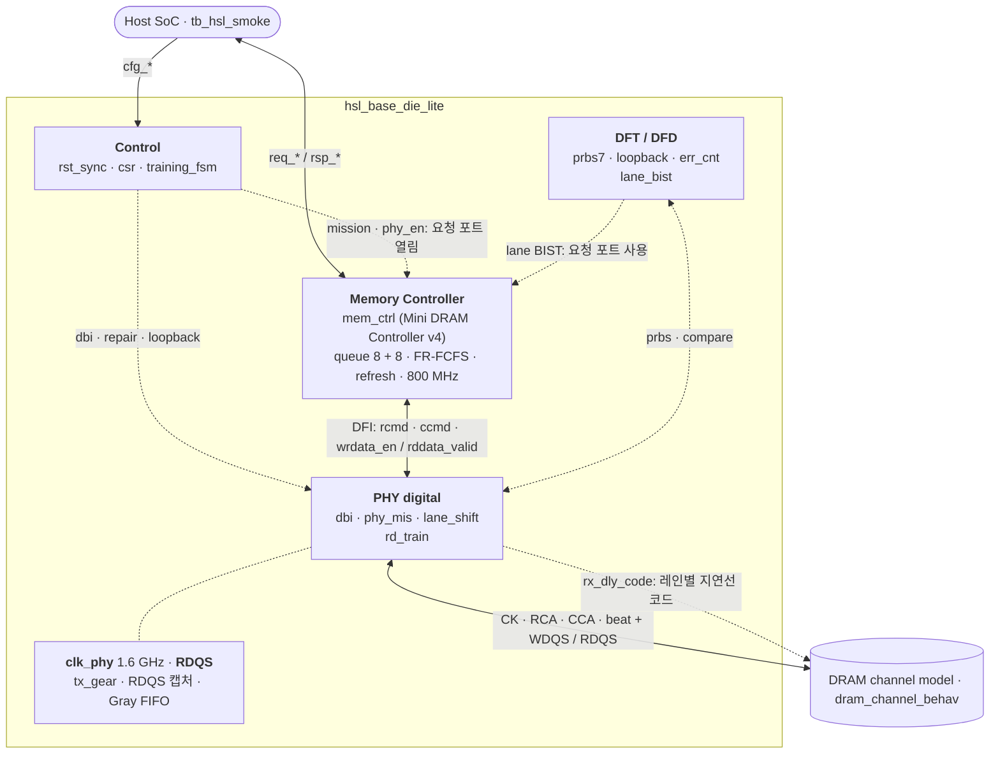

<div align="center">

# High-Speed Link Lite

**HBM Base Die 디지털 링크를 한 채널 슬라이스로 축소한 SystemVerilog RTL 설계**<br>
Spec → Architecture → RTL → Verification → PD Guide

[](rtl/)
[](sim/)
[](syn/)

**[📄 포트폴리오 PDF (23쪽)](portfolio-deck/HighSpeedLinkLite_Portfolio.pdf)** · [PPTX](portfolio-deck/HighSpeedLinkLite_Portfolio.pptx) · [스터디 맵](docs/00_study_map.md)

<a href="portfolio-deck/HighSpeedLinkLite_Portfolio.pdf"></a>

SK hynix HBM Digital Design (RTL Design) 지원 · 권용현

</div>

## 한눈에 보기

| 설계 범위 | 회귀 | 코드 커버리지 | 합성 면적 |
| :---: | :---: | :---: | :---: |
| **MC · PHY · DFT** | **18 / 18 PASS** | **Line 95.6%**<br>**Branch 89.1%** | **30,241 µm²**<br>**2,741 FF** |
| RTL 27개 모듈<br>2,633줄 (주석 제외) | SMOKE · T1–T12 · E7 · E9 · E11<br>스코어보드: 요청 4,070 · 읽기 1,154 | Toggle 83.4% | Nangate45 typical<br>Yosys 0.52, 배선 없음 |

> [!NOTE]
> 표와 아래 결과는 commit `0193c04` 기준이다(Verilator 5.052, ModelSim-Altera 10.1d 모두 18/18 PASS). `0193c04`에서 메모리 컨트롤러를 [Mini DRAM Controller](https://github.com/yhkwon-git/mini-dram-controller) v4로 바꿔 PHY와 DFI 형태로 붙이고, 저속 bypass framer를 없앴다. PDF는 DBI-AC까지 담은 `631d3bd` 판이다(3–20쪽은 `4feb39f` 측정). 그 뒤의 레인 리페어, 읽기 레벨링, mission 데이터패스, 컨트롤러 교체는 이 README에만 있다.

## 개요

HBM base die는 호스트 SoC와 DRAM core die 사이에서 명령 스케줄링, 트레이닝, 데이터 인코딩, 테스트를 디지털로 처리한다. 이 저장소는 그중 한 채널을 스터디 규모(DQ 8 · BL 4 · Bank 4)로 줄여, 요구 스펙부터 PD 인계 문서까지 한 흐름으로 설계했다. 호스트의 읽기 · 쓰기 요청은 메모리 컨트롤러가 DRAM 명령으로 바꿔 DFI 형태로 PHY에 넘기고, PHY가 핀으로 내보낸다. 핀 너머의 DRAM 동작은 테스트벤치의 채널 모델이 맡는다.

- **경계를 먼저 정했다.** 디지털은 핀의 논리값과 enable, 핸드셰이크, CDC, 리셋, DFT 관측점을 책임진다. 드라이버, 샘플러, VREF, ZQ 회로, 클럭 스파인은 아날로그와 풀커스텀 쪽이다.
- **컨트롤러는 검증된 것을 그대로 쓴다.** 메모리 컨트롤러는 별도 저장소에서 600만 요청 랜덤 회귀와 독립 타이밍 체커로 검증한 RTL을 파일 그대로 가져온다. 이 저장소는 그 경계(DFI 형태의 명령 · 데이터 신호)와 칩 레벨 검증(핀에서 재는 프로토콜 · 타이밍 검사, 참조 메모리 스코어보드)에 집중한다.
- **숫자는 한 곳에서 내려간다.** 스펙 값은 `docs/01_requirements.md` → `hsl_pkg` → RTL → 테스트벤치 → SDC 순서로 옮긴다. DRAM 타이밍은 컨트롤러의 `dram_pkg` 하나에서 오고, TIMING CSR은 그 값을 읽기 전용으로 보여 준다. 클럭 주기는 E12 대조표로 네 곳이 같은지 확인하고, 스모크 테스트가 시작할 때 패키지 상수를 다시 검사한다.
- **근거 없는 숫자는 쓰지 않는다.** 면적과 지연은 공개 교육용 라이브러리(Nangate45 typical)로 잰 값이고 배선은 넣지 않았다. mW와 사인오프 slack은 적지 않는다.

공개된 HBM 개념을 교육용으로 축소한 모델이다. 특정 제품의 내부 구조나 IP를 재현하지 않으며, 파라미터와 타이밍 숫자는 JEDEC 값이 아니다. RTL 이름과 주석은 영어, 설계 문서는 한글이다.

## 설계 범위

| 영역 | 구현 | 위치 |
| --- | --- | --- |
| Memory Controller | [Mini DRAM Controller](https://github.com/yhkwon-git/mini-dram-controller) v4 RTL(그 저장소 `44a0bb3`과 같은 파일). 읽기 8 + 쓰기 8 큐, FR-FCFS, 행 · 열 명령 버스에 매 클럭 하나씩, bank group 2 × 2, per-bank refresh와 RFM, posted write, 쓰기 큐 forwarding, in-order 응답 | [`rtl/mc/`](rtl/mc/) |
| PHY digital | DFI 형태 입력(행 · 열 명령, WL 뒤 쓰기 데이터, `rddata_valid`). 행 · 열 CA 핀, 동기 2:1 TX 기어 → 1.6 GHz beat + WDQS, RDQS 캡처 → Gray FIFO, DBI(DC · AC), shift 방식 레인 리페어(spare 핀 1개, 핀마다 2:1 mux), 읽기 레벨링(레인별 지연선 코드 스윕 → eye 중앙), 0–4 tap deskew(블록만) | [`rtl/phy/`](rtl/phy/) |
| Control | CSR 11개, 트레이닝 FSM(9개 상태, done 펄스 대기), 리셋 동기화기(비동기 assert, 2-FF 동기 deassert), 호스트 · BIST 요청 포트 mux | [`rtl/ctrl/`](rtl/ctrl/), [`rtl/top/`](rtl/top/) |
| DFT / DFD | PRBS7, 병렬 루프백, 16 bit 포화 에러 카운터, 레인 BIST(컨트롤러 요청 포트로 PRBS7 16워드를 쓰고 큐가 빈 뒤 읽어 DQ 레인별 고장 검출), STATUS · ERRCNT · REMAP · LANE_BIST 관측점 | [`rtl/dft/`](rtl/dft/) |
| PD 인계 | SDC(클럭, 생성 클럭, I/O delay, CDC `set_max_delay`), 클럭 · 리셋 · CDC · 핀 · floorplan 가이드 | [`syn/`](syn/), [`docs/05_pd_guide.md`](docs/05_pd_guide.md) |
| 검증 | 칩 레벨 테스트, 블록 테스트, DRAM 채널 모델(핀에서 프로토콜과 같은 뱅크 타이밍 검사), 모든 호스트 응답을 참조 메모리와 비교하는 스코어보드를 한 번에 도는 회귀 | [`tb/`](tb/), [`sim/`](sim/) |

## 아키텍처



- **요청**: `req_*`(14 bit 워드 주소) → `mem_ctrl`. 주소를 XOR 맵으로 bank · row · col로 나눠 읽기 큐와 쓰기 큐에 넣는다. 쓰기는 받은 다음 클럭에 응답하고(posted), 쓰기 큐에 있는 주소를 읽으면 핀을 거치지 않고 그 데이터로 답한다. 응답은 요청 순서대로 나간다
- **명령**: 스케줄러가 매 클럭 행 명령(ACT · PRE · REFpb) 하나와 열 명령(RD · WR) 하나를 고른다. PHY는 한 클럭 뒤 `pin_rca = {cmd, bank, row}`, `pin_cca = {cmd, bank, col, ap}`로 내고, 코드는 컨트롤러의 `dram_cmd_e` 그대로다. 열 명령은 row를 싣지 않고 그 뱅크의 열린 row를 쓴다
- **쓰기 데이터**: WR 뒤 WL(1) 클럭에 `wrdata_en` → DBI(DC 또는 AC) → 레인 shift(4 심볼) → 동기 2:1 TX 기어 → `clk_phy` beat 두 개(beat당 2 UI × 10핀)와 WDQS
- **읽기 데이터**: RDQS(= CK + tDQSCK)로 beat 두 개를 받아 Gray FIFO로 컨트롤러 클럭에 넘기고, shift 복원과 DBI 복원 뒤 `rddata_valid`. 지연을 고정하지 않아도 컨트롤러가 `rddata_valid`로 진행 중인 RD를 센다. 루프백이 켜져 있으면 RD를 핀으로 내지 않고 마지막 쓰기 버스트(`lb_hold`)로 답한다
- **포트**: 요청 포트는 MISSION이면서 PHY가 켜져 있을 때(`CTRL.phy_en`)만 열린다. CK는 PHY가 켜져 있을 때만 `pin_ck`로 나간다. 레인 BIST가 도는 동안은 BIST가 포트를 쓰고 응답을 모두 가져간다. deskew는 아직 경로에 없고 블록 테스트만 한다

<details>
<summary>모듈 계층 (27개 모듈 + 패키지 2개)</summary>

```text
hsl_base_die_lite
├─ hsl_rst_sync           비동기 assert, 2-FF 동기 deassert
├─ hsl_csr                CSR 11개, ID "HSL1"
├─ hsl_training_fsm       RESET → … → MISSION
├─ hsl_rd_train           읽기 레벨링: 레인별 지연선 코드 스윕, eye 중앙 (레인 BIST로 판정)
├─ mem_ctrl               Mini DRAM Controller v4 (그 저장소 44a0bb3과 같은 파일)
│  ├─ mc_queue ×2         읽기 8 · 쓰기 8, 큐 안의 나이 행렬, 주소 비교
│  ├─ mc_xage             두 큐 사이의 나이 (WDRAIN = 0일 때만 씀)
│  ├─ mc_wdrain           읽기 모드 / 쓰기 배치 (WR_HI 6, WR_LO 2)
│  ├─ mc_bank ×4          열린 row, tRCD · tRP · tRAS · tRC · tRTP · tWR, auto-precharge, RAA
│  ├─ mc_chan             bank group별 tCCD · tRRD · tWTR(S/L), tFAW · tRTW · tRFC
│  ├─ mc_refresh          per-bank refresh (tREFI/4마다 REFpb 하나)
│  ├─ mc_sched            행 · 열 명령을 매 클럭, FR-FCFS, refresh와 RFM
│  └─ mc_resp             tag, 읽기 반환 FIFO, 쓰기 데이터 파이프, in-order 응답
├─ hsl_phy_top            DBI, PRBS 먹스, 루프백 보관, CK 게이트
│  ├─ hsl_phy_clk         2배 클럭 (합성 시 빈 쉘, PLL 자리)
│  ├─ hsl_dbi             DBI-DC · DBI-AC
│  └─ hsl_phy_mis         CA 핀, TX 기어, RDQS 캡처, 읽기 FIFO
│     ├─ hsl_lane_shift   shift 방식 레인 리페어 (TX · RX, 핀마다 2:1 mux)
│     ├─ hsl_tx_gear      동기 2:1, 컨트롤러 클럭마다 워드 하나 → beat 두 개
│     └─ hsl_cdc_fifo     Gray 포인터, RDQS → clk
└─ hsl_dft_top
   ├─ hsl_prbs            x⁷ + x⁶ + 1
   ├─ hsl_loopback        병렬 루프백
   ├─ hsl_err_cnt         16 bit 포화 카운터
   └─ hsl_lane_bist       레인 BIST (요청 포트로 PRBS7 쓰기 → 큐 비움 → 읽기)
hsl_deskew                레인별 0–4 tap (블록 테스트만)
```

</details>

## 설계 결정

| 결정 | 이유 | 대가와 후속 조치 |
| --- | --- | --- |
| 단일 클럭(A)으로 시작해 E7에서 컨트롤러 1 : PHY 2(B)로 전환. RTL UI 직렬화(C)는 채택하지 않음 | 명령이 드롭되지 않는 핸드셰이크와 뱅크 타이밍을 먼저 닫고 CDC를 올린다. UI 직렬화는 아날로그 PHY 경계 밖이다 | 클럭이 하나 늘고 포인터 동기화 리스크가 생긴다 → E8 Gray FIFO, E12 클럭 대조표 |
| 메모리 컨트롤러는 Mini DRAM Controller v4 RTL을 파일 그대로 쓰고, PHY와는 DFI 형태 신호로만 연결 | 컨트롤러는 자기 저장소에서 랜덤 회귀 600만 요청과 독립 타이밍 체커로 검증했다. 이 칩은 경계(행 · 열 명령 버스, WL 뒤 쓰기 데이터, `rddata_valid`)만 맞추면 되고, 두 저장소가 같은 RTL을 쓴다 | 컨트롤러를 고칠 일은 그 저장소에서 먼저 고쳐 가져온다(ModelSim 캐스트 수정, `q_empty` 출력). 그쪽 모델은 RD를 낸 뒤 3 클럭에 data_valid를 받지만 이 PHY는 8 클럭이라, RD를 4개까지만 띄우는 `RD_PIPE`가 읽기 대역을 묶는다([mission 데이터패스](#mission-데이터패스-ca-핀-16-ghz-beat-rdqs)) |
| PHY 읽기 경로는 지연을 고정하지 않고 `rddata_valid`로 알림 | RDQS 캡처와 Gray FIFO 동기화의 지연은 RDQS 위상에 따라 한 클럭쯤 달라진다. 컨트롤러가 `rddata_valid`로 진행 중인 RD를 세므로 순서만 지키면 된다 | 실제 DFI의 `tphy_rdlat` 같은 고정 지연 계약은 없다. 컨트롤러의 읽기 반환 FIFO는 PHY 왕복만큼 깊어야 한다 |
| Beat-major 데이터 배치 | DBI와 ECC가 한 UI의 바이트를 한 덩어리로 다룬다 | 레인 단위 접근은 비트를 흩어 읽는다 |
| CSR은 `rst_sync_n`만, 데이터패스는 `rst_sync_n & ~soft_rst` | CSR까지 soft reset에 넣으면 `soft_rst` 비트가 다음 사이클에 스스로 지워진다 | 리셋 도메인이 둘이 된다 |
| CDC: Gray 포인터는 소스 클럭의 플롭에서 넘기고, 크로싱은 false path 대신 `set_max_delay` | 조합 XOR 출력이 넘어가면 여러 비트가 바뀌는 순간의 glitch를 싱크 플롭이 잡을 수 있다. false path는 그 경로의 지연을 타이밍이 보지 않게 만든다 | 포인터 레지스터가 늘고, 제약 값을 클럭 주기와 함께 관리해야 한다 |
| mission TX 기어는 동기식, RX는 RDQS로 받아 Gray FIFO로만 넘김 | `clk_phy`는 PLL에서 컨트롤러 클럭과 위상이 맞으므로, 워드를 컨트롤러 엣지 반 주기 뒤의 PHY 엣지(E1)에서 받으면 핸드셰이크 없이 매 클럭 한 워드를 고정 지연으로 낸다. RDQS는 위상이 정해지지 않은 클럭이라 FIFO 말고는 넘어가지 않는다 | 이전의 토글 핸드셰이크 기어박스는 3 클럭에 한 워드라 교체했다. E1은 컨트롤러 토글을 PHY 클럭으로 비교해 찾는다(FF 1개) |
| 레인 리페어는 shift 방식: 고장 핀부터 위쪽 레인을 한 칸씩 spare(RED) 쪽으로 | 핀마다 자기 레인과 아래 레인 중 하나를 고르는 2:1 mux라 배선이 이웃 핀까지만 간다. 치환 방식은 모든 레인에서 spare까지 경로가 필요하다 | 고장 핀 위의 레인 번호와 핀 번호가 어긋난다 → 양 끝(PHY, DRAM)이 같은 설정을 가져야 한다. 모델은 mode register 대신 입력으로 받는다 |
| 읽기 레벨링: 지연선은 아날로그 모델로 두고 디지털은 코드만 낸다 | 디지털이 책임지는 것은 코드 스윕, 레인별 판정, 가장 긴 통과 구간 찾기, 중앙 선택이다. 지연선과 샘플러는 채널 모델이 코드에 따라 흉내 낸다(창 밖에서는 이웃 UI를 읽음) | 판정에 레인 BIST를 재사용해 코드마다 BIST 한 번(32 코드). 레인당 상태 27 FF. 쓰기 방향 레벨링은 없다 |
| 레인 BIST는 컨트롤러 요청 포트로 16워드를 쓰고, 큐가 빌 때까지 기다린 뒤 읽음 | 뱅크 타이밍, refresh, 버스 전환은 컨트롤러가 지킨다. 쓰기가 큐에 남은 채 읽으면 컨트롤러가 쓰기 큐에서 바로 답해 링크를 거치지 않으므로, 컨트롤러에 `q_empty`를 내어 그때까지 기다린다. 주소는 CA 핀으로 가므로 16 컬럼을 써도 DQ 고장이 주소에 섞이지 않는다 | BIST 중에는 호스트 포트를 막고 응답을 BIST가 가져가므로, 호스트가 조용하고 응답을 다 받은 상태에서 시작해야 한다. DBI 레인 고장은 DBI를 끈 상태에서 양방향 반전이 상쇄돼 데이터에 드러나지 않는다 |
| DBI는 DC 방식(beat의 1이 4개를 넘으면 반전)으로 시작하고, AC 방식(직전 UI 대비 DQ 전이가 4개를 넘으면 반전)을 CSR로 고르게 추가 | DC는 high 개수를 줄여 high에서 종단 전류가 흐르는 I/O에 맞다. HBM처럼 종단이 없는 짧은 채널에서는 전이 수가 스위칭 전력과 SSO를 정하므로 AC가 맞다 | AC는 이전 beat의 반전 여부에 묶인 직렬 체인이다 → 원시 beat끼리 전이를 미리 세어 beat당 2:1 mux 하나로 줄임([DBI-AC](#dbi-ac-off--dc--ac-비교)) |

## 스펙 요약

| 항목 | 값 |
| --- | --- |
| DQ / DBI / RED | 8 / 1 / 1 (데이터 핀 10개) |
| 버스트 | BL 4, beat-major (beat 0이 첫 UI) |
| 뱅크 / row / col | 4 (bank group 2 × 2) / 8 bit / 4 bit. 호스트 주소는 14 bit 워드 주소, XOR 맵(bank = a[5:4] ^ a[7:6]) |
| 데이터 폭 | 32 bit (`DQ_W × BL`). 컨트롤러 클럭 한 번에 버스트 하나 |
| 목표 데이터율 | 3.2 Gb/s/DQ → raw 3.2 GB/s (리프레시, 명령 간격, 트레이닝을 빼기 전) |
| 클럭 | 컨트롤러 1.25 ns (800 MHz), PHY 0.625 ns (1.6 GHz) |
| 타이밍 (컨트롤러 클럭, `dram_pkg`) | tRCD 3 · tRP 3 · tRAS 6 · tRC 9 · tRTP 2 · tWR 2 · tCCD_S/L 1/2 · tRRD_S/L 2/3 · tWTR_S/L 2/4 · tFAW 8 · tRTW 4 · tRFC 12 · tRFCpb 8 · tREFI 64 · WL 1 |
| 트레이닝 순서 | RESET → CKE → MRS → ZQCAL → WRLVL → RDLVL → DESKEW → WRTRAIN → MISSION |
| 전력 · 신뢰성 규칙 | CKE는 RESET에서만 0, 쓰기 beat가 없으면 TX beat는 0, DBI-DC는 beat의 1이 4개를 넘으면 반전, DBI-AC는 직전 UI 대비 DQ 전이가 4개를 넘으면 반전, 에러 카운터는 16'hFFFF에서 포화 |

```text
CK              = 3.2 Gb/s ÷ 2   = 1.6 GHz (625 ps)
Controller      = CK ÷ 2         = 800 MHz (1250 ps)
beats_per_burst = BL ÷ DDR_BITS  = 2   → PHY beat 20 bit (2 UI × 10핀)
```

<details>
<summary>CSR 맵</summary>

| 주소 | 이름 | 접근 | 내용 |
| --- | --- | --- | --- |
| `0x00` | ID | RO | `0x48534C31` ("HSL1") |
| `0x04` | VERSION | RO | `0x00000300` |
| `0x08` | CTRL | RW | `soft_rst`, `train_bypass`, `loopback`, `prbs_en`, `dbi_en`, (bit 5 예약, 0으로 읽힘), `dbi_ac`, `phy_en` |
| `0x0C` | STATUS | RO | `train_state`, `train_done`, `mission_mode`, `soft_rst` 에코 |
| `0x10` | TRAIN | RW | `[0]` start, `[4:1]` done 펄스, `[15:8]` wait |
| `0x14` | ERRCNT | RW | 읽기는 카운트, 쓰기는 clear |
| `0x18` | REMAP | RW | `[0]` enable, `[7:4]` 건너뛸 핀 (0–7 DQ, 8 DBI, 9 이상은 shift 없음) |
| `0x1C` | TIMING0 | RO | `{tCCD_L, tRAS, tRP, tRCD}`, 컨트롤러 상수 |
| `0x20` | TIMING1 | RO | `{tRFC, tRTP, tWR, tWTR_L}`, 컨트롤러 상수 |
| `0x24` | LANE_BIST | RW | 쓰기: `[0]` start, `[5:4]` bank, `[15:8]` row(그 bank · row의 컬럼 0–15를 씀). 읽기: `[0]` busy, `[1]` done, `[2]` pass, `[3]` 한 레인만 실패, `[7:4]` 실패 레인, `[15:8]` 레인별 에러, `[20:16]` 불일치 버스트 수 |
| `0x28` | RDTRAIN | RW | 쓰기: `[0]` start, `[6:4]` 읽어 볼 레인. 읽기: `[0]` busy, `[1]` done, `[2]` 모든 레인에서 eye 찾음, `[6:4]` 레인, `[12:8]` 그 레인의 코드, `[20:16]` eye 시작, `[29:24]` eye 폭 |

비트 단위 정의는 [`docs/03_microarchitecture.md`](docs/03_microarchitecture.md)에 있다.

</details>

## 검증

`tb_hsl_smoke`가 칩 전체(`hsl_base_die_lite`)와 DRAM 채널 모델을 묶고, 같은 프로세스 안에서 `tb_hsl_blocks`가 블록을 독립 인스턴스로 검사한다. 한 번의 실행이 칩, 블록, 채널 세 계층을 모두 돈다.

- **스코어보드**: 호스트 요청 포트의 응답을 모두 참조 메모리와 비교한다. 요청이 받아들여지는 순간 그 주소의 기대값을 기록하고, 응답은 요청 순서로 온다. 회귀 전체에서 요청 4,070개, 읽기 1,154개를 비교해 불일치 0이다
- **채널 모델의 핀 검사**: 프로토콜(열린 뱅크에 ACT, 닫힌 뱅크에 RD/WR, 열린 뱅크에 REFpb, 다른 버스의 명령), 같은 뱅크 타이밍(tRCD · tRP · tRAS · tRC · tRTP · 쓰기 회복 · tRFCpb · tRFC), 쓰기 데이터가 닿기 전에 같은 주소를 읽는 RD, WDQS 패턴을 세고, 회귀가 끝날 때 모두 0이어야 한다. 규칙을 일부러 tRCD + 1로 바꾼 모델은 1,162건을 잡았다. bank group 간 규칙(tCCD · tRRD · tFAW · tWTR · tRTW)은 컨트롤러 저장소의 체커가 맡는다
- 체크마다 PASS나 FAIL을 찍는다. 하나라도 실패하면 마지막 줄이 `[ALL] FAIL (n)`이고 0이 아닌 코드로 끝난다. 타임아웃도 실패다
- 비교는 `!==`, `===`로 한다. X나 Z가 나오면 통과가 아니라 실패다
- 리셋은 클럭 negedge에서 푼다. posedge와 같은 시각에 풀면 첫 싱크러나이저 플롭과 레이스가 생긴다

| ID | 대상 | 확인 내용 |
| --- | --- | --- |
| SMOKE | 칩 기본 동작 | ID · VERSION · TIMING(읽기 전용) 값, 미정의 주소 0, 리셋 직후 핀과 ready 0, bypass 후 MISSION이어도 PHY가 꺼져 있으면 요청 포트가 닫힘, 응답을 막으면 요청 15개(tag 수)에서 ready 0, soft reset 후 복귀 |
| T1 | 트레이닝 FSM | 순서대로 진행하고, 각 대기 상태는 done 펄스가 오기 전까지 머무름 |
| T2 | 핀의 DRAM 명령 | bank 1의 두 row에 쓰고 다시 읽을 때 행 · 열 CA 핀의 코드와 간격: ACT → WR 3, WR → PRE 4, PRE → ACT 3, ACT → RD 3, RD → PRE 3(tRAS가 묶음) 클럭으로 모두 그 자리에 걸린 규칙의 최소값. idle 256 클럭 동안 bank마다 REFpb 4번 |
| T3 | 랜덤 트래픽 | 4 bank × 4 row × 16 col을 채운 뒤 요청 2,000개(읽기 · 쓰기 무작위, 임의 idle, 응답은 네 클럭 중 세 클럭만 받음). 읽기 1,021개 모두 일치, row hit 38%, 쓰기 큐에서 답한 읽기 15개 |
| T4 | posted write · forwarding | 쓰기는 다음 클럭에 응답. 바로 뒤 같은 주소 읽기는 쓰기 큐에서 답하고 핀에 RD가 없음. 쓰기가 나간 뒤의 읽기는 채널 모델에서 `A5A5_5A5A` |
| T5 | DBI | 핀 beat에서 `0x1F` → `E0` + DBI 1, `0x0F` → 그대로 |
| T6 | CDC FIFO | 두 클럭 사이에서 3 word 순서 유지 |
| T7 | 레인 리페어 | shift 핀 값: lane 3이면 `FF` → 핀 `1F7`(DQ3 쉼, DBI 핀이 DQ7, RED가 DBI), lane 8(DBI 핀)이면 DBI가 RED로(`200`), lane 15는 그대로. 블록: 모든 설정 × 랜덤에서 참조 모델 일치, 건너뛴 핀의 stuck 값이 RX로 들어오지 않음 |
| T8 | PRBS · 루프백 | PRBS 비교는 루프백이면 ERRCNT 0, 아니면 증가. 루프백 RD는 핀에 RD를 내지 않고 마지막 쓰기 버스트(`2222_2222`)를 돌려줌 |
| T9 | DBI-AC | 블록: 직렬 참조 모델과 랜덤 4,000 버스트 비교, 두 AC 구조 등가, 랜덤 스트림 전이 수가 이항분포 기대값과 일치. 칩: AC 핀 값 정확 비교, bank group 두 개를 번갈아 버스트가 쉬지 않고 이어지는 PRBS7 · 55/AA 쓰기 스트림의 off / DC / AC 전이 수와 규칙 위반 0, 채널 모델이 DBI를 붙인 읽기 데이터를 RX가 복원 |
| T10 | 레인 BIST · 리페어 | 칩과 채널 모델 사이 링크 핀에 stuck-at 주입 → BIST가 그 레인만 표시 → REMAP과 모델 설정 → 재검사 PASS. DQ 8레인 × stuck 0/1 = 16/16 검출, 16/16 복구. 리페어된 링크로 DBI-AC 트래픽 읽기 16개 일치. 두 레인 고장은 수리 불가로 표시 |
| T11 | 읽기 레벨링 | 레인마다 eye(통과하는 지연선 코드 구간)를 주고 학습: 고정 eye 한 번, 랜덤 eye 한 번 모두 8레인의 eye 시작 · 폭이 정확하고 코드가 중앙. 학습 전에는 eye가 기본 코드 16을 벗어난 레인만 BIST 실패, 학습 후 BIST PASS와 호스트 트래픽 읽기 16개 일치. 닫힌 eye는 실패로 표시 |
| T12 | mission 데이터패스 | 이전 in-order MC로 쟀던 WR 16 + RD 16(162 → 77 클럭), 열린 row 읽기 하나의 지연(요청 → 응답 9, 핀의 RD → `rddata_valid` 6 클럭), bank group 두 개에 걸친 읽기 32개, DBI-AC 양방향 + lane 5 stuck-at-1 리페어 트래픽, 채널 모델 오류 0 |
| E7 | TX 기어 | 32 bit 두 워드가 연속 PHY 클럭 네 beat로(`C3D4`, `A1B2`, `7788`, `5566`) |
| E9 | Deskew | tap 0 통과, tap 2 지연 |
| E11 | PRBS seed | 리셋 seed `5A`의 첫 비트 1, seed 0 load 무시 |

```text
[T7] unit PASS
[E9] PASS
[E11] prbs PASS
[E7] PASS
[T6] PASS
[SMOKE] PASS
[T9] random stream 40000 UI, DQ+DBI per UI: toggles off 4.00 dc 4.16 ac 3.38, ones off 4.00 dc 3.27 ac 4.36
[T9] unit PASS
[T1] PASS
[T2] bank 1 at the pins: ACT +3 WR +4 PRE +3 ACT +3 WR | PRE +11 ACT +3 RD +3 PRE +3 ACT +3 RD
[T2] 256 idle cycles: REFpb per bank 4 4 4 4 (tREFI 64)
[T2] PASS
[T3] 2000 requests (1021 reads) in 5851 cycles; DFI data bus busy 33.9% (979 WR, 1006 RD bursts)
[T3] at the pins: 1234 ACT, 1234 PRE, 1006 RD, 979 WR, 365 REFpb; row hits 37.8%; 15 reads answered from the write queue
[T3] PASS
[T4] PASS
[T5] PASS
[T7] PASS
[T8] PASS
[T9] PRBS7 x254, DQ+DBI per data UI: toggles off 4.02 dc 4.13 ac 3.42, ones off 4.03 dc 3.31 ac 4.33
[T9] 55/AA x254, DQ+DBI per data UI: toggles off 7.74 dc 7.71 ac 1.20, ones off 4.00 dc 4.00 ac 4.50
[T9] PASS
[T10] stuck-at on 8 DQ lanes x {0,1}: found 16/16, repaired 16/16; two lanes flagged not repairable
[T10] PASS
[T11] lane:[eye]->code 0:[3,9]->6 1:[9,17]->13 2:[18,25]->21 3:[6,17]->11 4:[20,25]->22 5:[1,10]->5 6:[12,16]->14 7:[15,25]->20
[T11] lane:[eye]->code 0:[21,27]->24 1:[10,14]->12 2:[14,22]->18 3:[21,24]->22 4:[13,15]->14 5:[6,13]->9 6:[7,14]->10 7:[9,19]->14
[T11] PASS
[T12] 16 WR + 16 RD to one row, back to back: 77 cycles from the first write request to the last read response (16 RD at the pins)
[T12] one read of an open row: 9 cycles from request to response; RD on the pins to rddata_valid 6 cycles
[T12] 32 reads over two bank groups: 76 cycles from the first request to the last response (4 RDs in flight at most)
[T12] channel model, whole run: 1544 ACT, 1540 PRE, 3282 RD, 5059 WR, 1387 REFpb; errors: protocol 0, timing 0, read before its write data 0, WDQS 0
[T12] PASS
[SB] 4070 host requests, 1154 reads compared against the reference memory
[ALL] PASS
```

<sub>Verilator 출력이다. ModelSim은 난수 생성기가 달라 T3과 T11 랜덤 회차의 수만 다르고(예: T3 읽기 994개, row hit 35.8%), 나머지 줄은 같다. T2의 `PRE +11 ACT`는 그 사이에 bank 1의 REFpb(tRFCpb 8)가 끼어서다.</sub>


<sub>T4, commit `0193c04`의 Verilator VCD(가운데 idle 7.1 ns는 생략). ① 쓰기 요청(호스트 주소 `1D1` = bank 2, row 07, col 1)을 받은 다음 클럭에 응답한다(posted). ② 바로 뒤 같은 주소 읽기는 쓰기 큐에서 `A5A5_5A5A`로 답하고 `pin_cca`에는 RD가 없다. 같은 클럭에 ACT b2 r07이 `pin_rca`로 나간다. ③ tRCD 3 클럭 뒤 WR b2 c1, 다음 클럭에 `wrdata_en`, 이어서 TX beat 두 개(UI 순서 `5A 5A A5 A5`)와 WDQS. 그사이 per-bank refresh(REFpb b0, b1)가 행 버스로 나간다. ④ 쓰기가 나간 뒤 같은 주소를 다시 읽으면 RD b2 c1이 핀으로 나가고, ⑤ RDQS beat 두 개가 Gray FIFO를 지나 핀의 RD 6 클럭 뒤 `rddata_valid`, 요청 9 클럭 뒤 응답이다.</sub>

<details>
<summary>모듈별 코드 커버리지 (commit <code>0193c04</code>, Verilator)</summary>

| 모듈 | Line | Branch | Toggle |
| --- | ---: | ---: | ---: |
| mem_ctrl (top) | 100.0% | 100.0% | 85.8% |
| mc_queue | 100.0% | 100.0% | 79.6% |
| mc_xage | 100.0% | 100.0% | 100.0% |
| mc_wdrain | 100.0% | 100.0% | 96.2% |
| mc_bank | 100.0% | 88.5% | 86.2% |
| mc_chan | 100.0% | 96.2% | 46.8% |
| mc_refresh | 100.0% | 83.3% | 95.7% |
| mc_sched | 89.2% | 60.9% | 80.5% |
| mc_resp | 80.0% | 100.0% | 100.0% |
| phy_top | 100.0% | 100.0% | 95.5% |
| phy_mis | 100.0% | 100.0% | 96.4% |
| tx_gear | 100.0% | 100.0% | 83.6% |
| cdc_fifo | 100.0% | 100.0% | 64.3% |
| lane_shift | – | 100.0% | 100.0% |
| dbi | 100.0% | 75.0% | 100.0% |
| rd_train | 93.3% | 90.9% | 75.2% |
| deskew | 100.0% | 83.3% | 23.4% |
| csr | 96.0% | 100.0% | 69.7% |
| training_fsm | 92.9% | 100.0% | 75.0% |
| rst_sync | 100.0% | 100.0% | 60.0% |
| lane_bist | 100.0% | 100.0% | 90.4% |
| prbs | 100.0% | 100.0% | 93.1% |
| err_cnt | 66.7% | 100.0% | 23.8% |
| loopback | – | 100.0% | 67.0% |
| **전체 (`rtl/` 27개 모듈)** | **95.6%** | **89.1%** | **83.4%** |

Verilator `--coverage-line --coverage-toggle`로 회귀 전체를 돌리고 `rtl/` 파일만 셌다. 같은 모듈의 인스턴스는 합쳤다(어느 인스턴스든 닿으면 커버). 표에 없는 top, dft_top, phy_clk도 전체에 들어 있다. 이전 in-order MC 시절(`4feb39f`)에는 87.5 / 96.6 / 56.6%였고, toggle은 T3의 랜덤 주소 · 데이터로 올랐다.

</details>

이 측정에서 닿지 않은 곳은 다음과 같다.

- 컨트롤러의 branch 구멍 대부분은 이 칩이 쓰지 않는 파라미터 경로다(all-bank refresh, close · timer page policy, 명령 버스 하나, FCFS, WL > 1). 컨트롤러 저장소는 빌드 16개로 이 경로를 돈다
- 실제로 비어 있는 곳: starvation 우선(160 클럭 대기), RFM(뱅크당 ACT 누적), refresh 부채 포화, `err_cnt`의 clear 우선순위, 읽기 레벨링의 일부 else 분기
- deskew와 err_cnt는 toggle이 낮다(23%대). deskew는 블록 테스트만 있고, 에러 카운터는 상위 비트까지 차오르는 시험이 없다

## DBI-AC: off · DC · AC 비교

DBI-AC는 beat마다 직전 UI에 실제로 나간 바이트와 비교해, DQ 8개 중 4개를 넘게 바뀌면 그 beat를 반전한다. 그래서 한 UI에 바뀌는 DQ는 4개 이하다(DBI 핀은 세지 않으며 함께 바뀔 수 있다). 첫 beat의 기준은 그 앞 UI다. DQ는 데이터만 실으므로, 직전 클럭에 쓰기 버스트가 나갔으면 그 마지막 바이트, 아니면 idle 버스(0)와 비교한다. CSR `CTRL[6]`이 DC와 AC를 고른다.

| 데이터 (측정 위치) | 지표 (UI당, DQ + DBI) | off | DC | AC |
| --- | --- | ---: | ---: | ---: |
| PRBS7, 쓰기 254개 (칩 핀) | 전이 | 4.02 | 4.13 | **3.42 (−15%)** |
| | high | 4.03 | **3.31 (−18%)** | 4.33 |
| `55 AA 55 AA` 반복, 쓰기 254개 (칩 핀) | 전이 | 7.74 | 7.71 | **1.20 (−84%)** |
| 균등 랜덤 연속 스트림 40,000 UI (블록) | 전이 | 4.00 | 4.16 | **3.38** |
| | high | 4.00 | 3.27 | 4.36 |

<sub>칩 핀 값은 T9가 쓰기 beat의 UI마다 핀에서 앞 UI(앞 beat의 마지막 UI, 비어 있으면 0) 대비로 잰 값이다(commit `0193c04`). 쓰기는 bank group 두 개를 번갈아 tCCD_S = 1 간격으로 이어지므로 버스트 경계를 넘는 전이도 들어간다. 55/AA의 off가 8이 아닌 7.74인 것은 refresh 등으로 쉰 뒤의 첫 UI(idle 0 → `55`, 4개)가 섞이기 때문이다. 랜덤 스트림은 버스트가 쉬지 않고 이어지는 경우이며, 이항분포 기대값(off 4.00, DC 4.16, AC 3.37)과 ±0.05 안에서 맞는지 T9가 검사한다.</sub>

- **두 규칙은 서로 다른 것을 줄인다.** DC는 high 핀 수를, AC는 전이 수를 줄인다. 랜덤에 가까운 데이터에서 DC는 오히려 전이를 조금 늘리고, AC는 high를 조금 늘린다.
- **AC가 이기는 경우는 전이가 몰린 데이터다.** 모든 DQ가 매 UI 바뀌는 `55/AA`에서 DC는 아무것도 하지 못하고(beat마다 1이 4개), AC는 DQ를 고정하고 DBI 핀만 바꾼다.
- **읽기 방향**: 채널 모델이 모드 레지스터 대신 `mr_dbi_en` · `mr_dbi_ac` 입력으로 읽기 데이터를 같은 규칙으로 인코딩한다. 모델의 인코더는 RTL과 따로 짠 직렬 규칙이고, RX가 DBI = 1인 beat를 복원해 읽기 32개가 모두 스코어보드와 일치했다.

AC 규칙은 직렬 체인이다. beat b의 기준은 beat b−1이 반전되어 나갔는지에 달려 있다. 그대로 짜면 beat마다 XOR, popcount, 비교, 반전이 차례로 붙는다. 원시 beat끼리의 전이 수 `r_b = popcount(din_b ^ din_b−1)`를 네 beat 모두 병렬로 세면, beat b−1이 반전된 경우 전이는 `8 − r_b`이므로 `inv_b = inv_b−1 ? (r_b < 4) : (r_b > 4)`가 되어 체인에는 beat당 2:1 mux 하나만 남는다. 두 구조는 파라미터 `AC_SERIAL`로 둘 다 빌드되고, 블록 테스트가 같은 입력에서 결과가 같은지 비교한다.

| `hsl_dbi` (Nangate45 typical, 배선 없음) | 면적 | Cell | 입력 → 출력 최대 지연 |
| --- | ---: | ---: | ---: |
| DC만 (commit `4d38ae9`) | 130 µm² | 101 | 0.449 ns |
| DC + AC, mux 체인 (기본) | 289 µm² | 224 | **0.882 ns** |
| DC + AC, 직렬 (`AC_SERIAL = 1`) | 301 µm² | 229 | 1.822 ns |

<sub>`syn/ppa_block.sh`(sv2v → Yosys 0.52 → OpenSTA 3.1, 입력 BUF_X1 구동, 출력 2 fF). 직렬 구조는 이 블록 하나로 컨트롤러 주기 1.25 ns를 넘는다. mux 체인은 0.37 ns를 남기지만, 칩 경로에는 컨트롤러의 쓰기 데이터 플롭, PRBS 먹스, 레인 shift가 앞뒤로 붙으므로 칩 STA(다음 단계)에서 다시 확인한다.</sub>

## Mission 데이터패스: CA 핀, 1.6 GHz beat, RDQS

```text
cycle t   : 컨트롤러가 행 명령과 열 명령을 고름 → t+1에 pin_rca, pin_cca (한 클럭씩)
WR        : t+1에 wrdata_en (WL 1) → DBI → lane shift(4 심볼) → tx_word ─ E1 ─▶ beat0 (UI0, UI1) ─ E0 ─▶ beat1 (UI2, UI3) + WDQS
RD        : DRAM ─ RL ─▶ beat0, beat1 on RDQS ─▶ 캡처 플롭(RDQS) ─▶ Gray FIFO ─▶ clk ─▶ unshift ─▶ DBI 복원 ─▶ rddata_valid
```

컨트롤러 클럭(800 MHz)마다 버스트 하나(4 UI × DQ 8)를 내보내므로 핀 기준 DQ당 3.2 Gb/s에 해당한다. UI 직렬화와 지연선, 샘플러는 아날로그 쪽이고, 디지털은 `clk_phy` beat와 strobe 패턴까지 책임진다(구조 B).

| 항목 (commit `0193c04`) | 결과 |
| --- | --- |
| 이전 in-order MC로 쟀던 트래픽: 한 row에 WR 16 → RD 16을 연달아 (첫 쓰기 요청 → 마지막 읽기 응답) | 162 → **77 클럭**. 읽기 16개는 모두 핀을 거쳤다. 이전 MC는 같은 뱅크의 컬럼 명령 사이에도 tWR · tRTP를 기다렸고, 지금은 같은 bank group의 tCCD_L 2 클럭과 WR → RD 전환(tWTR_L 4)이 남는다 |
| 핀의 명령 간격 (T2) | ACT → WR 3, WR → PRE 4, PRE → ACT 3, ACT → RD 3 클럭. 모두 규칙의 최소값이다 |
| 열린 row 읽기 하나 (T12) | 요청 → 응답 9 클럭, 그중 핀의 RD → `rddata_valid`가 6 클럭 |
| 병목: 진행 중인 RD 수 | 컨트롤러는 RD를 4개(`RD_PIPE`)까지 띄우고, RD 하나는 낸 클럭부터 data_valid를 받을 때까지 슬롯을 잡는다. 컨트롤러 저장소의 모델에서는 3 클럭이지만 이 PHY에서는 8 클럭이라, 읽기만으로는 데이터 버스의 절반까지만 쓴다. bank group 두 개에 걸친 읽기 32개가 76 클럭 걸린다(T12). 읽기 반환 FIFO를 PHY 왕복만큼 늘리는 것이 다음 단계다 |
| 함께 검증한 것 | DBI-AC(양방향), lane 5 stuck-at-1 리페어, 읽기 레벨링, 루프백. 채널 모델이 WDQS 패턴, 짝 없는 쓰기 데이터, 프로토콜, 같은 뱅크 타이밍을 검사해 오류 0 |

| 블록 (Nangate45 typical) | 면적 | Cell | FF |
| --- | ---: | ---: | ---: |
| `hsl_tx_gear` (40 bit → 20 bit × 2) | 325 µm² | 130 | 44 |
| `hsl_phy_mis` (CA, shift, 기어, RDQS 캡처, 깊이 4 × 40 bit FIFO, 복원) | 2,827 µm² | 1,088 | 352 |

<sub>`syn/ppa_block.sh`, `hsl_phy_mis`는 commit `0193c04`(DFI 입력), `hsl_tx_gear`는 `6a5a4ce`.</sub>

## 읽기 레벨링: 지연선 코드 스윕

디지털은 레인마다 지연선 코드(0–31, `rx_dly_code`)를 내고, 지연선과 샘플러는 아날로그 쪽이다. 여기서는 채널 모델이 그 역할을 한다: 코드가 그 레인의 eye `[lo, hi]` 안이면 자기 UI를 읽고, 앞이면 이전 UI, 뒤면 다음 UI를 읽는다(버스트 밖은 0).

`hsl_rd_train`은 모든 레인에 같은 코드 c = 0 … 31을 차례로 주고, 코드마다 레인 BIST를 한 번 돌려 레인별 통과 여부를 받는다. 레인마다 연속으로 통과한 가장 긴 구간(시작, 길이)을 기억했다가, 끝나면 코드를 `lo + (len − 1) / 2`로 둔다. 구간이 2 코드보다 짧은 레인이 있으면 `ok` = 0이다. 판정을 레인 BIST에 맡겨서 이 블록은 스윕과 구간 추적만 한다.

```text
[T11] lane:[eye]->code 0:[3,9]->6 1:[9,17]->13 2:[18,25]->21 3:[6,17]->11 4:[20,25]->22 5:[1,10]->5 6:[12,16]->14 7:[15,25]->20
```

<sub>T11 고정 eye 회차. 레인 0, 2, 4, 5는 eye가 기본 코드 16을 벗어나서, 학습 전 BIST가 정확히 그 네 레인(`0x35`)을 실패로 표시한다. 학습 뒤에는 BIST와 호스트 트래픽이 모두 통과한다. 랜덤 eye 회차도 8레인 모두 eye 시작 · 폭과 중앙 코드가 정확했다.</sub>

| 블록 (Nangate45 typical) | 면적 | Cell | FF | 최대 경로 |
| --- | ---: | ---: | ---: | ---: |
| `hsl_rd_train` | 2,551 µm² | 1,361 | 228 | 0.707 ns |

<sub>commit `381dd5b`. FF는 레인당 27개(현재 구간 시작 · 길이, 최고 구간 시작 · 길이, 학습 코드) × 8과 코드 · 상태다. 지금은 모든 레인이 같은 코드로 함께 스윕하므로, 학습 코드를 최고 구간에서 바로 계산하면 레인당 5 FF를 더 줄일 수 있다.</sub>

## 레인 리페어: 검출 → 재매핑 → 재검사

논리 레인 9개 `{DBI, DQ[7:0]}`가 핀 10개 `{RED, DBI, DQ[7:0]}`를 쓴다. 고장 핀 k가 정해지면 k보다 아래 레인은 제자리, k부터 위 레인은 한 칸씩 위 핀으로 가고, 핀 k는 0으로 쉰다. RED는 마지막 레인(DBI)을 받는다. 수신 쪽은 반대로 푼다. 핀마다 "내 레인 또는 아래 레인"을 고르는 2:1 mux 하나라 어떤 레인도 이웃 핀보다 멀리 가지 않는다.

```text
lane 3이 고장인 경우      DQ0 DQ1 DQ2 DQ3 DQ4 DQ5 DQ6 DQ7 DBI RED   (핀)
                         L0  L1  L2  --  L3  L4  L5  L6  L7  L8    (실리는 논리 레인)
```

shift는 `hsl_phy_mis`에서 버스트의 네 심볼 모두에 걸린다(쓰기는 TX 기어 앞, 읽기는 FIFO 뒤). 주소는 CA 핀으로 가므로 DQ shift와 상관없다. 채널 모델은 mode register 대신 `mr_repair_en` · `mr_repair_lane` 입력으로 같은 설정을 받는다(RTL과 따로 짠 루프 구현).

| 단계 | 하는 일 | T10 결과 |
| --- | --- | --- |
| 검출 | `LANE_BIST` start → 컨트롤러 요청 포트로 한 bank · row의 컬럼 0–15에 PRBS7 워드 16개를 쓰고, 큐가 비면(`q_empty`) 다시 읽어 DQ 레인별로 비교, sticky 기록 | stuck-at 0/1 × DQ 8레인: 16/16이 정확히 그 레인 하나로 표시 |
| 재매핑 | 펌웨어(TB)가 `REMAP`에 그 핀을 쓰고 DRAM 쪽에도 같은 설정 | |
| 재검사 | BIST 다시 실행 | 16/16 PASS. 리페어된 링크(lane 5 stuck-at-1)로 DBI-AC 켠 쓰기 · 읽기 16개 일치 |
| 한계 | spare가 하나라 두 레인 고장은 고칠 수 없음 | lane 2 · 6 동시 고장: 에러 `0x44`, "한 레인만 실패" 비트 0 |

| 블록 (Nangate45 typical) | 면적 | Cell | FF | 최대 경로 |
| --- | ---: | ---: | ---: | ---: |
| `hsl_lane_shift` (TX + RX) | 61 µm² | 54 | 0 | 0.227 ns |
| 이전 치환 방식 `hsl_lane_repair` × 4 beat (TX만, commit `4d38ae9`) | 143 µm² | 136 | 0 | 0.177 ns |
| `hsl_lane_bist` (PRBS7 2개, 쓰기 → 큐 비움 → 읽기, 레인 비교, commit `0193c04`) | 630 µm² | 342 | 54 | 0.740 ns |

<sub>`syn/ppa_block.sh`. 치환 방식은 버스트(4 beat × 8 bit) 단계에서 beat마다 인스턴스가 하나씩 필요했고 RED로 옮길 비트를 고르는 mux가 framer에 따로 있었다. shift는 UI 심볼 하나에 걸어 한 벌로 TX와 RX를 함께 처리한다.</sub>

## PPA · PD 인계

칩 전체를 Yosys 0.52로 모듈 경계를 유지한 채 합성하고 Nangate45 typical에 매핑한 면적이다(commit `0193c04`, 배선 없음). mW와 slack은 아직 적지 않는다(Nangate45 칩 STA는 다음 단계).

| 블록 | 면적 (µm²) | Cell | FF | 비중 | 구성 (µm²) |
| --- | ---: | ---: | ---: | ---: | --- |
| Memory Controller (`mem_ctrl`) | 22,412 | 11,693 | 2,004 | 74% | 쓰기 큐 5,055 · 읽기 큐 4,460 · resp 5,811 · sched 3,488 · bank ×4 1,388 · chan 682 · xage 582 · 그 외 948 |
| PHY digital | 3,494 | 1,484 | 385 | 12% | cdc_fifo 1,403 · phy_mis 1,003 · tx_gear 326 · phy_top 299 · dbi 296 · lane_shift 168 |
| 읽기 레벨링 (`hsl_rd_train`) | 2,485 | 1,361 | 228 | 8% | 레인당 구간 추적 상태 |
| DFT | 1,078 | 609 | 77 | 4% | lane_bist 425 + prbs ×2 251 · err_cnt 148 · prbs 125 · dft_top 69 · loopback 60 |
| CSR | 616 | 377 | 41 | 2% | 주소 11개와 읽기 mux |
| 기타 | 156 | 87 | 6 | 1% | top 98 · training_fsm 48 · rst_sync 11 |
| **합계** | **30,241** | **15,611** | **2,741** | | |

<sub>컨트롤러 저장소는 `mem_ctrl`만 flatten 합성해 18,912 µm²를 낸다. 여기서는 블록별로 나누려고 경계를 유지해서, 경계를 넘는 최적화가 빠진 만큼 크다. 같은 컨트롤러가 그 저장소에서 reg-to-reg 2.831 ns라, 이 라이브러리로는 800 MHz 컨트롤러 클럭을 닫지 못한다. 칩 STA에서 경로를 확인한다.</sub>

| 제약 | 내용 |
| --- | --- |
| `clk` | 1.25 ns (800 MHz), 포트 `clk` |
| `clk_phy` | `u_phy/u_phy_clk/clk_phy`에 `create_generated_clock -multiply_by 2` (0.625 ns). PLL 매크로 자리다. TX 기어의 clk → clk_phy는 반 주기 경로 |
| `rdqs` | `pin_rdqs`에 0.625 ns 클럭. 위상이 정해지지 않아, 그 도메인을 떠나는 경로는 읽기 FIFO뿐이고 모두 아래 `set_max_delay`로 묶는다(비동기 clock group은 그 제약을 false path로 덮으므로 쓰지 않음) |
| I/O delay | 컨트롤러 주기의 40%인 0.5 ns. 호스트 포트(`req_*`, `rsp_*`), CA 핀, `rx_dly_code` |
| CDC 포인터 · 데이터 | 읽기 FIFO(`u_phy/u_mis/u_rx_fifo`): 소스 Gray 플롭 → 첫 싱크 플롭에 `set_max_delay 0.625`(false path 아님), FIFO 데이터 → `clk`에 `set_max_delay 1.25` |
| `rst_n` | `set_false_path`. v0.1 단순화이며, 실제 덱은 싱크러나이저의 recovery/removal을 따로 확인한다 |
| `pin_ck` | mission에서 `clk_phy`를 클럭 게이트(PHY 하강 엣지에서 enable)를 거쳐 내보냄. 출력 포트에 생성 클럭 `ck_out` |

- **성능** (`0193c04`): 핀의 명령 간격은 규칙의 최소값이고(T2), 열린 row 읽기는 요청 → 응답 9 클럭이다. 이전 in-order MC의 WR 16 + RD 16(162 클럭)이 77 클럭으로 줄었다. 남은 병목은 진행 중인 RD 4개 대 PHY 왕복 8 클럭이다.
- **전력** (mW 미측정): DBI-DC는 DQ 8핀 중 high를 4개 이하로, DBI-AC는 UI당 DQ 전이를 4개 이하로 둔다([비교](#dbi-ac-off--dc--ac-비교)). CKE는 RESET에서만 0이고, 쓰기 beat가 없으면 TX beat는 0이다.
- **PD 가이드**: deskew 4 tap = 8 UI까지 레인 스큐 허용, SRAM 매크로 없음(읽기 FIFO는 깊이 4 플롭이고, 컨트롤러의 큐와 응답 버퍼도 플롭으로 FF 2,004개), PHY 핀 로직은 범프 쪽, CSR과 FSM은 안쪽. 자세한 내용은 [`docs/05_pd_guide.md`](docs/05_pd_guide.md)에 있다.

## 이슈 기록

실습 중에 고친 문제와 재검증(실행, 합성, 코드 리뷰)에서 나온 문제다. A–E의 원인과 파형 근거는 PDF 19쪽에 있다.

| ID | 증상 | 원인 | 조치 |
| --- | --- | --- | --- |
| E1 | soft reset을 유지할 수 없음 | CSR까지 soft reset에 넣어 CTRL bit 0이 다음 사이클에 지워짐 | CSR은 `rst_sync_n`만, 나머지는 `rst_logic_n` |
| E3 | MISSION에서도 `cmd_ready` 0 | 스텁 큐가 `push_ready`를 0에 묶음 | 큐 구현 후 기대값을 "리셋 직후와 full일 때 0"으로 수정 |
| E8 | CDC 포인터 경로가 타이밍에서 빠짐 | false path는 그 경로의 지연을 보지 않음 | `set_max_delay`로 제약, false path 금지 |
| E11 | 고장이 통과하거나 정상처럼 보임 | seed 0끼리 비교, 16 bit wrap-around | seed 0 무시, 카운터 포화 |
| E12 | PHY 주기 1248 ps | 반주기를 정수 312 ps로 둠 | `#312.5ps`, 문서 · 패키지 · TB · SDC 대조표 |
| E12 | I/O delay 4.0 ns | 예전 10 ns 클럭의 40%가 남음 | 800 MHz 주기의 40%인 0.5 ns |
| A | `#312.5ps`가 313 ps로 반올림 | `timescale 1ns/1ps` | 정밀도 100 fs (`edb139a`) |
| B | 리셋 해제가 한 사이클 빨라짐 | TB가 posedge 직후 리셋을 풀어 첫 싱크 플롭과 레이스 | negedge에서 해제 (`edb139a`) |
| C | 합성 후 SDC 대상 셀이 사라짐 | 칩 안 `clk_phy` 경로의 입력이 tie-off | mission 경로가 TX 기어와 읽기 FIFO를 칩에서 써서 해소. SDC를 `u_phy/u_mis/u_rx_fifo`와 RDQS 기준으로 갱신. deskew만 블록 테스트로 남음 |
| D | 큐가 멈춘 채 풀리지 않음 | REF나 예약 opcode가 head에 오면 `head_ok` = 0 | 컨트롤러 교체로 해소(`0193c04`). 요청 포트에는 opcode가 없고, refresh는 컨트롤러가 스스로 낸다 |
| E | 리셋 없는 플롭 200개 | 큐 데이터 배열이 리셋 분기 밖 | 데이터 배열을 별도 `always_ff`로 분리하고 DFT 규칙에 명시 (`edb139a`) |
| 리뷰 | CDC 포인터 glitch 위험, 제약이 크로싱을 비켜 감 | binary 플롭의 XOR(조합 Gray)이 바로 싱크러나이저로 들어감. SDC는 한 클럭 안의 `*_s1` → `*_s2`를 묶고 있었음 | Gray 포인터를 소스 클럭 플롭으로 잡고, `set_max_delay`를 소스 Gray 플롭 → `*_s1`로 옮김 (`d1f8e2b`) |
| 리뷰 | 루프백 RD가 TX 버스트를 돌려주지 않음 (요구 5 미충족) | RD 응답이 그 시점의 TX 페이로드(큐 head의 wdata나 0)를 그대로 돌려줌 | 마지막 루프백 WR 버스트를 `lb_hold`에 보관해 RD로 반환, T8에 WR → RD 추가 (`d1f8e2b`) |
| 리뷰 | ModelSim-Altera 10.1d 컴파일 실패 | 폭이 파라미터인 캐스트 `BANK_W'(gi)`를 파싱하지 못함 | 타입이 있는 localparam으로 교체 (`d1f8e2b`) |
| 통합 | 가져온 컨트롤러가 ModelSim 10.1d에서 컴파일되지 않음 | 같은 파라미터 폭 캐스트 21곳 | 컨트롤러 저장소에서 고쳐 회귀를 다시 돌린 뒤(`44a0bb3`) 파일을 가져옴 |
| 통합 | 레인 BIST가 링크를 검사하지 못할 수 있음 | 새 컨트롤러는 쓰기 큐에 남은 주소의 읽기를 큐에서 답해 핀을 거치지 않음 | 컨트롤러에 `q_empty` 출력을 넣고, BIST가 쓰기 16개를 보낸 뒤 큐가 빌 때까지 기다렸다가 읽음 (`0193c04`) |

## 실행 방법

성공하면 `[ALL] PASS`가 찍히고 종료 코드 0으로 끝난다. 소스 순서는 [`sim/filelist.f`](sim/filelist.f)이고, 컨트롤러의 `dram_pkg`가 첫 파일, `hsl_pkg`가 그다음이다.

```powershell
# Windows: Icarus Verilog가 PATH에 있으면 그것을, 없으면 WSL의 Verilator를 쓴다
powershell -ExecutionPolicy Bypass -File .\sim\run_smoke.ps1
```

```bash
# Linux / WSL (Verilator 5.x, --binary --timing)
bash sim/run_smoke.sh        # 또는 make -C sim smoke
```

```text
# ModelSim / Questa (저장소 루트에서. work/와 transcript는 git에서 제외됨)
vlib work
vlog -sv -f sim/filelist.f
vsim -c tb_hsl_smoke -do "run -all; quit -f"
```

확인한 조합은 Verilator 5.052와 ModelSim-Altera 10.1d다. HSL 파일은 `` `timescale 1ns/100fs ``라 `#312.5ps` 반주기가 반올림되지 않는다([`docs/e12_clocks.md`](docs/e12_clocks.md)). 컨트롤러 파일은 원래 저장소대로 `1ns/1ps`이고 지연 문장이 없다.

## 저장소 구조

```text
rtl/
  include/       hsl_pkg: 파라미터, 핀 · CA 배치, CSR 맵, host_addr (컨트롤러의 XOR 주소 맵)
  top/           hsl_base_die_lite, hsl_rst_sync
  ctrl/          hsl_csr, hsl_training_fsm
  mc/            dram_pkg, mem_ctrl, mc_* (Mini DRAM Controller v4, 그 저장소 44a0bb3과 같은 파일)
  phy/           hsl_phy_top, phy_mis, tx_gear, dbi, lane_shift, rd_train, deskew, cdc_fifo, phy_clk
  dft/           hsl_dft_top, hsl_prbs, hsl_loopback, hsl_err_cnt, hsl_lane_bist
tb/              tb_hsl_smoke (top, 스코어보드), tb_hsl_blocks, models/dram_channel_behav (핀 검사)
sim/             filelist.f, run_smoke.ps1, run_smoke.sh, Makefile
syn/             filelist.f, constraints/hsl_base_die_lite.sdc, ppa_block.sh
docs/            스펙부터 PD 가이드까지 설계 문서, 실습 기록, images/
portfolio-deck/  포트폴리오 PDF, PPTX (631d3bd 판: 3–20쪽 4feb39f, 21–22쪽 DBI-AC와 리뷰 수정)
```

## 문서

[`docs/00_study_map.md`](docs/00_study_map.md)부터 읽고 [`docs/exercises.md`](docs/exercises.md)의 E0부터 따라가면 구현 순서(스펙 → 아키텍처 → 컨트롤러 타이밍 → PHY → DFT → PD 제약)와 같다.

| 문서 | 내용 |
| --- | --- |
| [00 스터디 맵](docs/00_study_map.md) | 항목별로 볼 파일, 3분 설명, 공개 HBM과 이 모델의 차이 |
| [01 요구 스펙](docs/01_requirements.md) | 기능 요구 7개, 파라미터, 타이밍, 전력 · 신뢰성 규칙, 수락 조건 |
| [02 아키텍처](docs/02_architecture.md) | 디지털 경계, 클럭 구조 A/B/C 비교, 클럭 식, 컨트롤러와 DFI 형태 경계, 데이터 배치, 리셋 |
| [03 마이크로아키텍처](docs/03_microarchitecture.md) | 계층, CSR 맵, 트레이닝 상태, 호스트 포트, CA 핀과 PHY beat, 레인 BIST |
| [04 검증 계획](docs/04_verification_plan.md) | 검증 계층, 스코어보드와 채널 모델 검사, SMOKE · T1–T12, 통과 규칙 |
| [05 PD 가이드](docs/05_pd_guide.md) | 클럭, 리셋, CDC, 핀 책임, floorplan, PD가 되묻는 항목 |
| [06 DFT 계획](docs/06_dft_plan.md) | 관측점, 루프백 두 종류, PRBS, 레인 BIST, 스캔 규칙, 웨이퍼 테스트 순서 |
| [07 용어](docs/07_glossary.md) | 이 프로젝트에서 쓰는 용어의 뜻 |
| [실습 E0–E12](docs/exercises.md) · [E0/E1 노트](docs/e0_e1_notes.md) · [E12 클럭 대조](docs/e12_clocks.md) | 실습 단계와 완료 조건, 리셋 파형 설명, 클럭 주기 대조표 |

## 한계와 다음 단계

알려진 한계:

- 컨트롤러는 RD를 4개까지만 띄우는데, 이 PHY에서는 RD 하나가 8 클럭 동안 슬롯을 잡아 읽기 대역이 절반으로 묶인다
- 같은 컨트롤러가 Nangate45에서 reg-to-reg 2.831 ns라 800 MHz 컨트롤러 클럭을 닫지 못한다. 칩 STA로 경로를 확인한 뒤 파이프라인을 나누거나 DFI 주파수 비율(1 : 2 이상)을 검토한다
- PHY 읽기 경로에 고정 지연 계약(DFI `tphy_rdlat`)이 없다. 컨트롤러가 `rddata_valid`로 순서만 맞춘다
- `phy_en`이나 루프백은 컨트롤러가 idle일 때만 바꿔야 한다. PHY를 끄면 진행 중인 RD가 답을 받지 못한다. 루프백 RD는 핀에 CA를 내지 않으므로 auto-precharge(close page)와 함께 쓰면 DRAM 쪽 뱅크 상태가 어긋난다. 기본값인 open page에서만 쓴다
- deskew(0–4 tap)는 아직 칩 경로에 없고 블록 테스트만 한다
- mission 경로의 strobe와 UI 직렬화는 beat 단위로 추상화했다. 채널 모델이 RDQS를 CK + tDQSCK로 만들고, preamble · DQS gating은 없다
- 루프백은 병렬 루프백만 있다. 직렬화 이후를 도는 핀 루프백은 없다
- 레인 BIST는 DQ 8레인만 진단한다. DBI 핀 고장은 DBI를 끈 상태에서 양방향 반전이 상쇄돼 데이터에 드러나지 않는다(경계 스캔 방식의 핀 테스트가 필요)
- 레인 BIST는 컨트롤러를 거치므로 호스트가 조용하고 응답을 다 받은 상태에서 시작해야 한다. 칩은 BIST 동안 호스트 포트를 막을 뿐 그 조건을 검사하지 않는다
- 읽기 레벨링은 MISSION에서 펌웨어(CSR)가 돌린다. 요청 포트가 MISSION에서만 열리기 때문이다. 트레이닝 FSM의 RDLVL 단계는 아직 done 펄스를 기다린다. 쓰기 방향 레벨링은 없다

다음 단계:

- [x] mission 데이터패스: 행 · 열 CA 핀, 동기 TX 기어 + WDQS, RDQS 캡처 + Gray FIFO (T12, 이슈 C)
- [x] Mini DRAM Controller v4를 DFI 형태로 붙여 in-order MC를 교체: FR-FCFS, refresh 발행과 tRFC, 핀 검사와 스코어보드 (T2–T4, `0193c04`)
- [x] Random traffic과 스코어보드로 toggle 커버리지 올리기 (T3, 56.6 → 83.4%)
- [x] DBI-AC 모드와 off / DC / AC 전이 비교, DBI 읽기 경로 검증(T9)
- [x] shift 방식 레인 리페어와 레인 BIST: 검출 → 재매핑 → 재검사(T10)
- [x] 읽기 레벨링: 레인별 지연선 코드 스윕과 eye 중앙(T11)
- [ ] 칩 STA: Nangate45 + OpenSTA로 `clk`, `clk_phy`, `rdqs` 세 클럭과 CDC 제약을 함께 확인
- [ ] 컨트롤러의 읽기 반환 깊이(`RD_PIPE`)를 PHY 왕복에 맞추기 (컨트롤러 저장소에서)
- [ ] deskew를 읽기 경로에 연결
- [ ] starvation · RFM · ERRCNT clear 경로를 지나는 테스트로 커버리지 구멍 메우기

## 관련 프로젝트

[Mini DRAM Controller](https://github.com/yhkwon-git/mini-dram-controller): 이 칩의 메모리 컨트롤러(`rtl/mc/`)가 그 저장소의 v4 RTL이다. 컨트롤러 단독 검증(랜덤 회귀 600만 요청, 독립 타이밍 체커, 기능 커버리지)과 v1–v4의 latency, throughput, PPA 비교는 그쪽에 있다.
