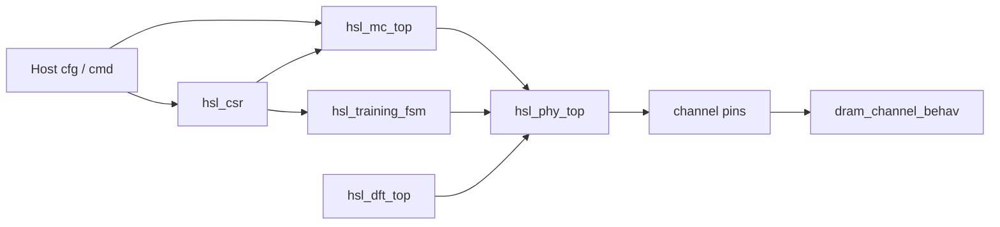

# High-Speed Link Lite

## 📄 포트폴리오 PDF

**[포트폴리오 PDF 보기 (21쪽)](portfolio-deck/HighSpeedLinkLite_Portfolio.pdf)** · [PPTX](portfolio-deck/HighSpeedLinkLite_Portfolio.pptx)

SK hynix HBM Digital Design (RTL Design) 지원 · 권용현

[](portfolio-deck/HighSpeedLinkLite_Portfolio.pdf)

PDF의 파형, 커버리지, 합성 수치는 커밋 `4feb39f` 기준이다. 그 뒤 커밋은 PDF 19쪽의 재검증 항목 A, B, E를 RTL과 테스트벤치에 반영했고, 회귀는 그대로 13/13 PASS다.

---

HBM base die에서 호스트와 DRAM 코어 다이 사이에 있는 디지털 고속 링크를, 스터디할 수 있는 크기로 줄인 RTL 프로젝트다.

한 채널 슬라이스만 있다. 호스트 명령은 메모리 컨트롤러를 지나 디지털 PHY에 닿고, PHY 핀 너머의 DRAM 동작은 테스트벤치 모델이 맡는다. 아날로그 드라이버, 샘플러, TSV, 인터포저 추출은 이 저장소 밖이다.

공개된 HBM 개념을 교육용으로 축소한 것이다. 특정 제품의 내부 구조나 IP를 재현하지 않는다. 파라미터와 타이밍 숫자는 JEDEC 값이 아니다. 세대별 채널 수와 AC 파라미터는 스펙을 따로 대조한다.

RTL 이름과 주석은 설계 문서 관례대로 영어다. 스터디 문서는 한글이다.

## 지금 동작하는 것

E0–E12가 한 회귀에 들어 있다. `[SMOKE] PASS`와 함께 T1–T8이 통과한다.

- CSR 읽기/쓰기, ID `0x48534C31` (`HSL1`)
- 리셋 동기 해제 (assert는 비동기, deassert는 클럭 2번). `soft_rst`는 CSR을 지우지 않음
- 트레이닝은 ZQ, write leveling, read leveling, deskew의 done 펄스를 기다림. `train_bypass`는 MISSION
- 깊이 4 큐. `cmd_ready`는 MISSION이고 빈 슬롯이 있을 때 1, 리셋 직후와 큐가 가득 차면 0
- in-order 스케줄러와 뱅크 타이밍. 컬럼은 tCCD, 같은 뱅크의 RD는 tRCD와 tRAS 이후
- `phy_bypass`일 때 ACT/WR/RD/PRE가 채널 모델과 버스트를 주고받음
- DBI-DC, 레인 리페어, deskew 4단(허용 8 UI), 2:1 기어박스, 그레이 포인터 FIFO
- PRBS7 병렬 루프백. 핀 루프백은 범위 밖

컨트롤러 클럭은 1.25 ns, PHY 클럭은 0.625 ns다. 대조표는 `docs/e12_clocks.md`다.

## 디렉터리

```text
portfolio-deck/  포트폴리오 PDF, PPTX
docs/     스펙, PPA, 마이크로아키텍처, 검증, PD, DFT, 용어, 실습
rtl/      include, top, ctrl, mc, phy, dft
tb/       스모크 테스트, DRAM 채널 모델
sim/      filelist, 회귀 러너 (Icarus 또는 WSL Verilator)
syn/      합성용 filelist, SDC 템플릿
```

## 블록



컨트롤러 안은 `cmd_queue -> scheduler -> bank_fsm x4` 다. bypass 송신은 `dbi -> lane_repair -> phy_tx` 다. 기어박스와 deskew, 비동기 FIFO는 2배 PHY 클럭에 있고, 칩 안 기어박스 입력 valid는 0이라 명령이 그쪽으로 빠지지 않는다. 그 블록의 트래픽은 `tb_hsl_blocks`가 본다.

## 시뮬레이션

성공하면 `[SMOKE] PASS`가 출력된다. 소스는 `sim/filelist.f` 순서이고, 패키지가 첫 파일이다.

```powershell
powershell -ExecutionPolicy Bypass -File .\sim\run_smoke.ps1
```

Icarus Verilog가 PATH에 있으면 그걸로 돌고, 없으면 WSL의 Verilator를 쓴다. WSL 안에서는 `bash sim/run_smoke.sh` 또는 `make -C sim smoke`다. 확인된 조합은 WSL Verilator 5.052다. ModelSim-Altera 10.1d에서도 같은 회귀가 13/13 PASS인 것을 확인했다. 시간 정밀도는 100 fs다(`docs/e12_clocks.md`).

## 스터디 순서

문서를 `docs/00_study_map.md`부터 읽고, `docs/exercises.md`의 E0부터 진행한다. 구현 순서는 스펙, 아키텍처, 컨트롤러 타이밍, PHY, DFT, PD 제약 순이다.

## 범위 밖

- 아날로그 TX/RX, delay line, VREF, ZQ 회로
- 멀티 채널, TSV, 마이크로범프 배치
- JEDEC 커맨드 트루스 테이블 전체와 벤더 모드 레지스터
- DFI 규격 준수. 컨트롤러와 PHY의 분리만 DFI에서 가져온 발상이다.
