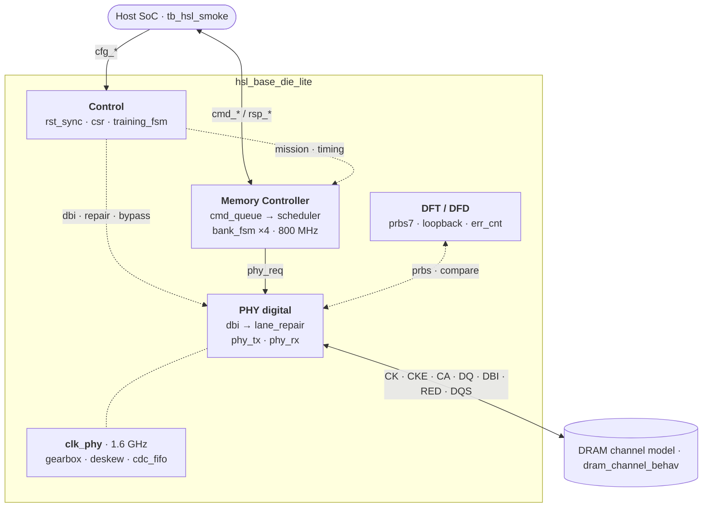

<div align="center">

# High-Speed Link Lite

**HBM Base Die 디지털 링크를 한 채널 슬라이스로 축소한 SystemVerilog RTL 설계**<br>
Spec → Architecture → RTL → Verification → PD Guide

[](rtl/)
[](sim/)
[](syn/)

**[📄 포트폴리오 PDF (21쪽)](portfolio-deck/HighSpeedLinkLite_Portfolio.pdf)** · [PPTX](portfolio-deck/HighSpeedLinkLite_Portfolio.pptx) · [스터디 맵](docs/00_study_map.md)

<a href="portfolio-deck/HighSpeedLinkLite_Portfolio.pdf"></a>

SK hynix HBM Digital Design (RTL Design) 지원 · 권용현

</div>

## 한눈에 보기

| 설계 범위 | 회귀 | 코드 커버리지 | 합성 면적 proxy |
| :---: | :---: | :---: | :---: |
| **MC · PHY · DFT** | **15 / 15 PASS** | **Line 87.5%**<br>**Branch 96.6%** | **3,748 cells**<br>**630 FF** |
| RTL 21개 모듈<br>1,492줄 (주석 제외) | SMOKE · T1–T9<br>E7 · E9 · E11 | Toggle 56.6% | Yosys 0.52<br>generic cell |

> [!NOTE]
> 커버리지와 합성 수치, PDF의 파형은 commit `4feb39f`에서 측정했다. 그 뒤 `edb139a`가 PDF 19쪽의 재검증 항목 A, B, E를, `d1f8e2b`가 이후 리뷰 결과(CDC Gray 크로싱과 SDC, 루프백 RD, ModelSim 빌드)를 반영했고, DBI-AC 모드와 T9를 더했다. 회귀는 HEAD에서 15/15 PASS다(Verilator 5.052, ModelSim-Altera 10.1d).

## 개요

HBM base die는 호스트 SoC와 DRAM core die 사이에서 명령 스케줄링, 트레이닝, 데이터 인코딩, 테스트를 디지털로 처리한다. 이 저장소는 그중 한 채널을 스터디 규모(DQ 8 · BL 4 · Bank 4)로 줄여, 요구 스펙부터 PD 인계 문서까지 한 흐름으로 설계했다. 호스트 명령은 메모리 컨트롤러를 지나 디지털 PHY의 핀에 닿고, 핀 너머의 DRAM 동작은 테스트벤치 모델이 맡는다.

- **경계를 먼저 정했다.** 디지털은 핀의 논리값과 enable, 핸드셰이크, CDC, 리셋, DFT 관측점을 책임진다. 드라이버, 샘플러, VREF, ZQ 회로, 클럭 스파인은 아날로그와 풀커스텀 쪽이다.
- **숫자는 한 곳에서 내려간다.** 스펙 값은 `docs/01_requirements.md` → `hsl_pkg` → RTL → 테스트벤치 → SDC 순서로 옮긴다. 클럭 주기는 E12 대조표로 네 곳이 같은지 확인하고, 스모크 테스트가 시작할 때 패키지 상수를 다시 검사한다.
- **근거 없는 숫자는 쓰지 않는다.** 칩 면적은 Yosys generic cell proxy다. µm²와 지연은 공개 교육용 라이브러리(Nangate45)로 잰 블록 값만 적고, mW와 사인오프 slack은 적지 않는다.

공개된 HBM 개념을 교육용으로 축소한 모델이다. 특정 제품의 내부 구조나 IP를 재현하지 않으며, 파라미터와 타이밍 숫자는 JEDEC 값이 아니다. RTL 이름과 주석은 영어, 설계 문서는 한글이다.

## 설계 범위

| 영역 | 구현 | 위치 |
| --- | --- | --- |
| Memory Controller | 깊이 4 링 버퍼 큐, in-order 스케줄러, 뱅크 FSM ×4. tRCD · tRP · tRAS · tRTP · tWR는 뱅크 FSM이, tCCD · tWTR는 스케줄러가 맡는다 | [`rtl/mc/`](rtl/mc/) |
| PHY digital | Bypass framer, DBI(DC · AC), 레인 리페어(리던던트 DQ 1개), 2:1 toggle-handshake 기어박스, Gray 포인터 비동기 FIFO, 0–4 tap deskew | [`rtl/phy/`](rtl/phy/) |
| Control | CSR 9개, 트레이닝 FSM(9개 상태, done 펄스 대기), 리셋 동기화기(비동기 assert, 2-FF 동기 deassert) | [`rtl/ctrl/`](rtl/ctrl/), [`rtl/top/`](rtl/top/) |
| DFT / DFD | PRBS7, 병렬 루프백, 16 bit 포화 에러 카운터, STATUS · ERRCNT · REMAP 관측점 | [`rtl/dft/`](rtl/dft/) |
| PD 인계 | SDC(클럭, 생성 클럭, I/O delay, CDC `set_max_delay`), 클럭 · 리셋 · CDC · 핀 · floorplan 가이드 | [`syn/`](syn/), [`docs/05_pd_guide.md`](docs/05_pd_guide.md) |
| 검증 | 칩 레벨 스모크, 블록 테스트, DRAM 채널 행동 모델을 한 번에 도는 회귀 | [`tb/`](tb/), [`sim/`](sim/) |

## 아키텍처



- **명령**: `cmd_*` → `cmd_queue` → `scheduler`(큐 head만 발행, 대상 뱅크의 `timing_ok` 확인) → `phy_tx` framer → `pin_ca`, `pin_dq_o`
- **쓰기 데이터**: `wdata` 또는 PRBS → DBI(DC 또는 AC) → 레인 리페어 → framer. 핀은 `{RED, DBI, DQ[7:0]}`
- **읽기**: DRAM 모델(모드에 따라 DBI 인코딩) → `phy_rx`(DBI 복원) → `rsp_*`. 루프백이 켜져 있으면 핀 대신 마지막 WR 버스트(`lb_hold`)를 돌려준다
- **`clk_phy` 도메인**: 기어박스(32 bit → 16 bit × 2), deskew, 비동기 FIFO. 칩 안에서는 입력이 tie-off이고, 동작은 `tb_hsl_blocks`의 독립 인스턴스로 검증한다

<details>
<summary>모듈 계층 (21개 모듈 + 패키지)</summary>

```text
hsl_base_die_lite
├─ hsl_rst_sync           비동기 assert, 2-FF 동기 deassert
├─ hsl_csr                CSR 9개, ID "HSL1"
├─ hsl_training_fsm       RESET → … → MISSION
├─ hsl_mc_top
│  ├─ hsl_cmd_queue       깊이 4 링 버퍼
│  ├─ hsl_scheduler       head만 발행, tCCD · tWTR
│  └─ hsl_bank_fsm ×4     tRCD · tRP · tRAS · tRTP · tWR
├─ hsl_phy_top
│  ├─ hsl_phy_clk         2배 클럭 (합성 시 빈 쉘, PLL 자리)
│  ├─ hsl_dbi             DBI-DC · DBI-AC
│  ├─ hsl_lane_repair ×4  DQ → RED 치환 (beat마다 1개)
│  ├─ hsl_gearbox         32 bit → 16 bit × 2
│  ├─ hsl_deskew          레인별 0–4 tap
│  ├─ hsl_cdc_fifo        Gray 포인터 레지스터, 2-FF 싱크
│  ├─ hsl_phy_tx          bypass framer
│  └─ hsl_phy_rx          수신, DBI 복원, 루프백 응답
└─ hsl_dft_top
   ├─ hsl_prbs            x⁷ + x⁶ + 1
   ├─ hsl_loopback        병렬 루프백
   └─ hsl_err_cnt         16 bit 포화 카운터
```

</details>

## 설계 결정

| 결정 | 이유 | 대가와 후속 조치 |
| --- | --- | --- |
| 단일 클럭(A)으로 시작해 E7에서 컨트롤러 1 : PHY 2(B)로 전환. RTL UI 직렬화(C)는 채택하지 않음 | 명령이 드롭되지 않는 핸드셰이크와 뱅크 타이밍을 먼저 닫고 CDC를 올린다. UI 직렬화는 아날로그 PHY 경계 밖이다 | 클럭이 하나 늘고 포인터 동기화 리스크가 생긴다 → E8 Gray FIFO, E12 클럭 대조표 |
| In-order 스케줄러, 뱅크 FSM은 스케줄러 밖에 둠 | 검증과 면적이 단순하다. 나중에 head가 아닌 엔트리를 고르게 바꿔도 큐 구조를 다시 짜지 않는다 | 다른 뱅크가 열려 있어도 head가 막히면 기다린다(대역 손해) |
| 뱅크 타이밍을 `timing_ok` 1 bit로 모음 | 스케줄러는 뱅크의 `is_open`과 `timing_ok`만 본다 | 컬럼 명령도 tRAS까지 기다려 JEDEC보다 보수적이다. T4의 ACT → WR가 15 cycles |
| Beat-major 데이터 배치 | DBI와 ECC가 한 UI의 바이트를 한 덩어리로 다룬다 | 레인 단위 접근은 비트를 흩어 읽는다 |
| CSR은 `rst_sync_n`만, 데이터패스는 `rst_sync_n & ~soft_rst` | CSR까지 soft reset에 넣으면 `soft_rst` 비트가 다음 사이클에 스스로 지워진다 | 리셋 도메인이 둘이 된다 |
| CDC: Gray 포인터는 소스 클럭의 플롭에서 넘기고, 크로싱은 false path 대신 `set_max_delay` | 조합 XOR 출력이 넘어가면 여러 비트가 바뀌는 순간의 glitch를 싱크 플롭이 잡을 수 있다. false path는 그 경로의 지연을 타이밍이 보지 않게 만든다 | 포인터 레지스터가 늘고, 제약 값을 클럭 주기와 함께 관리해야 한다 |
| DBI는 DC 방식(beat의 1이 4개를 넘으면 반전)으로 시작하고, AC 방식(직전 UI 대비 DQ 전이가 4개를 넘으면 반전)을 CSR로 고르게 추가 | DC는 high 개수를 줄여 high에서 종단 전류가 흐르는 I/O에 맞다. HBM처럼 종단이 없는 짧은 채널에서는 전이 수가 스위칭 전력과 SSO를 정하므로 AC가 맞다 | AC는 이전 beat의 반전 여부에 묶인 직렬 체인이다 → 원시 beat끼리 전이를 미리 세어 beat당 2:1 mux 하나로 줄임([DBI-AC](#dbi-ac-off--dc--ac-비교)) |

## 스펙 요약

| 항목 | 값 |
| --- | --- |
| DQ / DBI / RED | 8 / 1 / 1 (데이터 핀 10개) |
| 버스트 | BL 4, beat-major (beat 0이 첫 UI) |
| 뱅크 / row / col | 4 / 8 bit / 4 bit |
| 데이터 폭 | 32 bit (`DQ_W × BL`). 컨트롤러 클럭 한 번에 버스트 하나 |
| 목표 데이터율 | 3.2 Gb/s/DQ → raw 3.2 GB/s (리프레시, 명령 간격, 트레이닝을 빼기 전) |
| 클럭 | 컨트롤러 1.25 ns (800 MHz), PHY 0.625 ns (1.6 GHz) |
| 타이밍 (컨트롤러 클럭) | tRCD 4 · tRP 4 · tRAS 10 · tRTP 3 · tWR 4 · tCCD 2 · tWTR 4 · tRFC 20 |
| 트레이닝 순서 | RESET → CKE → MRS → ZQCAL → WRLVL → RDLVL → DESKEW → WRTRAIN → MISSION |
| 전력 · 신뢰성 규칙 | CKE는 RESET에서만 0, 버스트 밖 `pin_dq_oe` = 0, DBI-DC는 beat의 1이 4개를 넘으면 반전, DBI-AC는 직전 UI 대비 DQ 전이가 4개를 넘으면 반전, 에러 카운터는 16'hFFFF에서 포화 |

```text
CK              = 3.2 Gb/s ÷ 2   = 1.6 GHz (625 ps)
Controller      = CK ÷ 2         = 800 MHz (1250 ps)
beats_per_burst = BL ÷ DDR_BITS  = 2   → PHY beat 16 bit
```

<details>
<summary>CSR 맵</summary>

| 주소 | 이름 | 접근 | 내용 |
| --- | --- | --- | --- |
| `0x00` | ID | RO | `0x48534C31` ("HSL1") |
| `0x04` | VERSION | RO | `0x00000100` |
| `0x08` | CTRL | RW | `soft_rst`, `train_bypass`, `loopback`, `prbs_en`, `dbi_en`, `phy_bypass`, `dbi_ac` |
| `0x0C` | STATUS | RO | `train_state`, `train_done`, `mission_mode`, `soft_rst` 에코 |
| `0x10` | TRAIN | RW | `[0]` start, `[4:1]` done 펄스, `[15:8]` wait |
| `0x14` | ERRCNT | RW | 읽기는 카운트, 쓰기는 clear |
| `0x18` | REMAP | RW | `[0]` enable, `[7:4]` lane |
| `0x1C` | TIMING0 | RW | `{tCCD, tRAS, tRP, tRCD}` |
| `0x20` | TIMING1 | RW | `{tRFC, tRTP, tWR, tWTR}` |

비트 단위 정의는 [`docs/03_microarchitecture.md`](docs/03_microarchitecture.md)에 있다.

</details>

## 검증

`tb_hsl_smoke`가 칩 전체(`hsl_base_die_lite`)와 DRAM 채널 모델을 묶고, 같은 프로세스 안에서 `tb_hsl_blocks`가 블록을 독립 인스턴스로 검사한다. 한 번의 실행이 스모크, 블록, 채널 세 계층을 모두 돈다.

- 체크마다 PASS나 FAIL을 찍는다. 하나라도 실패하면 마지막 줄이 `[ALL] FAIL (n)`이고 0이 아닌 코드로 끝난다. 타임아웃도 실패다
- 비교는 `!==`, `===`로 한다. X나 Z가 나오면 통과가 아니라 실패다
- 리셋은 클럭 negedge에서 푼다. posedge와 같은 시각에 풀면 첫 싱크러나이저 플롭과 레이스가 생긴다

| ID | 대상 | 확인 내용 |
| --- | --- | --- |
| SMOKE | 칩 기본 동작 | ID · VERSION · TIMING 리셋값, 미정의 주소 0, 리셋 직후 핀과 ready 0, bypass 후 MISSION, 깊이 4가 차면 ready 0, soft reset 후 복귀 |
| T1 | 트레이닝 FSM | 순서대로 진행하고, 각 대기 상태는 done 펄스가 오기 전까지 머무름 |
| T2 | 뱅크 FSM | tRCD 전 RD 거절, tRP 전 ACT 거절 |
| T3 | 스케줄러 | tCCD 전 다음 컬럼 명령 거절 |
| T4 | 채널 | ACT → WR → RD, `A5A5_5A5A` 일치 |
| T5 | DBI | `0x1F` → 핀 `E0` + DBI 1, `0x0F` → 그대로 |
| T6 | CDC FIFO | 두 클럭 사이에서 3 word 순서 유지 |
| T7 | 레인 리페어 | lane 3 치환(핀 `F7`, RED 1), lane 8은 치환하지 않음 |
| T8 | PRBS · 루프백 | PRBS 비교는 루프백이면 ERRCNT 0, 아니면 증가. 루프백 WR 다음 RD가 채널 모델 값이 아니라 그 WR 버스트(`2222_2222`)를 돌려줌 |
| T9 | DBI-AC | 블록: 직렬 참조 모델과 랜덤 4,000 버스트 비교, 두 AC 구조 등가, 랜덤 스트림 전이 수가 이항분포 기대값과 일치. 칩: AC 핀 값 정확 비교, PRBS7 · 55/AA 스트림의 off / DC / AC 전이 수와 규칙 위반 0, 채널 모델이 DBI를 붙인 RD 데이터를 RX가 복원 |
| E7 | 기어박스 | 32 bit → `C3D4`, `A1B2` 두 beat |
| E9 | Deskew | tap 0 통과, tap 2 지연 |
| E11 | PRBS seed | 리셋 seed `5A`의 첫 비트 1, seed 0 load 무시 |

```text
[T7] unit PASS
[SMOKE] PASS
[E9] PASS
[T1] PASS
[E11] prbs PASS
[T4] PASS
[T3] PASS
[T5] PASS
[T7] PASS
[T8] PASS
[T2] PASS
[E7] PASS
[T6] PASS
[T9] random stream 40000 UI, DQ+DBI per UI: toggles off 4.00 dc 4.17 ac 3.38, ones off 4.01 dc 3.27 ac 4.36
[T9] unit PASS
[T9] PRBS7 x254, DQ+DBI per data UI: toggles off 4.01 dc 4.08 ac 3.35, ones off 4.03 dc 3.31 ac 4.13
[T9] 55/AA x254, DQ+DBI per data UI: toggles off 7.00 dc 7.00 ac 1.64, ones off 4.00 dc 4.00 ac 4.50
[T9] PASS
[ALL] PASS
```


<sub>T4, commit `4feb39f`의 Verilator VCD. ① ACT 핀 프레임(`pin_ca` ACT, DQ = row `07`). bank 0이 `ST_ACT`에서 tRCD 4를 센다. ② `ras_left`가 0이 된 뒤 WR 발행. ACT 발행부터 15사이클이다. ③ WR 헤더(col `01`) 뒤 beat `5A 5A A5 A5`. ④ RD 발행 → RD 헤더, DRAM 모델이 `pin_dq_i`를 구동한다. ⑤ `rsp_rdata = A5A5_5A5A` 일치. RD 발행부터 응답까지 6사이클이다. 두 사이클 수는 HEAD에서 다시 재도 같다.</sub>

<details>
<summary>모듈별 코드 커버리지 (commit <code>4feb39f</code>, Verilator)</summary>

| 모듈 | Line | Branch | Toggle |
| --- | ---: | ---: | ---: |
| training_fsm | 92.9% | 100.0% | 75.0% |
| csr | 80.0% | 100.0% | 33.7% |
| rst_sync | 100.0% | 100.0% | 60.0% |
| cmd_queue | 100.0% | 100.0% | 45.1% |
| scheduler | 90.0% | 83.3% | 29.5% |
| bank_fsm | 90.0% | 100.0% | 21.3% |
| phy_tx | 83.3% | 100.0% | 81.8% |
| phy_rx | 66.7% | 87.5% | 60.8% |
| dbi | 100.0% | 100.0% | 95.7% |
| lane_repair | 100.0% | 100.0% | 93.8% |
| gearbox | 100.0% | 100.0% | 51.6% |
| deskew | 100.0% | 75.0% | 93.0% |
| cdc_fifo | 100.0% | 100.0% | 31.0% |
| prbs | 87.5% | 100.0% | 89.2% |
| err_cnt | 66.7% | 100.0% | 21.4% |
| **전체** | **87.5%** | **96.6%** | **56.6%** |

모듈별 값은 블록 TB 인스턴스까지 합산했다. 전체에는 표에 없는 top, mc_top, dft_top, loopback, phy_top, phy_clk도 들어 있다.

</details>

이 측정에서 닿지 않은 곳은 다음과 같다.

- CSR의 ERRCNT clear와 TIMING0/1 쓰기, `err_cnt`의 clear 우선순위
- 스케줄러의 REF · 예약 opcode 분기, tCCD · tWTR ≤ 1 분기
- PRE 핀 프레임, deskew `delay_sel` > 4 clamp. 핀 DBI = 1 수신은 이후 T9가 채널 모델의 읽기 DBI로 채웠다(위 표는 그 전 측정)
- 데이터와 주소 상위 비트가 고정이라 toggle이 낮다. random 패턴과 functional coverage(covergroup)가 아직 없다

## DBI-AC: off · DC · AC 비교

DBI-AC는 beat마다 직전 UI에 실제로 나간 바이트와 비교해, DQ 8개 중 4개를 넘게 바뀌면 그 beat를 반전한다. 그래서 한 UI에 바뀌는 DQ는 4개 이하다(DBI 핀은 세지 않으며 함께 바뀔 수 있다). 첫 beat의 기준은 그 앞 UI다. 이 bypass framer에서는 WR 헤더(DQ에 col)가 바로 앞에 나가므로 헤더 바이트와 비교한다. CSR `CTRL[6]`이 DC와 AC를 고른다.

| 데이터 (측정 위치) | 지표 (UI당, DQ + DBI) | off | DC | AC |
| --- | --- | ---: | ---: | ---: |
| PRBS7, WR 254개 (칩 핀) | 전이 | 4.01 | 4.08 | **3.35 (−16%)** |
| | high | 4.03 | **3.31 (−18%)** | 4.13 |
| `55 AA 55 AA` 반복, WR 254개 (칩 핀) | 전이 | 7.00 | 7.00 | **1.64 (−77%)** |
| 균등 랜덤 연속 스트림 40,000 UI (블록) | 전이 | 4.00 | 4.17 | **3.38** |
| | high | 4.01 | 3.27 | 4.36 |

<sub>칩 핀 값은 T9가 WR 데이터 UI 4개(헤더 → beat 0 포함)에서 잰 값이다. 랜덤 스트림은 헤더 없이 버스트가 이어지는 데이터 전용 DQ를 가정하며, 이항분포 기대값(off 4.00, DC 4.16, AC 3.37)과 ±0.05 안에서 맞는지 T9가 검사한다.</sub>

- **두 규칙은 서로 다른 것을 줄인다.** DC는 high 핀 수를, AC는 전이 수를 줄인다. 랜덤에 가까운 데이터에서 DC는 오히려 전이를 조금 늘리고, AC는 high를 조금 늘린다.
- **AC가 이기는 경우는 전이가 몰린 데이터다.** 모든 DQ가 매 UI 바뀌는 `55/AA`에서 DC는 아무것도 하지 못하고(beat마다 1이 4개), AC는 DQ를 고정하고 DBI 핀만 바꾼다.
- **읽기 방향**: 채널 모델이 모드 레지스터 대신 `mr_dbi_en` · `mr_dbi_ac` 입력으로 RD 데이터를 같은 규칙으로 인코딩한다. 모델의 인코더는 RTL과 따로 짠 직렬 규칙이고, RX가 DBI = 1인 beat를 복원해 32개 RD가 모두 일치했다.

AC 규칙은 직렬 체인이다. beat b의 기준은 beat b−1이 반전되어 나갔는지에 달려 있다. 그대로 짜면 beat마다 XOR, popcount, 비교, 반전이 차례로 붙는다. 원시 beat끼리의 전이 수 `r_b = popcount(din_b ^ din_b−1)`를 네 beat 모두 병렬로 세면, beat b−1이 반전된 경우 전이는 `8 − r_b`이므로 `inv_b = inv_b−1 ? (r_b < 4) : (r_b > 4)`가 되어 체인에는 beat당 2:1 mux 하나만 남는다. 두 구조는 파라미터 `AC_SERIAL`로 둘 다 빌드되고, 블록 테스트가 같은 입력에서 결과가 같은지 비교한다.

| `hsl_dbi` (Nangate45 typical, 배선 없음) | 면적 | Cell | 입력 → 출력 최대 지연 |
| --- | ---: | ---: | ---: |
| DC만 (commit `4d38ae9`) | 130 µm² | 101 | 0.449 ns |
| DC + AC, mux 체인 (기본) | 289 µm² | 224 | **0.882 ns** |
| DC + AC, 직렬 (`AC_SERIAL = 1`) | 301 µm² | 229 | 1.822 ns |

<sub>`syn/ppa_block.sh`(sv2v → Yosys 0.52 → OpenSTA 3.1, 입력 BUF_X1 구동, 출력 2 fF). 직렬 구조는 이 블록 하나로 컨트롤러 주기 1.25 ns를 넘는다. mux 체인은 0.37 ns를 남기지만, 칩 경로에는 큐 head 플롭, PRBS 먹스, 레인 리페어가 앞뒤로 붙으므로 칩 STA(다음 단계)에서 다시 확인한다.</sub>

## PPA · PD 인계

Yosys 0.52 generic cell 기준의 면적 proxy다(commit `4feb39f`, 계층 합성, 인스턴스 수 반영). 칩 단위의 µm², mW, slack은 아직 적지 않는다(Nangate45 칩 STA는 다음 단계).

| 블록 | Cell | FF | 비중 | 구성 (cell) |
| --- | ---: | ---: | ---: | --- |
| Memory Controller | 1,848 | 334 | 49% | queue 585 · bank_fsm ×4 1,028 · scheduler 200 |
| PHY digital | 1,191 | 178 | 32% | tx 365 · rx 353 · dbi 181 · lane_repair ×4 260 |
| CSR | 363 | 89 | 10% | 주소 9개와 읽기 mux |
| DFT | 287 | 23 | 8% | prbs 81 · err_cnt 77 · loopback 32 |
| 기타 | 59 | 6 | 2% | training_fsm 56 · rst_sync 2 |
| **합계** | **3,748** | **630** | | flatten 후 3,492 cells (칩 레벨 상수 전파) |

칩 안에서 입력이 tie-off인 `clk_phy` 블록은 합성에서 지워지므로 따로 합성했다. gearbox 96 cells / 72 FF, cdc_fifo 378 / 146, deskew 126 / 36이다. 이 측정 이후 칩에는 루프백 응답용 `lb_hold` 32 FF가, cdc_fifo에는 Gray 포인터 레지스터 6 FF가 더해졌다.

| 제약 | 내용 |
| --- | --- |
| `clk` | 1.25 ns (800 MHz), 포트 `clk` |
| `clk_phy` | `u_phy/u_phy_clk/clk_phy`에 `create_generated_clock -multiply_by 2` (0.625 ns). PLL 매크로 자리다 |
| I/O delay | 컨트롤러 주기의 40%인 0.5 ns |
| CDC 포인터 | 소스 도메인 Gray 플롭 → 첫 싱크 플롭(`wgray` → `wptr_g_s1`, `rgray` → `rptr_g_s1`)에 `set_max_delay 0.625`. 빠른 쪽 주기이며 false path가 아니다 |
| `rst_n` | `set_false_path`. v0.1 단순화이며, 실제 덱은 싱크러나이저의 recovery/removal을 따로 확인한다 |
| `pin_ck` | 0에 고정. 생성 클럭으로 선언하지 않는다 |

- **성능** (T4 실측): ACT → WR 15 cycles, RD → 응답 6 cycles. Bypass framer는 컨트롤러 사이클당 beat 하나(WR 5 cycles)라 목표 대역을 내는 경로가 아니다.
- **전력** (mW 미측정): DBI-DC는 DQ 8핀 중 high를 4개 이하로, DBI-AC는 UI당 DQ 전이를 4개 이하로 둔다([비교](#dbi-ac-off--dc--ac-비교)). CKE는 RESET에서만 0이고, 버스트 밖에서는 `pin_dq_oe` = 0이다.
- **PD 가이드**: deskew 4 tap = 8 UI까지 레인 스큐 허용, SRAM 매크로 없음(FIFO는 깊이 4 플롭), PHY 핀 로직은 범프 쪽, CSR과 FSM은 안쪽. 자세한 내용은 [`docs/05_pd_guide.md`](docs/05_pd_guide.md)에 있다.

## 이슈 기록

실습 중에 고친 문제와 재검증(실행, 합성, 코드 리뷰)에서 나온 문제다. A–E의 원인과 파형 근거는 PDF 19쪽에 있다.

| ID | 증상 | 원인 | 조치 |
| --- | --- | --- | --- |
| E1 | soft reset을 유지할 수 없음 | CSR까지 soft reset에 넣어 CTRL bit 0이 다음 사이클에 지워짐 | CSR은 `rst_sync_n`만, 나머지는 `rst_logic_n` |
| E3 | MISSION에서도 `cmd_ready` 0 | 스텁 큐가 `push_ready`를 0에 묶음 | 큐 구현 후 기대값을 "리셋 직후와 full일 때 0"으로 수정 |
| E8 | CDC 포인터 경로가 타이밍에서 빠짐 | false path는 그 경로의 지연을 보지 않음 | `set_max_delay`로 제약, false path 금지 |
| E11 | 고장이 통과하거나 정상처럼 보임 | seed 0끼리 비교, 16 bit wrap-around | seed 0 무시, 카운터 포화 |
| E12 | PHY 주기 1248 ps | 반주기를 정수 312 ps로 둠 | `#312.5ps`, 문서 · 패키지 · TB · SDC 대조표 |
| E12 | I/O delay 4.0 ns | 예전 10 ns 클럭의 40%가 남음 | 800 MHz 주기의 40%인 0.5 ns |
| A | `#312.5ps`가 313 ps로 반올림 | `timescale 1ns/1ps` | 정밀도 100 fs (`edb139a`) |
| B | 리셋 해제가 한 사이클 빨라짐 | TB가 posedge 직후 리셋을 풀어 첫 싱크 플롭과 레이스 | negedge에서 해제 (`edb139a`) |
| C | 합성 후 SDC 대상 셀이 사라짐 | 칩 안 `clk_phy` 경로의 입력이 tie-off | 경로를 칩에 연결하는 단계에서 의미를 가짐. PD 가이드에 명시 |
| D | 큐가 멈춘 채 풀리지 않음 | REF나 예약 opcode가 head에 오면 `head_ok` = 0 | 미해결. soft reset으로만 풀림. push 단계에서 거절하는 것이 개선안 |
| E | 리셋 없는 플롭 200개 | 큐 데이터 배열이 리셋 분기 밖 | 데이터 배열을 별도 `always_ff`로 분리하고 DFT 규칙에 명시 (`edb139a`) |
| 리뷰 | CDC 포인터 glitch 위험, 제약이 크로싱을 비켜 감 | binary 플롭의 XOR(조합 Gray)이 바로 싱크러나이저로 들어감. SDC는 한 클럭 안의 `*_s1` → `*_s2`를 묶고 있었음 | Gray 포인터를 소스 클럭 플롭으로 잡고, `set_max_delay`를 소스 Gray 플롭 → `*_s1`로 옮김 (`d1f8e2b`) |
| 리뷰 | 루프백 RD가 TX 버스트를 돌려주지 않음 (요구 5 미충족) | RD 응답이 그 시점의 TX 페이로드(큐 head의 wdata나 0)를 그대로 돌려줌 | 마지막 루프백 WR 버스트를 `lb_hold`에 보관해 RD로 반환, T8에 WR → RD 추가 (`d1f8e2b`) |
| 리뷰 | ModelSim-Altera 10.1d 컴파일 실패 | 폭이 파라미터인 캐스트 `BANK_W'(gi)`를 파싱하지 못함 | 타입이 있는 localparam으로 교체 (`d1f8e2b`) |

## 실행 방법

성공하면 `[ALL] PASS`가 찍히고 종료 코드 0으로 끝난다. 소스 순서는 [`sim/filelist.f`](sim/filelist.f)이고 패키지가 첫 파일이다.

```powershell
# Windows: Icarus Verilog가 PATH에 있으면 그것을, 없으면 WSL의 Verilator를 쓴다
powershell -ExecutionPolicy Bypass -File .\sim\run_smoke.ps1
```

```bash
# Linux / WSL (Verilator 5.x, --binary --timing)
bash sim/run_smoke.sh        # 또는 make -C sim smoke
```

```text
# ModelSim / Questa (저장소 루트에서. work/와 transcript는 git에서 제외됨)
vlib work
vlog -sv -f sim/filelist.f
vsim -c tb_hsl_smoke -do "run -all; quit -f"
```

확인한 조합은 Verilator 5.052와 ModelSim-Altera 10.1d다. 모든 파일은 `` `timescale 1ns/100fs ``라 `#312.5ps` 반주기가 반올림되지 않는다([`docs/e12_clocks.md`](docs/e12_clocks.md)).

## 저장소 구조

```text
rtl/
  include/       hsl_pkg: 파라미터, opcode, CSR 맵, 타이밍 기본값
  top/           hsl_base_die_lite, hsl_rst_sync
  ctrl/          hsl_csr, hsl_training_fsm
  mc/            hsl_mc_top, hsl_cmd_queue, hsl_scheduler, hsl_bank_fsm
  phy/           hsl_phy_top, phy_tx/rx, dbi, lane_repair, gearbox, deskew, cdc_fifo, phy_clk
  dft/           hsl_dft_top, hsl_prbs, hsl_loopback, hsl_err_cnt
tb/              tb_hsl_smoke (top), tb_hsl_blocks, models/dram_channel_behav
sim/             filelist.f, run_smoke.ps1, run_smoke.sh, Makefile
syn/             filelist.f, constraints/hsl_base_die_lite.sdc, ppa_block.sh
docs/            스펙부터 PD 가이드까지 설계 문서, 실습 기록, images/
portfolio-deck/  포트폴리오 PDF, PPTX
```

## 문서

[`docs/00_study_map.md`](docs/00_study_map.md)부터 읽고 [`docs/exercises.md`](docs/exercises.md)의 E0부터 따라가면 구현 순서(스펙 → 아키텍처 → 컨트롤러 타이밍 → PHY → DFT → PD 제약)와 같다.

| 문서 | 내용 |
| --- | --- |
| [00 스터디 맵](docs/00_study_map.md) | 항목별로 볼 파일, 3분 설명, 공개 HBM과 이 모델의 차이 |
| [01 요구 스펙](docs/01_requirements.md) | 기능 요구 7개, 파라미터, 타이밍 기본값, 전력 · 신뢰성 규칙, 수락 조건 |
| [02 아키텍처](docs/02_architecture.md) | 디지털 경계, 클럭 구조 A/B/C 비교, 클럭 식, 스케줄러, 데이터 배치, 리셋 |
| [03 마이크로아키텍처](docs/03_microarchitecture.md) | 계층, CSR 맵, 트레이닝 상태, 명령, 핀 프레임, 뱅크 FSM |
| [04 검증 계획](docs/04_verification_plan.md) | 검증 계층, 스모크 항목, T1–T8, 통과 규칙 |
| [05 PD 가이드](docs/05_pd_guide.md) | 클럭, 리셋, CDC, 핀 책임, floorplan, PD가 되묻는 항목 |
| [06 DFT 계획](docs/06_dft_plan.md) | 관측점, 루프백 두 종류, PRBS, 스캔 규칙, 웨이퍼 테스트 순서 |
| [07 용어](docs/07_glossary.md) | 이 프로젝트에서 쓰는 용어의 뜻 |
| [실습 E0–E12](docs/exercises.md) · [E0/E1 노트](docs/e0_e1_notes.md) · [E12 클럭 대조](docs/e12_clocks.md) | 실습 단계와 완료 조건, 리셋 파형 설명, 클럭 주기 대조표 |

## 한계와 다음 단계

알려진 한계:

- REF는 인코딩만 있고 스케줄러가 발행하지 않는다. REF나 예약 opcode가 큐 head에 오면 soft reset 전까지 큐가 멈춘다(이슈 D)
- `clk_phy` 경로(기어박스, deskew, FIFO)는 칩 안에서 입력이 tie-off라 합성에서 지워진다. 동작은 블록 테스트로만 확인했다(이슈 C)
- 루프백은 병렬 루프백만 있다. 직렬화 이후를 도는 핀 루프백은 없다
- 레인 리페어는 TX 핀까지만 검증했다. RX와 DRAM 모델은 RED 핀을 쓰지 않는다

다음 단계:

- [ ] REF 발행과 tRFC 적용, 미지원 opcode는 push 단계에서 거절
- [ ] `clk_phy` 경로(기어박스, deskew, FIFO)를 칩 데이터패스에 연결해 tie-off 해제(이슈 C)
- [ ] 타이밍 재설정, ERRCNT clear 테스트로 커버리지 구멍 메우기
- [ ] Random traffic과 스코어보드로 toggle 커버리지 올리기
- [ ] 실제 셀 라이브러리로 STA, 면적, 전력 수치 확보
- [ ] Out-of-order 스케줄러. 뱅크 FSM을 분리해 둔 구조를 그대로 쓴다
- [x] DBI-AC 모드와 off / DC / AC 전이 비교, DBI 읽기 경로 검증(T9)

## 관련 프로젝트

[Mini DRAM Controller](https://github.com/yhkwon-git/mini-dram-controller): 이 저장소의 in-order 컨트롤러 다음 단계다. 요청 큐와 뱅크 엔진 ×4로 뱅크를 병렬 처리하고, tag 기반 in-order 응답과 refresh 스케줄링을 구현했으며, latency, throughput, PPA를 v0와 비교해 수치로 정리했다.
